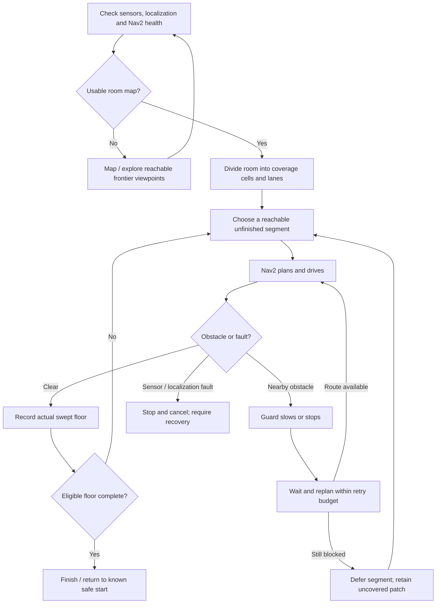

# vacuum-workspace-source-20261007.tar.gz

Historical source: ros-original


## src

## src/vacuum_sim

## src/vacuum_sim/package.xml

<?xml version="1.0"?>
<package format="3">
  <name>vacuum_sim</name><version>0.1.0</version>
  <description>Starter vacuum robot simulation with explicitly provisional geometry.</description>
  <maintainer email="[REDACTED_EMAIL]">Local robot developer</maintainer>
  <license>Apache-2.0</license>
  <buildtool_depend>ament_cmake</buildtool_depend>
  <exec_depend>ament_index_python</exec_depend><exec_depend>launch</exec_depend><exec_depend>launch_ros</exec_depend>
  <exec_depend>rclpy</exec_depend><exec_depend>geometry_msgs</exec_depend>
  <exec_depend>robot_state_publisher</exec_depend><exec_depend>xacro</exec_depend>
  <exec_depend>ros_gz_sim</exec_depend><exec_depend>ros_gz_bridge</exec_depend>
  <exec_depend>gz_ros2_control</exec_depend><exec_depend>controller_manager</exec_depend>
  <exec_depend>diff_drive_controller</exec_depend><exec_depend>joint_state_broadcaster</exec_depend>
  <exec_depend>rviz2</exec_depend><exec_depend>slam_toolbox</exec_depend>
  <exec_depend>nav2_bringup</exec_depend><exec_depend>python3-yaml</exec_depend>
  <export><build_type>ament_cmake</build_type></export>
</package>


## src/vacuum_sim/config

## src/vacuum_sim/config/view.rviz

Panels:
- Class: rviz_common/Displays
  Help Height: 70
  Name: Displays
  Property Tree Widget:
    Expanded: null
    Splitter Ratio: 0.5
  Tree Height: 208
- Class: rviz_common/Tool Properties
  Expanded: null
  Name: Tool Properties
  Splitter Ratio: 0.5
Visualization Manager:
  Class: ''
  Displays:
  - Alpha: 0.5
    Cell Size: 0.5
    Class: rviz_default_plugins/Grid
    Color: 160; 160; 164
    Enabled: true
    Line Style:
      Line Width: 0.029999999329447746
      Value: Lines
    Name: Grid
    Normal Cell Count: 0
    Offset:
      X: 0
      Y: 0
      Z: 0
    Plane: XY
    Plane Cell Count: 20
    Reference Frame: <Fixed Frame>
    Value: true
  - Alpha: 1
    Class: rviz_default_plugins/RobotModel
    Collision Enabled: false
    Description File: ''
    Description Source: Topic
    Description Topic:
      Depth: 5
      Durability Policy: Transient Local
      History Policy: Keep Last
      Reliability Policy: Reliable
      Value: /robot_description
    Enabled: true
    Links:
      All Links Enabled: true
      Expand Joint Details: false
      Expand Link Details: false
      Expand Tree: false
      Link Tree Style: Links in Alphabetic Order
      base_footprint:
        Alpha: 1
        Show Axes: false
        Show Trail: false
      base_link:
        Alpha: 1
        Show Axes: false
        Show Trail: false
        Value: true
      camera_link:
        Alpha: 1
        Show Axes: false
        Show Trail: false
        Value: true
      camera_optical_frame:
        Alpha: 1
        Show Axes: false
        Show Trail: false
      caster:
        Alpha: 1
        Show Axes: false
        Show Trail: false
        Value: true
      left_wheel:
        Alpha: 1
        Show Axes: false
        Show Trail: false
        Value: true
      lidar_link:
        Alpha: 1
        Show Axes: false
        Show Trail: false
        Value: true
      right_wheel:
        Alpha: 1
        Show Axes: false
        Show Trail: false
        Value: true
    Mass Properties:
      Inertia: false
      Mass: false
    Name: Robot
    TF Prefix: ''
    Update Interval: 0
    Value: true
    Visual Enabled: true
  - Alpha: 1
    Autocompute Intensity Bounds: true
    Autocompute Value Bounds:
      Max Value: 10
      Min Value: -10
      Value: true
    Axis: Z
    Channel Name: intensity
    Class: rviz_default_plugins/LaserScan
    Color: 255; 255; 255
    Color Transformer: Intensity
    Decay Time: 0
    Enabled: true
    Invert Rainbow: false
    Max Color: 255; 255; 255
    Max Intensity: 0
    Min Color: 0; 0; 0
    Min Intensity: 0
    Name: Lidar
    Position Transformer: XYZ
    Selectable: true
    Size (Pixels): 3
    Size (m): 0.02500000037252903
    Style: Flat Squares
    Topic:
      Depth: 5
      Durability Policy: Volatile
      Filter size: 10
      History Policy: Keep Last
      Reliability Policy: Best Effort
      Value: /scan
    Use Fixed Frame: true
    Use rainbow: true
    Value: true
  - Alpha: 0.699999988079071
    Binary representation: false
    Binary threshold: 100
    Class: rviz_default_plugins/Map
    Color Scheme: map
    Draw Behind: false
    Enabled: true
    Name: Map
    Topic:
      Depth: 5
      Durability Policy: Transient Local
      Filter size: 10
      History Policy: Keep Last
      Reliability Policy: Reliable
      Value: /map
    Update Topic:
      Depth: 5
      Durability Policy: Volatile
      History Policy: Keep Last
      Reliability Policy: Reliable
      Value: /map_updates
    Use Timestamp: false
    Value: true
  - Class: rviz_default_plugins/Image
    Enabled: true
    Max Value: 1
    Median window: 5
    Min Value: 0
    Name: Camera
    Normalize Range: true
    Topic:
      Depth: 5
      Durability Policy: Volatile
      History Policy: Keep Last
      Reliability Policy: Best Effort
      Value: /camera/image_raw
    Value: true
  Enabled: true
  Global Options:
    Background Color: 35; 40; 48
    Fixed Frame: map
    Frame Rate: 15
  Name: root
  Tools:
  - Class: rviz_default_plugins/Interact
    Hide Inactive Objects: true
  - Class: rviz_default_plugins/MoveCamera
  - Class: rviz_default_plugins/Select
  - Class: nav2_rviz_plugins/GoalTool
  Transformation:
    Current:
      Class: rviz_default_plugins/TF
  Value: true
  Views:
    Current:
      Class: rviz_default_plugins/Orbit
      Distance: 6
      Enable Stereo Rendering:
        Stereo Eye Separation: 0.05999999865889549
        Stereo Focal Distance: 1
        Swap Stereo Eyes: false
        Value: false
      Focal Point:
        X: 0
        Y: 0
        Z: 0
      Focal Shape Fixed Size: true
      Focal Shape Size: 0.05000000074505806
      Invert Z Axis: false
      Name: Current View
      Near Clip Distance: 0.009999999776482582
      Pitch: 0.800000011920929
      Target Frame: <Fixed Frame>
      Value: Orbit (rviz_default_plugins)
      Yaw: 0.800000011920929
    Saved: null
Window Geometry:
  Camera:
    collapsed: false
  Displays:
    collapsed: false
  Height: 800
  Hide Left Dock: false
  Hide Right Dock: false
  QMainWindow State: 000000ff00000000fd000000010000000000000156000002cafc0200000003fb0000000c00430061006d006500720061010000003b000000c90000001600fffffffb000000100044006900730070006c006100790073010000010a00000151000000c700fffffffb0000001e0054006f006f006c002000500072006f00700065007200740069006500730100000261000000a40000005c00ffffff00000354000002ca00000004000000040000000800000008fc0000000100000002000000010000000a0054006f006f006c00730100000000ffffffff0000000000000000
  Tool Properties:
    collapsed: false
  Width: 1200
  X: 1934
  Y: 40


## src/vacuum_sim/config/bridge.yaml

- ros_topic_name: /clock
  gz_topic_name: /clock
  ros_type_name: rosgraph_msgs/msg/Clock
  gz_type_name: gz.msgs.Clock
  direction: GZ_TO_ROS
- ros_topic_name: /scan
  gz_topic_name: /scan
  ros_type_name: sensor_msgs/msg/LaserScan
  gz_type_name: gz.msgs.LaserScan
  direction: GZ_TO_ROS
  qos_profile: SENSOR_DATA
- ros_topic_name: /camera/image_raw
  gz_topic_name: /camera/image_raw
  ros_type_name: sensor_msgs/msg/Image
  gz_type_name: gz.msgs.Image
  direction: GZ_TO_ROS
  qos_profile: SENSOR_DATA
- ros_topic_name: /camera/camera_info
  gz_topic_name: /camera/camera_info
  ros_type_name: sensor_msgs/msg/CameraInfo
  gz_type_name: gz.msgs.CameraInfo
  direction: GZ_TO_ROS
  qos_profile: SENSOR_DATA


## src/vacuum_sim/config/nav2.yaml

amcl:
  ros__parameters:
    alpha1: 0.2
    alpha2: 0.2
    alpha3: 0.2
    alpha4: 0.2
    alpha5: 0.2
    base_frame_id: base_footprint
    beam_skip_distance: 0.5
    beam_skip_error_threshold: 0.9
    beam_skip_threshold: 0.3
    do_beamskip: false
    global_frame_id: map
    lambda_short: 0.1
    laser_likelihood_max_dist: 2.0
    laser_max_range: 100.0
    laser_min_range: -1.0
    laser_model_type: likelihood_field
    max_beams: 60
    max_particles: 2000
    min_particles: 500
    odom_frame_id: odom
    pf_err: 0.05
    pf_z: 0.99
    recovery_alpha_fast: 0.0
    recovery_alpha_slow: 0.0
    resample_interval: 1
    robot_model_type: nav2_amcl::DifferentialMotionModel
    save_pose_rate: 0.5
    sigma_hit: 0.2
    tf_broadcast: true
    transform_tolerance: 1.0
    update_min_a: 0.2
    update_min_d: 0.25
    z_hit: 0.5
    z_max: 0.05
    z_rand: 0.5
    z_short: 0.05
    scan_topic: scan
    use_sim_time: true
bt_navigator:
  ros__parameters:
    global_frame: map
    robot_base_frame: base_footprint
    odom_topic: /odom
    bt_loop_duration: 10
    default_server_timeout: 20
    wait_for_service_timeout: 1000
    action_server_result_timeout: 900.0
    navigators:
    - navigate_to_pose
    - navigate_through_poses
    navigate_to_pose:
      plugin: nav2_bt_navigator::NavigateToPoseNavigator
    navigate_through_poses:
      plugin: nav2_bt_navigator::NavigateThroughPosesNavigator
    error_code_names:
    - compute_path_error_code
    - follow_path_error_code
    use_sim_time: true
    enable_stamped_cmd_vel: false
controller_server:
  ros__parameters:
    controller_frequency: 20.0
    costmap_update_timeout: 0.3
    min_x_velocity_threshold: 0.001
    min_y_velocity_threshold: 0.5
    min_theta_velocity_threshold: 0.001
    failure_tolerance: 0.3
    progress_checker_plugins:
    - progress_checker
    goal_checker_plugins:
    - general_goal_checker
    controller_plugins:
    - FollowPath
    use_realtime_priority: false
    progress_checker:
      plugin: nav2_controller::SimpleProgressChecker
      required_movement_radius: 0.15
      movement_time_allowance: 30.0
    general_goal_checker:
      stateful: true
      plugin: nav2_controller::SimpleGoalChecker
      xy_goal_tolerance: 0.15
      yaw_goal_tolerance: 0.25
    FollowPath:
      plugin: dwb_core::DWBLocalPlanner
      debug_trajectory_details: false
      min_vel_x: -0.15
      max_vel_x: 0.25
      min_vel_y: 0.0
      max_vel_y: 0.0
      max_vel_theta: 1.0
      min_speed_xy: 0.0
      max_speed_xy: 0.25
      min_speed_theta: 0.0
      acc_lim_x: 0.3
      acc_lim_y: 0.0
      acc_lim_theta: 1.0
      decel_lim_x: -0.3
      decel_lim_y: 0.0
      decel_lim_theta: -1.0
      vx_samples: 20
      vy_samples: 1
      vtheta_samples: 20
      sim_time: 1.7
      linear_granularity: 0.05
      angular_granularity: 0.025
      transform_tolerance: 0.2
      xy_goal_tolerance: 0.15
      trans_stopped_velocity: 0.02
      short_circuit_trajectory_evaluation: true
      stateful: true
      critics:
      - RotateToGoal
      - Oscillation
      - BaseObstacle
      - GoalAlign
      - PathAlign
      - PathDist
      - GoalDist
      BaseObstacle.scale: 0.02
      PathAlign.scale: 32.0
      PathAlign.forward_point_distance: 0.1
      GoalAlign.scale: 24.0
      GoalAlign.forward_point_distance: 0.1
      PathDist.scale: 32.0
      GoalDist.scale: 24.0
      RotateToGoal.scale: 32.0
      RotateToGoal.slowing_factor: 5.0
      RotateToGoal.lookahead_time: -1.0
    use_sim_time: true
    odom_topic: /odom
    enable_stamped_cmd_vel: false
local_costmap:
  local_costmap:
    ros__parameters:
      update_frequency: 5.0
      publish_frequency: 2.0
      global_frame: odom
      robot_base_frame: base_footprint
      rolling_window: true
      width: 3
      height: 3
      resolution: 0.05
      plugins:
      - voxel_layer
      - inflation_layer
      inflation_layer:
        plugin: nav2_costmap_2d::InflationLayer
        cost_scaling_factor: 3.0
        inflation_radius: 0.35
      voxel_layer:
        plugin: nav2_costmap_2d::VoxelLayer
        enabled: true
        publish_voxel_map: true
        origin_z: 0.0
        z_resolution: 0.05
        z_voxels: 16
        max_obstacle_height: 2.0
        mark_threshold: 0
        observation_sources: scan
        scan:
          topic: /scan
          max_obstacle_height: 2.0
          clearing: true
          marking: true
          data_type: LaserScan
          raytrace_max_range: 8.0
          raytrace_min_range: 0.0
          obstacle_max_range: 6.0
          obstacle_min_range: 0.0
      static_layer:
        plugin: nav2_costmap_2d::StaticLayer
        map_subscribe_transient_local: true
      always_send_full_costmap: true
      use_sim_time: true
      footprint: '[[0.120726, 0.0], [0.11783, 0.029405], [0.109252, 0.05768], [0.095324,
        0.083739], [0.076579, 0.106579], [0.053739, 0.125324], [0.02768, 0.139252],
        [-0.000595, 0.14783], [-0.03, 0.150726], [-0.059405, 0.14783], [-0.08768,
        0.139252], [-0.113739, 0.125324], [-0.136579, 0.106579], [-0.155324, 0.083739],
        [-0.169252, 0.05768], [-0.17783, 0.029405], [-0.180726, 0.0], [-0.17783, -0.029405],
        [-0.169252, -0.05768], [-0.155324, -0.083739], [-0.136579, -0.106579], [-0.113739,
        -0.125324], [-0.08768, -0.139252], [-0.059405, -0.14783], [-0.03, -0.150726],
        [-0.000595, -0.14783], [0.02768, -0.139252], [0.053739, -0.125324], [0.076579,
        -0.106579], [0.095324, -0.083739], [0.109252, -0.05768], [0.11783, -0.029405]]'
      footprint_padding: 0.02
global_costmap:
  global_costmap:
    ros__parameters:
      update_frequency: 1.0
      publish_frequency: 1.0
      global_frame: map
      robot_base_frame: base_footprint
      resolution: 0.05
      track_unknown_space: true
      plugins:
      - static_layer
      - obstacle_layer
      - inflation_layer
      obstacle_layer:
        plugin: nav2_costmap_2d::ObstacleLayer
        enabled: true
        observation_sources: scan
        scan:
          topic: /scan
          max_obstacle_height: 2.0
          clearing: true
          marking: true
          data_type: LaserScan
          raytrace_max_range: 8.0
          raytrace_min_range: 0.0
          obstacle_max_range: 6.0
          obstacle_min_range: 0.0
      static_layer:
        plugin: nav2_costmap_2d::StaticLayer
        map_subscribe_transient_local: true
      inflation_layer:
        plugin: nav2_costmap_2d::InflationLayer
        cost_scaling_factor: 3.0
        inflation_radius: 0.35
      always_send_full_costmap: true
      use_sim_time: true
      footprint: '[[0.120726, 0.0], [0.11783, 0.029405], [0.109252, 0.05768], [0.095324,
        0.083739], [0.076579, 0.106579], [0.053739, 0.125324], [0.02768, 0.139252],
        [-0.000595, 0.14783], [-0.03, 0.150726], [-0.059405, 0.14783], [-0.08768,
        0.139252], [-0.113739, 0.125324], [-0.136579, 0.106579], [-0.155324, 0.083739],
        [-0.169252, 0.05768], [-0.17783, 0.029405], [-0.180726, 0.0], [-0.17783, -0.029405],
        [-0.169252, -0.05768], [-0.155324, -0.083739], [-0.136579, -0.106579], [-0.113739,
        -0.125324], [-0.08768, -0.139252], [-0.059405, -0.14783], [-0.03, -0.150726],
        [-0.000595, -0.14783], [0.02768, -0.139252], [0.053739, -0.125324], [0.076579,
        -0.106579], [0.095324, -0.083739], [0.109252, -0.05768], [0.11783, -0.029405]]'
      footprint_padding: 0.02
map_saver:
  ros__parameters:
    save_map_timeout: 5.0
    free_thresh_default: 0.25
    occupied_thresh_default: 0.65
    map_subscribe_transient_local: true
    use_sim_time: true
planner_server:
  ros__parameters:
    expected_planner_frequency: 20.0
    planner_plugins:
    - GridBased
    costmap_update_timeout: 1.0
    GridBased:
      plugin: nav2_navfn_planner::NavfnPlanner
      tolerance: 0.5
      use_astar: false
      allow_unknown: false
    use_sim_time: true
smoother_server:
  ros__parameters:
    smoother_plugins:
    - simple_smoother
    simple_smoother:
      plugin: nav2_smoother::SimpleSmoother
      tolerance: 1.0e-10
      max_its: 1000
      do_refinement: true
    use_sim_time: true
behavior_server:
  ros__parameters:
    local_costmap_topic: local_costmap/costmap_raw
    global_costmap_topic: global_costmap/costmap_raw
    local_footprint_topic: local_costmap/published_footprint
    global_footprint_topic: global_costmap/published_footprint
    cycle_frequency: 10.0
    behavior_plugins:
    - spin
    - backup
    - drive_on_heading
    - assisted_teleop
    - wait
    spin:
      plugin: nav2_behaviors::Spin
    backup:
      plugin: nav2_behaviors::BackUp
    drive_on_heading:
      plugin: nav2_behaviors::DriveOnHeading
    wait:
      plugin: nav2_behaviors::Wait
    assisted_teleop:
      plugin: nav2_behaviors::AssistedTeleop
    local_frame: odom
    global_frame: map
    robot_base_frame: base_footprint
    transform_tolerance: 0.1
    simulate_ahead_time: 2.0
    max_rotational_vel: 1.0
    min_rotational_vel: 0.4
    rotational_acc_lim: 3.2
    use_sim_time: true
    odom_topic: /odom
    enable_stamped_cmd_vel: false
waypoint_follower:
  ros__parameters:
    loop_rate: 20
    stop_on_failure: false
    action_server_result_timeout: 900.0
    waypoint_task_executor_plugin: wait_at_waypoint
    wait_at_waypoint:
      plugin: nav2_waypoint_follower::WaitAtWaypoint
      enabled: true
      waypoint_pause_duration: 200
    use_sim_time: true
route_server:
  ros__parameters:
    boundary_radius_to_achieve_node: 1.0
    radius_to_achieve_node: 2.0
    smooth_corners: true
    operations:
    - AdjustSpeedLimit
    - ReroutingService
    - CollisionMonitor
    ReroutingService:
      plugin: nav2_route::ReroutingService
    AdjustSpeedLimit:
      plugin: nav2_route::AdjustSpeedLimit
    CollisionMonitor:
      plugin: nav2_route::CollisionMonitor
      max_collision_dist: 3.0
    edge_cost_functions:
    - DistanceScorer
    - CostmapScorer
    DistanceScorer:
      plugin: nav2_route::DistanceScorer
    CostmapScorer:
      plugin: nav2_route::CostmapScorer
    use_sim_time: true
velocity_smoother:
  ros__parameters:
    smoothing_frequency: 20.0
    stamp_smoothed_velocity_with_smoothing_time: false
    scale_velocities: false
    feedback: OPEN_LOOP
    max_velocity:
    - 0.25
    - 0.0
    - 1.0
    min_velocity:
    - -0.15
    - 0.0
    - -1.0
    max_accel:
    - 0.3
    - 0.0
    - 1.0
    max_decel:
    - -0.3
    - 0.0
    - -1.0
    odom_topic: /odom
    odom_duration: 0.1
    deadband_velocity:
    - 0.0
    - 0.0
    - 0.0
    velocity_timeout: 0.5
    use_sim_time: true
    enable_stamped_cmd_vel: false
collision_monitor:
  ros__parameters:
    base_frame_id: base_footprint
    odom_frame_id: odom
    cmd_vel_in_topic: cmd_vel_smoothed
    cmd_vel_out_topic: cmd_vel
    state_topic: collision_monitor_state
    transform_tolerance: 0.2
    source_timeout: 1.0
    base_shift_correction: true
    stop_pub_timeout: 2.0
    polygons:
    - FootprintApproach
    FootprintApproach:
      type: polygon
      action_type: approach
      footprint_topic: /local_costmap/published_footprint
      time_before_collision: 1.2
      simulation_time_step: 0.1
      min_points: 6
      visualize: false
      enabled: true
    observation_sources:
    - scan
    scan:
      type: scan
      topic: scan
      min_height: 0.15
      max_height: 2.0
      enabled: true
    use_sim_time: true
    enable_stamped_cmd_vel: false
docking_server:
  ros__parameters:
    controller_frequency: 50.0
    initial_perception_timeout: 5.0
    wait_charge_timeout: 5.0
    dock_approach_timeout: 30.0
    undock_linear_tolerance: 0.05
    undock_angular_tolerance: 0.1
    max_retries: 3
    base_frame: base_footprint
    fixed_frame: odom
    dock_backwards: false
    dock_prestaging_tolerance: 0.5
    dock_plugins:
    - simple_charging_dock
    simple_charging_dock:
      plugin: opennav_docking::SimpleChargingDock
      docking_threshold: 0.05
      staging_x_offset: -0.7
      use_external_detection_pose: true
      use_battery_status: false
      use_stall_detection: false
      external_detection_timeout: 1.0
      external_detection_translation_x: -0.18
      external_detection_translation_y: 0.0
      external_detection_rotation_roll: -1.57
      external_detection_rotation_pitch: -1.57
      external_detection_rotation_yaw: 0.0
      filter_coef: 0.1
    controller:
      k_phi: 3.0
      k_delta: 2.0
      v_linear_min: 0.15
      v_linear_max: 0.15
      use_collision_detection: true
      costmap_topic: local_costmap/costmap_raw
      footprint_topic: local_costmap/published_footprint
      transform_tolerance: 0.1
      projection_time: 5.0
      simulation_step: 0.1
      dock_collision_threshold: 0.3
    use_sim_time: true
    enable_stamped_cmd_vel: false
loopback_simulator:
  ros__parameters:
    base_frame_id: base_footprint
    odom_frame_id: odom
    map_frame_id: map
    scan_frame_id: base_scan
    update_duration: 0.02
    scan_range_min: 0.05
    scan_range_max: 30.0
    scan_angle_min: -3.1415
    scan_angle_max: 3.1415
    scan_angle_increment: 0.02617
    scan_use_inf: true
    use_sim_time: true


## src/vacuum_sim/config/vacuum_navigate.xml

<root BTCPP_format="4" main_tree_to_execute="MainTree">
  <BehaviorTree ID="MainTree">
    <RecoveryNode number_of_retries="2" name="BoundedWaitAndReplan">
      <PipelineSequence name="NavigateWithReplanning">
        <RateController hz="1.0">
          <ComputePathToPose goal="{goal}" path="{path}" planner_id="GridBased" error_code_id="{compute_path_error_code}"/>
        </RateController>
        <FollowPath path="{path}" controller_id="FollowPath" error_code_id="{follow_path_error_code}"/>
      </PipelineSequence>
      <Wait wait_duration="3.0"/>
    </RecoveryNode>
  </BehaviorTree>
</root>


## src/vacuum_sim/config/slam.yaml

slam_toolbox:
  ros__parameters:
    use_sim_time: true
    mode: mapping
    odom_frame: odom
    map_frame: map
    base_frame: base_footprint
    scan_topic: /scan
    resolution: 0.05
    max_laser_range: 12.0
    minimum_travel_distance: 0.1
    minimum_travel_heading: 0.15
    map_update_interval: 2.0
    transform_publish_period: 0.02
    transform_timeout: 0.2
    tf_buffer_duration: 30.0
    scan_queue_size: 1
    use_scan_matching: true
    use_scan_barycenter: true
    solver_plugin: solver_plugins::CeresSolver
    ceres_linear_solver: SPARSE_NORMAL_CHOLESKY
    ceres_preconditioner: SCHUR_JACOBI
    ceres_trust_strategy: LEVENBERG_MARQUARDT
    ceres_dogleg_type: TRADITIONAL_DOGLEG
    ceres_loss_function: None


## src/vacuum_sim/config/vacuum_nav2.yaml

amcl:
  ros__parameters:
    alpha1: 0.2
    alpha2: 0.2
    alpha3: 0.2
    alpha4: 0.2
    alpha5: 0.2
    base_frame_id: base_footprint
    beam_skip_distance: 0.5
    beam_skip_error_threshold: 0.9
    beam_skip_threshold: 0.3
    do_beamskip: false
    global_frame_id: map
    lambda_short: 0.1
    laser_likelihood_max_dist: 2.0
    laser_max_range: 100.0
    laser_min_range: -1.0
    laser_model_type: likelihood_field
    max_beams: 60
    max_particles: 2000
    min_particles: 500
    odom_frame_id: odom
    pf_err: 0.05
    pf_z: 0.99
    recovery_alpha_fast: 0.0
    recovery_alpha_slow: 0.0
    resample_interval: 1
    robot_model_type: nav2_amcl::DifferentialMotionModel
    save_pose_rate: 0.5
    sigma_hit: 0.2
    tf_broadcast: true
    transform_tolerance: 1.0
    update_min_a: 0.2
    update_min_d: 0.25
    z_hit: 0.5
    z_max: 0.05
    z_rand: 0.5
    z_short: 0.05
    scan_topic: scan
    use_sim_time: true
bt_navigator:
  ros__parameters:
    global_frame: map
    robot_base_frame: base_footprint
    odom_topic: /odom
    bt_loop_duration: 10
    default_server_timeout: 20
    wait_for_service_timeout: 1000
    action_server_result_timeout: 900.0
    navigators:
    - navigate_to_pose
    navigate_to_pose:
      plugin: nav2_bt_navigator::NavigateToPoseNavigator
    navigate_through_poses:
      plugin: nav2_bt_navigator::NavigateThroughPosesNavigator
    error_code_names:
    - compute_path_error_code
    - follow_path_error_code
    use_sim_time: true
    enable_stamped_cmd_vel: false
    default_nav_to_pose_bt_xml: /home/robot/vacuum_ws/src/vacuum_sim/config/vacuum_navigate.xml
controller_server:
  ros__parameters:
    controller_frequency: 20.0
    costmap_update_timeout: 0.3
    min_x_velocity_threshold: 0.001
    min_y_velocity_threshold: 0.5
    min_theta_velocity_threshold: 0.001
    failure_tolerance: 0.3
    progress_checker_plugins:
    - progress_checker
    goal_checker_plugins:
    - general_goal_checker
    controller_plugins:
    - FollowPath
    use_realtime_priority: false
    progress_checker:
      plugin: nav2_controller::SimpleProgressChecker
      required_movement_radius: 0.15
      movement_time_allowance: 30.0
    general_goal_checker:
      stateful: true
      plugin: nav2_controller::SimpleGoalChecker
      xy_goal_tolerance: 0.1
      yaw_goal_tolerance: 0.2
    FollowPath:
      plugin: dwb_core::DWBLocalPlanner
      debug_trajectory_details: false
      min_vel_x: 0.0
      max_vel_x: 0.2
      min_vel_y: 0.0
      max_vel_y: 0.0
      max_vel_theta: 0.7
      min_speed_xy: 0.0
      max_speed_xy: 0.2
      min_speed_theta: 0.0
      acc_lim_x: 0.3
      acc_lim_y: 0.0
      acc_lim_theta: 1.0
      decel_lim_x: -0.3
      decel_lim_y: 0.0
      decel_lim_theta: -1.0
      vx_samples: 20
      vy_samples: 1
      vtheta_samples: 20
      sim_time: 1.7
      linear_granularity: 0.05
      angular_granularity: 0.025
      transform_tolerance: 0.2
      xy_goal_tolerance: 0.15
      trans_stopped_velocity: 0.02
      short_circuit_trajectory_evaluation: true
      stateful: true
      critics:
      - RotateToGoal
      - Oscillation
      - ObstacleFootprint
      - GoalAlign
      - PathAlign
      - PathDist
      - GoalDist
      PathAlign.scale: 32.0
      PathAlign.forward_point_distance: 0.1
      GoalAlign.scale: 24.0
      GoalAlign.forward_point_distance: 0.1
      PathDist.scale: 32.0
      GoalDist.scale: 24.0
      RotateToGoal.scale: 32.0
      RotateToGoal.slowing_factor: 5.0
      RotateToGoal.lookahead_time: -1.0
      ObstacleFootprint.scale: 1.0
    use_sim_time: true
    odom_topic: /odom
    enable_stamped_cmd_vel: false
local_costmap:
  local_costmap:
    ros__parameters:
      update_frequency: 5.0
      publish_frequency: 2.0
      global_frame: odom
      robot_base_frame: base_footprint
      rolling_window: true
      width: 3
      height: 3
      resolution: 0.05
      plugins:
      - obstacle_layer
      - inflation_layer
      inflation_layer:
        plugin: nav2_costmap_2d::InflationLayer
        cost_scaling_factor: 4.0
        inflation_radius: 0.5
      static_layer:
        plugin: nav2_costmap_2d::StaticLayer
        map_subscribe_transient_local: true
      always_send_full_costmap: true
      use_sim_time: true
      footprint: '[[0.120726, 0.0], [0.11783, 0.029405], [0.109252, 0.05768], [0.095324,
        0.083739], [0.076579, 0.106579], [0.053739, 0.125324], [0.02768, 0.139252],
        [-0.000595, 0.14783], [-0.03, 0.150726], [-0.059405, 0.14783], [-0.08768,
        0.139252], [-0.113739, 0.125324], [-0.136579, 0.106579], [-0.155324, 0.083739],
        [-0.169252, 0.05768], [-0.17783, 0.029405], [-0.180726, 0.0], [-0.17783, -0.029405],
        [-0.169252, -0.05768], [-0.155324, -0.083739], [-0.136579, -0.106579], [-0.113739,
        -0.125324], [-0.08768, -0.139252], [-0.059405, -0.14783], [-0.03, -0.150726],
        [-0.000595, -0.14783], [0.02768, -0.139252], [0.053739, -0.125324], [0.076579,
        -0.106579], [0.095324, -0.083739], [0.109252, -0.05768], [0.11783, -0.029405]]'
      footprint_padding: 0.02
      obstacle_layer:
        plugin: nav2_costmap_2d::ObstacleLayer
        enabled: true
        max_obstacle_height: 2.0
        observation_sources: scan
        scan:
          topic: /scan
          max_obstacle_height: 2.0
          clearing: true
          marking: true
          data_type: LaserScan
          raytrace_max_range: 8.0
          raytrace_min_range: 0.0
          obstacle_max_range: 6.0
          obstacle_min_range: 0.0
global_costmap:
  global_costmap:
    ros__parameters:
      update_frequency: 1.0
      publish_frequency: 1.0
      global_frame: map
      robot_base_frame: base_footprint
      resolution: 0.05
      track_unknown_space: true
      plugins:
      - static_layer
      - obstacle_layer
      - inflation_layer
      obstacle_layer:
        plugin: nav2_costmap_2d::ObstacleLayer
        enabled: true
        observation_sources: scan
        scan:
          topic: /scan
          max_obstacle_height: 2.0
          clearing: true
          marking: true
          data_type: LaserScan
          raytrace_max_range: 8.0
          raytrace_min_range: 0.0
          obstacle_max_range: 6.0
          obstacle_min_range: 0.0
      static_layer:
        plugin: nav2_costmap_2d::StaticLayer
        map_subscribe_transient_local: true
      inflation_layer:
        plugin: nav2_costmap_2d::InflationLayer
        cost_scaling_factor: 4.0
        inflation_radius: 0.5
      always_send_full_costmap: true
      use_sim_time: true
      footprint: '[[0.120726, 0.0], [0.11783, 0.029405], [0.109252, 0.05768], [0.095324,
        0.083739], [0.076579, 0.106579], [0.053739, 0.125324], [0.02768, 0.139252],
        [-0.000595, 0.14783], [-0.03, 0.150726], [-0.059405, 0.14783], [-0.08768,
        0.139252], [-0.113739, 0.125324], [-0.136579, 0.106579], [-0.155324, 0.083739],
        [-0.169252, 0.05768], [-0.17783, 0.029405], [-0.180726, 0.0], [-0.17783, -0.029405],
        [-0.169252, -0.05768], [-0.155324, -0.083739], [-0.136579, -0.106579], [-0.113739,
        -0.125324], [-0.08768, -0.139252], [-0.059405, -0.14783], [-0.03, -0.150726],
        [-0.000595, -0.14783], [0.02768, -0.139252], [0.053739, -0.125324], [0.076579,
        -0.106579], [0.095324, -0.083739], [0.109252, -0.05768], [0.11783, -0.029405]]'
      footprint_padding: 0.02
map_saver:
  ros__parameters:
    save_map_timeout: 5.0
    free_thresh_default: 0.25
    occupied_thresh_default: 0.65
    map_subscribe_transient_local: true
    use_sim_time: true
planner_server:
  ros__parameters:
    expected_planner_frequency: 20.0
    planner_plugins:
    - GridBased
    costmap_update_timeout: 1.0
    GridBased:
      plugin: nav2_navfn_planner::NavfnPlanner
      tolerance: 0.1
      use_astar: true
      allow_unknown: false
    use_sim_time: true
smoother_server:
  ros__parameters:
    smoother_plugins:
    - simple_smoother
    simple_smoother:
      plugin: nav2_smoother::SimpleSmoother
      tolerance: 1.0e-10
      max_its: 1000
      do_refinement: true
    use_sim_time: true
behavior_server:
  ros__parameters:
    local_costmap_topic: local_costmap/costmap_raw
    global_costmap_topic: global_costmap/costmap_raw
    local_footprint_topic: local_costmap/published_footprint
    global_footprint_topic: global_costmap/published_footprint
    cycle_frequency: 10.0
    behavior_plugins:
    - wait
    spin:
      plugin: nav2_behaviors::Spin
    backup:
      plugin: nav2_behaviors::BackUp
    drive_on_heading:
      plugin: nav2_behaviors::DriveOnHeading
    wait:
      plugin: nav2_behaviors::Wait
    assisted_teleop:
      plugin: nav2_behaviors::AssistedTeleop
    local_frame: odom
    global_frame: map
    robot_base_frame: base_footprint
    transform_tolerance: 0.1
    simulate_ahead_time: 2.0
    max_rotational_vel: 1.0
    min_rotational_vel: 0.4
    rotational_acc_lim: 3.2
    use_sim_time: true
    odom_topic: /odom
    enable_stamped_cmd_vel: false
waypoint_follower:
  ros__parameters:
    loop_rate: 20
    stop_on_failure: false
    action_server_result_timeout: 900.0
    waypoint_task_executor_plugin: wait_at_waypoint
    wait_at_waypoint:
      plugin: nav2_waypoint_follower::WaitAtWaypoint
      enabled: true
      waypoint_pause_duration: 200
    use_sim_time: true
route_server:
  ros__parameters:
    boundary_radius_to_achieve_node: 1.0
    radius_to_achieve_node: 2.0
    smooth_corners: true
    operations:
    - AdjustSpeedLimit
    - ReroutingService
    - CollisionMonitor
    ReroutingService:
      plugin: nav2_route::ReroutingService
    AdjustSpeedLimit:
      plugin: nav2_route::AdjustSpeedLimit
    CollisionMonitor:
      plugin: nav2_route::CollisionMonitor
      max_collision_dist: 3.0
    edge_cost_functions:
    - DistanceScorer
    - CostmapScorer
    DistanceScorer:
      plugin: nav2_route::DistanceScorer
    CostmapScorer:
      plugin: nav2_route::CostmapScorer
    use_sim_time: true
velocity_smoother:
  ros__parameters:
    smoothing_frequency: 20.0
    stamp_smoothed_velocity_with_smoothing_time: false
    scale_velocities: false
    feedback: OPEN_LOOP
    max_velocity:
    - 0.2
    - 0.0
    - 0.7
    min_velocity:
    - 0.0
    - 0.0
    - -0.7
    max_accel:
    - 0.3
    - 0.0
    - 1.0
    max_decel:
    - -0.3
    - 0.0
    - -1.0
    odom_topic: /odom
    odom_duration: 0.1
    deadband_velocity:
    - 0.0
    - 0.0
    - 0.0
    velocity_timeout: 0.5
    use_sim_time: true
    enable_stamped_cmd_vel: false
collision_monitor:
  ros__parameters:
    base_frame_id: base_footprint
    odom_frame_id: odom
    cmd_vel_in_topic: /vacuum/selected_cmd_vel
    cmd_vel_out_topic: cmd_vel
    state_topic: collision_monitor_state
    transform_tolerance: 0.2
    source_timeout: 0.5
    base_shift_correction: true
    stop_pub_timeout: 2.0
    polygons:
    - StopZone
    - SlowZone
    - FootprintApproach
    FootprintApproach:
      type: polygon
      action_type: approach
      footprint_topic: /local_costmap/published_footprint
      time_before_collision: 1.2
      simulation_time_step: 0.1
      min_points: 1
      visualize: false
      enabled: true
    observation_sources:
    - scan
    scan:
      type: scan
      topic: scan
      min_height: 0.0
      max_height: 2.0
      enabled: true
      source_timeout: 0.5
    use_sim_time: true
    enable_stamped_cmd_vel: false
    StopZone:
      type: polygon
      points: '[[0.201113, 0.0], [0.196672, 0.045088], [0.18352, 0.088443], [0.162163,
        0.128399], [0.133421, 0.163421], [0.098399, 0.192163], [0.058443, 0.21352],
        [0.015088, 0.226672], [-0.03, 0.231113], [-0.075088, 0.226672], [-0.118443,
        0.21352], [-0.158399, 0.192163], [-0.193421, 0.163421], [-0.222163, 0.128399],
        [-0.24352, 0.088443], [-0.256672, 0.045088], [-0.261113, 0.0], [-0.256672,
        -0.045088], [-0.24352, -0.088443], [-0.222163, -0.128399], [-0.193421, -0.163421],
        [-0.158399, -0.192163], [-0.118443, -0.21352], [-0.075088, -0.226672], [-0.03,
        -0.231113], [0.015088, -0.226672], [0.058443, -0.21352], [0.098399, -0.192163],
        [0.133421, -0.163421], [0.162163, -0.128399], [0.18352, -0.088443], [0.196672,
        -0.045088]]'
      action_type: stop
      min_points: 1
      visualize: true
      polygon_pub_topic: vacuum_stop_zone
      enabled: true
    SlowZone:
      type: polygon
      points: '[[0.321694, 0.0], [0.314936, 0.068612], [0.294922, 0.134587], [0.262422,
        0.19539], [0.218685, 0.248685], [0.16539, 0.292422], [0.104587, 0.324922],
        [0.038612, 0.344936], [-0.03, 0.351694], [-0.098612, 0.344936], [-0.164587,
        0.324922], [-0.22539, 0.292422], [-0.278685, 0.248685], [-0.322422, 0.19539],
        [-0.354922, 0.134587], [-0.374936, 0.068612], [-0.381694, 0.0], [-0.374936,
        -0.068612], [-0.354922, -0.134587], [-0.322422, -0.19539], [-0.278685, -0.248685],
        [-0.22539, -0.292422], [-0.164587, -0.324922], [-0.098612, -0.344936], [-0.03,
        -0.351694], [0.038612, -0.344936], [0.104587, -0.324922], [0.16539, -0.292422],
        [0.218685, -0.248685], [0.262422, -0.19539], [0.294922, -0.134587], [0.314936,
        -0.068612]]'
      action_type: slowdown
      slowdown_ratio: 0.4
      min_points: 1
      visualize: true
      polygon_pub_topic: vacuum_slow_zone
      enabled: true
docking_server:
  ros__parameters:
    controller_frequency: 50.0
    initial_perception_timeout: 5.0
    wait_charge_timeout: 5.0
    dock_approach_timeout: 30.0
    undock_linear_tolerance: 0.05
    undock_angular_tolerance: 0.1
    max_retries: 3
    base_frame: base_footprint
    fixed_frame: odom
    dock_backwards: false
    dock_prestaging_tolerance: 0.5
    dock_plugins:
    - simple_charging_dock
    simple_charging_dock:
      plugin: opennav_docking::SimpleChargingDock
      docking_threshold: 0.05
      staging_x_offset: -0.7
      use_external_detection_pose: true
      use_battery_status: false
      use_stall_detection: false
      external_detection_timeout: 1.0
      external_detection_translation_x: -0.18
      external_detection_translation_y: 0.0
      external_detection_rotation_roll: -1.57
      external_detection_rotation_pitch: -1.57
      external_detection_rotation_yaw: 0.0
      filter_coef: 0.1
    controller:
      k_phi: 3.0
      k_delta: 2.0
      v_linear_min: 0.15
      v_linear_max: 0.15
      use_collision_detection: true
      costmap_topic: local_costmap/costmap_raw
      footprint_topic: local_costmap/published_footprint
      transform_tolerance: 0.1
      projection_time: 5.0
      simulation_step: 0.1
      dock_collision_threshold: 0.3
    use_sim_time: true
    enable_stamped_cmd_vel: false
loopback_simulator:
  ros__parameters:
    base_frame_id: base_footprint
    odom_frame_id: odom
    map_frame_id: map
    scan_frame_id: base_scan
    update_duration: 0.02
    scan_range_min: 0.05
    scan_range_max: 30.0
    scan_angle_min: -3.1415
    scan_angle_max: 3.1415
    scan_angle_increment: 0.02617
    scan_use_inf: true
    use_sim_time: true


## src/vacuum_sim/config/controllers.yaml

controller_manager:
  ros__parameters:
    update_rate: 50
    use_sim_time: true
    joint_state_broadcaster:
      type: joint_state_broadcaster/JointStateBroadcaster
    diff_drive_controller:
      type: diff_drive_controller/DiffDriveController
diff_drive_controller:
  ros__parameters:
    use_sim_time: true
    left_wheel_names:
    - left_wheel_joint
    right_wheel_names:
    - right_wheel_joint
    wheel_separation: 0.22
    wheel_radius: 0.05
    publish_rate: 30.0
    odom_frame_id: odom
    base_frame_id: base_footprint
    enable_odom_tf: true
    open_loop: false
    position_feedback: true
    cmd_vel_timeout: 0.5
    pose_covariance_diagonal:
    - 0.001
    - 0.001
    - 0.001
    - 0.001
    - 0.001
    - 0.01
    twist_covariance_diagonal:
    - 0.001
    - 0.001
    - 0.001
    - 0.001
    - 0.001
    - 0.01
    linear.x.has_velocity_limits: true
    linear.x.max_velocity: 0.25
    linear.x.min_velocity: -0.15
    linear.x.has_acceleration_limits: true
    linear.x.max_acceleration: 0.3
    linear.x.min_acceleration: -0.3
    angular.z.has_velocity_limits: true
    angular.z.max_velocity: 1.0
    angular.z.min_velocity: -1.0
    angular.z.has_acceleration_limits: true
    angular.z.max_acceleration: 1.0
    angular.z.min_acceleration: -1.0


## src/vacuum_sim/launch

## src/vacuum_sim/launch/mapping.launch.py

from pathlib import Path
from ament_index_python.packages import get_package_share_directory
from launch import LaunchDescription
from launch.actions import IncludeLaunchDescription
from launch.launch_description_sources import PythonLaunchDescriptionSource


def generate_launch_description():
    package = Path(get_package_share_directory('vacuum_sim'))
    slam = Path(get_package_share_directory('slam_toolbox'))
    return LaunchDescription([IncludeLaunchDescription(
        PythonLaunchDescriptionSource(str(slam / 'launch/online_async_launch.py')),
        launch_arguments={'use_sim_time': 'true', 'slam_params_file': str(package / 'config/slam.yaml')}.items())])


## src/vacuum_sim/launch/navigation.launch.py

"""Start navigation against the map published by the separate mapping launch."""
from pathlib import Path
from ament_index_python.packages import get_package_share_directory
from launch import LaunchDescription
from launch.actions import IncludeLaunchDescription, DeclareLaunchArgument
from launch.launch_description_sources import PythonLaunchDescriptionSource
from launch.substitutions import LaunchConfiguration


def generate_launch_description():
    package = Path(get_package_share_directory('vacuum_sim'))
    config = package / 'config/nav2.yaml'
    if not config.exists():
        raise RuntimeError('Generate config with tools/prepare_nav2.py in Ubuntu and rebuild first.')
    nav2 = Path(get_package_share_directory('nav2_bringup'))
    return LaunchDescription([DeclareLaunchArgument('params_file', default_value=str(config)), IncludeLaunchDescription(
        PythonLaunchDescriptionSource(str(nav2 / 'launch/navigation_launch.py')),
        launch_arguments={'use_sim_time': 'true', 'params_file': LaunchConfiguration('params_file'),
                          'autostart': 'true', 'use_composition': 'False'}.items())])


## src/vacuum_sim/launch/navigation.launch.py.before-autonomy-20261006

## src/vacuum_sim/launch/sim.launch.py

from pathlib import Path
from ament_index_python.packages import get_package_share_directory
from launch import LaunchDescription
from launch.actions import DeclareLaunchArgument, IncludeLaunchDescription, RegisterEventHandler, SetEnvironmentVariable, ExecuteProcess
from launch.conditions import IfCondition
from launch.event_handlers import OnProcessExit
from launch.launch_description_sources import PythonLaunchDescriptionSource
from launch.substitutions import Command, LaunchConfiguration
from launch_ros.actions import Node
from launch_ros.parameter_descriptions import ParameterValue


def generate_launch_description():
    package = Path(get_package_share_directory('vacuum_sim'))
    gz_launch = str(Path(get_package_share_directory('ros_gz_sim')) / 'launch' / 'gz_sim.launch.py')
    description = ParameterValue(Command(['xacro ', str(package / 'urdf/vacuum.urdf.xacro'), ' camera_width:=', LaunchConfiguration('camera_width'), ' camera_height:=', LaunchConfiguration('camera_height'), ' camera_rate:=', LaunchConfiguration('camera_rate')]), value_type=str)
    spawn = Node(package='ros_gz_sim', executable='create', arguments=[
        '-world', 'vacuum_room', '-name', 'vacuum', '-topic', '/robot_description', '-z', '0.015'], output='screen')
    controllers = Node(package='controller_manager', executable='spawner', arguments=[
        'joint_state_broadcaster', 'diff_drive_controller', '--controller-manager-timeout', '120'], output='screen')
    return LaunchDescription([
        DeclareLaunchArgument('camera_width', default_value='320'),
        DeclareLaunchArgument('camera_height', default_value='240'),
        DeclareLaunchArgument('camera_rate', default_value='5'),
        DeclareLaunchArgument('gui', default_value='true'),
        DeclareLaunchArgument('rviz', default_value='true'),
        SetEnvironmentVariable('ROS_AUTOMATIC_DISCOVERY_RANGE', 'LOCALHOST'),
        SetEnvironmentVariable('ROS_DOMAIN_ID', '42'),
        SetEnvironmentVariable('GZ_PARTITION', 'vacuum_sim_42'),
        SetEnvironmentVariable('GZ_IP', '127.0.0.1'),
        # Direct argv keeps Gazebo under launch's signal handling; a shell wrapper
        # previously exited first and left its Gazebo child running.
        ExecuteProcess(cmd=['gz', 'sim', '-r', '-s', '-v', '2', str(package / 'worlds/room.sdf')], output='screen'),
        ExecuteProcess(cmd=['gz', 'sim', '-g', '-v', '2'], output='screen', condition=IfCondition(LaunchConfiguration('gui'))),
        Node(package='robot_state_publisher', executable='robot_state_publisher',
             parameters=[{'robot_description': description, 'use_sim_time': True}], output='screen'),
        Node(package='ros_gz_bridge', executable='parameter_bridge', parameters=[
            {'config_file': str(package / 'config/bridge.yaml'), 'use_sim_time': True}], output='screen'),
        RegisterEventHandler(OnProcessExit(target_action=spawn, on_exit=[controllers])),
        spawn,
        Node(package='vacuum_sim', executable='twist_adapter.py', parameters=[{'use_sim_time': True}], output='screen'),
        Node(package='rviz2', executable='rviz2', arguments=['-d', str(package / 'config/view.rviz')],
             parameters=[{'use_sim_time': True}], condition=IfCondition(LaunchConfiguration('rviz')), output='screen'),
    ])


## src/vacuum_sim/worlds

## src/vacuum_sim/worlds/room.sdf

<?xml version="1.0"?>
<sdf version="1.9">
  <world name="vacuum_room">
    <physics name="physics" type="ignored"><max_step_size>0.002</max_step_size><real_time_factor>1.0</real_time_factor></physics>
    <gravity>0 0 -9.81</gravity>
    <plugin filename="gz-sim-physics-system" name="gz::sim::systems::Physics"/>
    <plugin filename="gz-sim-user-commands-system" name="gz::sim::systems::UserCommands"/>
    <plugin filename="gz-sim-scene-broadcaster-system" name="gz::sim::systems::SceneBroadcaster"/>
    <plugin filename="gz-sim-sensors-system" name="gz::sim::systems::Sensors"><render_engine>ogre2</render_engine></plugin>
    <scene><ambient>0.6 0.6 0.6 1</ambient><background>0.8 0.85 0.9 1</background><shadows>false</shadows></scene>
    <light name="sun" type="directional"><pose>0 0 6 0 0 0</pose><diffuse>0.8 0.8 0.8 1</diffuse><specular>0.2 0.2 0.2 1</specular><direction>-0.5 -0.4 -1</direction><cast_shadows>false</cast_shadows></light>
    <model name="floor"><static>true</static><link name="floor">
      <collision name="collision"><geometry><plane><normal>0 0 1</normal><size>8 8</size></plane></geometry></collision>
      <visual name="visual"><geometry><plane><normal>0 0 1</normal><size>8 8</size></plane></geometry><material><ambient>0.55 0.48 0.38 1</ambient><diffuse>0.65 0.58 0.48 1</diffuse></material></visual>
    </link></model>
    <model name="walls"><static>true</static>
      <link name="north"><pose>0 3 0.5 0 0 0</pose><collision name="c"><geometry><box><size>6.2 0.1 1</size></box></geometry></collision><visual name="v"><geometry><box><size>6.2 0.1 1</size></box></geometry><material><diffuse>0.85 0.87 0.9 1</diffuse></material></visual></link>
      <link name="south"><pose>0 -3 0.5 0 0 0</pose><collision name="c"><geometry><box><size>6.2 0.1 1</size></box></geometry></collision><visual name="v"><geometry><box><size>6.2 0.1 1</size></box></geometry><material><diffuse>0.85 0.87 0.9 1</diffuse></material></visual></link>
      <link name="east"><pose>3 0 0.5 0 0 0</pose><collision name="c"><geometry><box><size>0.1 6 1</size></box></geometry></collision><visual name="v"><geometry><box><size>0.1 6 1</size></box></geometry><material><diffuse>0.85 0.87 0.9 1</diffuse></material></visual></link>
      <link name="west"><pose>-3 0 0.5 0 0 0</pose><collision name="c"><geometry><box><size>0.1 6 1</size></box></geometry></collision><visual name="v"><geometry><box><size>0.1 6 1</size></box></geometry><material><diffuse>0.85 0.87 0.9 1</diffuse></material></visual></link>
    </model>
    <model name="cabinet"><static>true</static><pose>1.3 1.1 0.35 0 0 0</pose><link name="body"><collision name="c"><geometry><box><size>1.0 0.6 0.7</size></box></geometry></collision><visual name="v"><geometry><box><size>1.0 0.6 0.7</size></box></geometry><material><diffuse>0.25 0.40 0.55 1</diffuse></material></visual></link></model>
    <model name="box"><static>true</static><pose>-1.4 -1.1 0.2 0 0 0.3</pose><link name="body"><collision name="c"><geometry><box><size>0.5 0.6 0.4</size></box></geometry></collision><visual name="v"><geometry><box><size>0.5 0.6 0.4</size></box></geometry><material><diffuse>0.7 0.4 0.2 1</diffuse></material></visual></link></model>
  </world>
</sdf>


## src/vacuum_sim/urdf

## src/vacuum_sim/urdf/vacuum.urdf.xacro

<robot xmlns:xacro="http://www.ros.org/wiki/xacro" name="vacuum">
  
  <xacro:arg name="controllers_file" default="$(find vacuum_sim)/config/controllers.yaml" />
  <xacro:arg name="camera_width" default="320" />
  <xacro:arg name="camera_height" default="240" />
  <xacro:arg name="camera_rate" default="5" />
  <xacro:property name="wheel_radius" value="0.05" />
  <xacro:property name="wheel_separation" value="0.22" />
  <xacro:property name="wheel_width" value="0.025" />
  <xacro:property name="body_x" value="0.30" />
  <xacro:property name="body_y" value="0.25" />
  <xacro:property name="body_z" value="0.10" />
  <xacro:property name="body_mass" value="3.0" />
  <material name="acrylic"><color rgba="0.2 0.65 0.85 0.6" /></material>
  <material name="rubber"><color rgba="0.08 0.08 0.10 1" /></material>
  <material name="sensor"><color rgba="0.15 0.18 0.20 1" /></material>

  <link name="base_footprint" />
  
  <joint name="base_joint" type="fixed"><parent link="base_footprint" /><child link="base_link" /><origin xyz="-0.03 0 0.08" /></joint>
  <link name="base_link">
    <inertial><mass value="${body_mass}" /><inertia ixx="${body_mass*(3*0.15**2+body_z**2)/12}" iyy="${body_mass*(3*0.15**2+body_z**2)/12}" izz="${body_mass*0.15**2/2}" ixy="0" ixz="0" iyz="0" /></inertial>
    <collision><geometry><cylinder radius="0.15" length="${body_z}" /></geometry></collision>
    <visual><origin xyz="0 0 -0.048" /><geometry><cylinder radius="0.15" length="0.004" /></geometry><material name="acrylic" /></visual>
    <visual><origin xyz="0 0 0.048" /><geometry><cylinder radius="0.15" length="0.004" /></geometry><material name="acrylic" /></visual>
    <visual><geometry><box size="0.20 0.16 0.065" /></geometry><material name="sensor" /></visual>
  </link>

  <xacro:macro name="wheel" params="side sign">
    <link name="${side}_wheel">
      <inertial><mass value="0.12" /><inertia ixx="${0.12*(3*wheel_radius**2+wheel_width**2)/12}" iyy="${0.12*wheel_radius**2/2}" izz="${0.12*(3*wheel_radius**2+wheel_width**2)/12}" ixy="0" ixz="0" iyz="0" /></inertial>
      <visual><origin rpy="${pi/2} 0 0" /><geometry><cylinder radius="${wheel_radius}" length="${wheel_width}" /></geometry><material name="rubber" /></visual>
      <collision><origin rpy="${pi/2} 0 0" /><geometry><cylinder radius="${wheel_radius}" length="${wheel_width}" /></geometry></collision>
    </link>
    <joint name="${side}_wheel_joint" type="continuous">
      <parent link="base_link" /><child link="${side}_wheel" />
      <origin xyz="0.03 ${sign*wheel_separation/2} ${wheel_radius-0.08}" /><axis xyz="0 1 0" />
      <limit effort="3.0" velocity="10.0" /><dynamics damping="0.01" friction="0.0" />
    </joint>
    <gazebo reference="${side}_wheel"><mu1>1.0</mu1><mu2>1.0</mu2></gazebo>
  </xacro:macro>
  <xacro:wheel side="left" sign="1" /><xacro:wheel side="right" sign="-1" />

  
  <joint name="caster_joint" type="fixed"><parent link="base_link" /><child link="caster" /><origin xyz="-0.105 0 -0.06" /></joint>
  <link name="caster">
    <inertial><mass value="0.08" /><inertia ixx="0.0000128" iyy="0.0000128" izz="0.0000128" ixy="0" ixz="0" iyz="0" /></inertial>
    <visual><geometry><sphere radius="0.02" /></geometry><material name="rubber" /></visual>
    <collision><geometry><sphere radius="0.02" /></geometry></collision>
  </link>
  <gazebo reference="caster_joint"><preserveFixedJoint>true</preserveFixedJoint></gazebo>
  <gazebo reference="caster"><mu1>0.01</mu1><mu2>0.01</mu2></gazebo>

  <joint name="lidar_joint" type="fixed"><parent link="base_link" /><child link="lidar_link" /><origin xyz="0 0 0.085" /></joint>
  <link name="lidar_link">
    <inertial><mass value="0.05" /><inertia ixx="0.00001" iyy="0.00001" izz="0.00002" ixy="0" ixz="0" iyz="0" /></inertial>
    <visual><geometry><cylinder radius="0.03" length="0.025" /></geometry><material name="sensor" /></visual>
    <collision><geometry><cylinder radius="0.03" length="0.025" /></geometry></collision>
  </link>
  <gazebo reference="lidar_joint"><preserveFixedJoint>true</preserveFixedJoint></gazebo>
  <gazebo reference="lidar_link">
    
    <sensor name="lidar" type="gpu_lidar">
      <topic>/scan</topic><gz_frame_id>lidar_link</gz_frame_id><update_rate>10</update_rate><always_on>true</always_on>
      <lidar><scan><horizontal><samples>360</samples><resolution>1</resolution><min_angle>${-pi}</min_angle><max_angle>${pi}</max_angle></horizontal></scan>
        <range><min>0.08</min><max>12.0</max><resolution>0.01</resolution></range>
        <noise><type>gaussian</type><mean>0</mean><stddev>0.005</stddev></noise>
      </lidar>
    </sensor>
  </gazebo>

  <joint name="camera_joint" type="fixed"><parent link="base_link" /><child link="camera_link" /><origin xyz="0.1325 0 0.025" /></joint>
  <link name="camera_link">
    <inertial><mass value="0.03" /><inertia ixx="0.000004" iyy="0.000004" izz="0.000004" ixy="0" ixz="0" iyz="0" /></inertial>
    <visual><geometry><box size="0.015 0.04 0.025" /></geometry><material name="sensor" /></visual>
  </link>
  <joint name="camera_optical_joint" type="fixed"><parent link="camera_link" /><child link="camera_optical_frame" /><origin rpy="${-pi/2} 0 ${-pi/2}" /></joint>
  <link name="camera_optical_frame" />
  <gazebo reference="camera_joint"><preserveFixedJoint>true</preserveFixedJoint></gazebo>
  <gazebo reference="camera_link">
    <sensor name="camera" type="camera"><topic>/camera/image_raw</topic><gz_frame_id>camera_optical_frame</gz_frame_id>
      <update_rate>$(arg camera_rate)</update_rate><always_on>true</always_on>
      <camera><horizontal_fov>1.0472</horizontal_fov><image><width>$(arg camera_width)</width><height>$(arg camera_height)</height><format>R8G8B8</format></image><clip><near>0.03</near><far>15</far></clip><camera_info_topic>/camera/camera_info</camera_info_topic></camera>
    </sensor>
  </gazebo>

  <ros2_control name="VacuumSimulation" type="system">
    <hardware><plugin>gz_ros2_control/GazeboSimSystem</plugin></hardware>
    <joint name="left_wheel_joint"><command_interface name="velocity" /><state_interface name="position" /><state_interface name="velocity" /></joint>
    <joint name="right_wheel_joint"><command_interface name="velocity" /><state_interface name="position" /><state_interface name="velocity" /></joint>
  </ros2_control>
  <gazebo>
    <plugin filename="libgz_ros2_control-system.so" name="gz_ros2_control::GazeboSimROS2ControlPlugin">
      <parameters>$(arg controllers_file)</parameters>
      <ros><remapping>/diff_drive_controller/odom:=/odom</remapping></ros>
    </plugin>
  </gazebo>
</robot>


## src/vacuum_sim/scripts

## src/vacuum_sim/scripts/twist_adapter.py

#!/usr/bin/env python3
"""Simulation-only adapter for Jazzy's unstamped teleop/Nav2 Twist messages.

Publishes only on receipt. The diff-drive controller enforces its 0.5 s timeout.
This module does not implement an emergency stop for a physical robot.
"""
import math
import rclpy
from geometry_msgs.msg import Twist, TwistStamped
from rclpy.node import Node


class TwistAdapter(Node):
    def __init__(self):
        super().__init__('simulation_twist_adapter')
        self.publisher = self.create_publisher(TwistStamped, '/diff_drive_controller/cmd_vel', 10)
        self.subscription = self.create_subscription(Twist, '/cmd_vel', self.on_twist, 10)

    def on_twist(self, message):
        outgoing = TwistStamped()
        outgoing.header.stamp = self.get_clock().now().to_msg()
        outgoing.header.frame_id = 'base_footprint'
        if math.isfinite(message.linear.x) and math.isfinite(message.angular.z):
            outgoing.twist.linear.x = max(-0.15, min(0.25, message.linear.x))
            outgoing.twist.angular.z = max(-1.0, min(1.0, message.angular.z))
        self.publisher.publish(outgoing)


def main():
    rclpy.init()
    node = TwistAdapter()
    try:
        rclpy.spin(node)
    except KeyboardInterrupt:
        pass
    finally:
        node.destroy_node()
        if rclpy.ok():
            rclpy.shutdown()


if __name__ == '__main__':
    main()


## src/vacuum_sim/CMakeLists.txt

cmake_minimum_required(VERSION 3.8)
project(vacuum_sim)
find_package(ament_cmake REQUIRED)
install(DIRECTORY urdf config launch worlds DESTINATION share/${PROJECT_NAME})
install(PROGRAMS scripts/twist_adapter.py DESTINATION lib/${PROJECT_NAME})
ament_package()


## tools

## tools/prepare_lab.py

"""Apply the 30 cm chassis to the existing Ubuntu simulator, with rollback."""
from datetime import datetime
import math
from pathlib import Path
import subprocess
import xml.etree.ElementTree as ET
import yaml

WS = Path('/home/robot/vacuum_ws')
PACKAGE = WS / 'src/vacuum_sim'
XACRO = 'http://www.ros.org/wiki/xacro'
ET.register_namespace('xacro', XACRO)


def circle(radius, count=32):
    # Circumscribed polygon: never underestimate the circular shell.
    outer = radius / math.cos(math.pi / count)
    return [[round(-.03 + outer * math.cos(2 * math.pi * i / count), 6),
             round(outer * math.sin(2 * math.pi * i / count), 6)] for i in range(count)]


def prepare():
    model = PACKAGE / 'urdf/vacuum.urdf.xacro'
    marker = WS / '.lab/circular-model-v1'
    if marker.exists():
        return
    root = ET.fromstring(model.read_text())
    props = {p.get('name'): p for p in root.findall(f'{{{XACRO}}}property')}
    for key in ('body_x', 'body_y', 'body_z', 'body_mass', 'wheel_separation'):
        if key not in props:
            raise RuntimeError(f'Unexpected robot model: missing {key}; no geometry changes applied.')
    props['wheel_separation'].set('value', '0.22')
    body = root.find("link[@name='base_link']")
    if body is None:
        raise RuntimeError('Expected chassis link was not found.')
    root.find("joint[@name='base_joint']/origin").set('xyz', '-0.03 0 0.08')
    inertia = body.find('inertial/inertia')
    inertia.set('ixx', '${body_mass*(3*0.15**2+body_z**2)/12}')
    inertia.set('iyy', '${body_mass*(3*0.15**2+body_z**2)/12}')
    inertia.set('izz', '${body_mass*0.15**2/2}')
    geom = body.find('collision/geometry')
    geom.clear()
    ET.SubElement(geom, 'cylinder', radius='0.15', length='${body_z}')
    plates = 0
    for visual in body.findall('visual'):
        geom = visual.find('geometry')
        box = geom.find('box')
        if box is not None and 'body_x' in box.get('size', ''):
            geom.clear()
            ET.SubElement(geom, 'cylinder', radius='0.15', length='0.004')
            plates += 1
        elif geom.find('cylinder') is not None:
            plate = geom.find('cylinder')
            if plate.get('radius') == '0.15' and plate.get('length') == '0.004':
                plates += 1
    if plates != 2:
        raise RuntimeError('Expected two acrylic plates; no geometry changes applied.')
    wheel = root.find(f'{{{XACRO}}}macro[@name="wheel"]/joint/origin')
    wheel.set('xyz', '0.03 ${sign*wheel_separation/2} ${wheel_radius-0.08}')
    root.find("joint[@name='caster_joint']/origin").set('xyz', '-0.105 0 -0.06')
    root.find("joint[@name='camera_joint']/origin").set('xyz', '0.1325 0 0.025')
    updates = {model: ET.tostring(root, encoding='unicode') + '\n'}
    controllers = PACKAGE / 'config/controllers.yaml'
    data = yaml.safe_load(controllers.read_text())
    data['diff_drive_controller']['ros__parameters']['wheel_separation'] = .22
    updates[controllers] = yaml.safe_dump(data, sort_keys=False)
    for name in ('nav2.yaml', 'vacuum_nav2.yaml'):
        path = PACKAGE / 'config' / name
        data = yaml.safe_load(path.read_text())
        for costmap in ('local_costmap', 'global_costmap'):
            params = data[costmap][costmap]['ros__parameters']
            params.pop('robot_radius', None)
            params['footprint'] = str(circle(.15))
            params['footprint_padding'] = .02
        params = data['collision_monitor']['ros__parameters']
        if name == 'vacuum_nav2.yaml':
            params['cmd_vel_in_topic'] = '/vacuum/selected_cmd_vel'
        for zone, radius in (('StopZone', .23), ('SlowZone', .35)):
            if zone in params:
                params[zone]['points'] = str(circle(radius))
        updates[path] = yaml.safe_dump(data, sort_keys=False)
    view = PACKAGE / 'config/view.rviz'
    data = yaml.safe_load(view.read_text())
    data['Visualization Manager']['Global Options']['Fixed Frame'] = 'map'
    updates[view] = yaml.safe_dump(data, sort_keys=False)
    backup = WS / 'model-backups' / datetime.now().strftime('%Y%m%d-%H%M%S-%f')
    backup.mkdir(parents=True)
    originals = {path: path.read_bytes() for path in updates}
    for path, content in originals.items():
        saved = backup / path.relative_to(PACKAGE)
        saved.parent.mkdir(parents=True, exist_ok=True)
        saved.write_bytes(content)
    try:
        for path, text in updates.items():
            path.write_text(text)
        built = subprocess.run(['/bin/bash', '-lc',
                                'source env.sh; colcon build --symlink-install --packages-select vacuum_sim'],
                               cwd=WS, text=True, stdout=subprocess.PIPE, stderr=subprocess.STDOUT, timeout=180)
        if built.returncode:
            raise RuntimeError('Model build failed: ' + built.stdout[-5000:])
        marker.parent.mkdir(exist_ok=True)
        marker.write_text('30 cm circular body; axle offset 3 cm; wheel separation 22 cm.\n'
                          f'Previous source files: {backup}\n'
                          'Previous navigation validation used the old body; rerun for this geometry.\n')
    except BaseException:
        for path, content in originals.items():
            path.write_bytes(content)
        raise
    print(f'30 cm circular chassis prepared. Previous source saved in {backup}', flush=True)


if __name__ == '__main__':
    prepare()


## tools/__pycache__

## tools/__pycache__/controller_bridge.cpython-312.pyc

## tools/__pycache__/command_gate.cpython-312.pyc

## tools/__pycache__/prepare_lab.cpython-312.pyc

## tools/validate_lab.py

"""Test an already-running launcher lab. Commands only the simulated robot."""
import json
import math
from pathlib import Path
import subprocess
import time
import rclpy
from rclpy.action import ActionClient
from rclpy.node import Node
from rclpy.qos import qos_profile_sensor_data
from geometry_msgs.msg import Twist
from nav_msgs.msg import Odometry
from nav2_msgs.action import NavigateToPose

WS = Path('/home/robot/vacuum_ws')
report = {'date': '2026-10-07', 'scope': 'simulator only', 'tests': {}}
rclpy.init()
node = Node('vacuum_lab_validation', parameter_overrides=[rclpy.parameter.Parameter('use_sim_time', value=True)])
odom = []
commands = []
node.create_subscription(Odometry, '/odom', odom.append, qos_profile_sensor_data)
node.create_subscription(Twist, '/vacuum/selected_cmd_vel', commands.append, 10)
client = ActionClient(node, NavigateToPose, '/navigate_to_pose')
bridge = None


def wait(predicate, seconds):
    end = time.monotonic() + seconds
    while time.monotonic() < end:
        rclpy.spin_once(node, timeout_sec=.05)
        if predicate():
            return True
    return bool(predicate())


def run(action):
    result = subprocess.run(['python3', 'tools/lab_controller.py', action], cwd=WS,
                            text=True, stdout=subprocess.PIPE, stderr=subprocess.STDOUT, timeout=100)
    print(result.stdout, flush=True)
    if result.returncode:
        raise RuntimeError(result.stdout)


try:
    assert wait(lambda: bool(odom) and bool(commands), 20), 'No odometry / command gate'
    assert client.wait_for_server(timeout_sec=10)
    goal = NavigateToPose.Goal()
    goal.pose.header.frame_id = 'map'
    goal.pose.header.stamp = node.get_clock().now().to_msg()
    goal.pose.pose.position.x = .6
    goal.pose.pose.orientation.w = 1.
    future = client.send_goal_async(goal)
    assert wait(future.done, 10)
    handle = future.result()
    assert handle.accepted, 'Navigation goal rejected'
    outcome = handle.get_result_async()
    if not wait(outcome.done, 100):
        cancellation = handle.cancel_goal_async()
        wait(cancellation.done, 5)
        raise RuntimeError('Navigation timed out; goal cancelled')
    result = outcome.result()
    assert result.status == 4 and result.result.error_code == 0, str(result)
    report['tests']['circular_robot_goal'] = {'status': result.status, 'error_code': result.result.error_code}
    print('Circular robot navigation goal passed.', flush=True)
    run('save-map')
    report['tests']['map_save'] = True
    run('manual')
    logfile = (WS / '.lab/bridge-validation.log').open('w')
    bridge = subprocess.Popen(['python3', 'tools/controller_bridge.py'], cwd=WS,
                              stdin=subprocess.PIPE, stdout=logfile, stderr=subprocess.STDOUT, text=True)

    def exercise(held, seconds):
        end = time.monotonic() + seconds
        while time.monotonic() < end:
            assert bridge.poll() is None, 'Manual bridge exited'
            bridge.stdin.write(json.dumps({'v': .10, 'w': 0., 'held': held}) + '\n')
            bridge.stdin.flush()
            rclpy.spin_once(node, timeout_sec=.05)
            time.sleep(.02)

    # Allow DDS services and subscriptions to connect while sending zero input.
    exercise(False, 5)
    assert abs(odom[-1].twist.twist.linear.x) < .02, 'Robot moved while disarmed'
    start = odom[-1].pose.pose.position
    before = (start.x, start.y)
    exercise(True, 3)
    end = odom[-1].pose.pose.position
    movement = math.hypot(end.x-before[0], end.y-before[1])
    assert movement > .08, f'Manual drive did not move: {movement}'
    exercise(False, 2)
    assert abs(commands[-1].linear.x) < .001 and abs(odom[-1].twist.twist.linear.x) < .02
    report['tests']['manual_hold_and_release'] = {'movement_m': movement, 'released_speed_m_s': odom[-1].twist.twist.linear.x}
    exercise(True, 1)
    # Keep the bridge alive, but stop supplying packets. Steady-time watchdog must stop.
    assert wait(lambda: abs(commands[-1].linear.x) < .001 and abs(odom[-1].twist.twist.linear.x) < .02, 4)
    report['tests']['input_timeout_stop'] = True
    bridge.stdin.close()
    bridge.wait(timeout=5)
    assert bridge.returncode == 0
    report['tests']['bridge_eof_cleanup'] = True
    report['passed'] = True
except Exception as exc:
    report['passed'] = False
    report['error'] = str(exc)
    raise
finally:
    if bridge and bridge.poll() is None:
        try:
            bridge.stdin.close()
            bridge.wait(timeout=5)
        except Exception:
            bridge.terminate()
    target = WS / 'validation/lab-20261007'
    target.mkdir(parents=True, exist_ok=True)
    (target / 'results.json').write_text(json.dumps(report, indent=2) + '\n')
    print(json.dumps(report, indent=2), flush=True)
    node.destroy_node()
    rclpy.shutdown()


## tools/diagnose_manual.py

import json,subprocess,time,rclpy
from rclpy.node import Node
from geometry_msgs.msg import Twist
from nav_msgs.msg import Odometry
rclpy.init(); node=Node('diagnose_manual'); latest={}
for topic in ['/vacuum/manual_cmd_vel','/vacuum/selected_cmd_vel','/cmd_vel']:
    node.create_subscription(Twist,topic,lambda m,t=topic: latest.update({t:m.linear.x}),10)
node.create_subscription(Odometry,'/odom',lambda m:latest.update({'odom':m.twist.twist.linear.x}),10)
p=subprocess.Popen(['python3','tools/controller_bridge.py'],stdin=subprocess.PIPE,text=True)
started=time.monotonic(); next_print=0
try:
    while time.monotonic()-started<9:
        elapsed=time.monotonic()-started
        p.stdin.write(json.dumps({'v':.1,'w':0.,'held':3<elapsed<7})+'\n');p.stdin.flush()
        rclpy.spin_once(node,timeout_sec=.05);time.sleep(.02)
        if elapsed>=next_print:
            print(round(elapsed,2),latest,flush=True);next_print=elapsed+1
finally:
    p.stdin.close();p.wait(timeout=5);node.destroy_node();rclpy.shutdown()


## tools/lab_controller.py

#!/usr/bin/env python3
"""User-owned, simulator-only launcher. No sudo, hardware, or global process killing."""
import argparse
import datetime
import fcntl
import json
import os
from pathlib import Path
import signal
import subprocess
import time

WS = Path('/home/robot/vacuum_ws')
RUN = WS / '.lab'
STATE = RUN / 'processes.json'


def say(message):
    print(message, flush=True)


def identity(pid):
    try:
        path = Path(f'/proc/{pid}')
        # comm may contain spaces, so split after its closing parenthesis.
        fields = (path / 'stat').read_text().rsplit(')', 1)[1].split()
        if fields[0] == 'Z' or path.stat().st_uid != os.getuid():
            return None
        return fields[19]  # /proc stat field 22: start time
    except (FileNotFoundError, ProcessLookupError, PermissionError):
        return None


def read_state():
    return json.loads(STATE.read_text()) if STATE.exists() else {}


def save(state):
    tmp = STATE.with_suffix('.tmp')
    tmp.write_text(json.dumps(state))
    tmp.replace(STATE)


def alive(record):
    return identity(record['pid']) == record['start']


def stop(state):
    # Reverse startup order. Never signal a recycled PID or another user's process.
    for name, record in reversed(list(state.items())):
        if not alive(record):
            continue
        say(f'Stopping {name}…')
        for sig, delay in ((signal.SIGTERM, 14), (signal.SIGKILL, 2)):
            if not alive(record):
                break
            try:
                if os.getpgid(record['pid']) != record['pid']:
                    raise RuntimeError('Process group changed; refusing to signal it.')
                os.killpg(record['pid'], sig)
            except ProcessLookupError:
                break
            end = time.monotonic() + delay
            while alive(record) and time.monotonic() < end:
                time.sleep(.2)
    remaining = {name: rec for name, rec in state.items() if alive(rec)}
    save(remaining)
    (RUN / 'manual-mode').unlink(missing_ok=True)
    if remaining:
        raise RuntimeError('Some lab processes did not stop. See .lab logs.')


def command(argv, timeout=20):
    return subprocess.run(['/bin/bash', '-lc', 'source env.sh; exec "$@"',
                           'vacuum-lab', *argv], cwd=WS, text=True,
                          stdout=subprocess.PIPE, stderr=subprocess.STDOUT,
                          timeout=timeout)


def launch(state, name, argv):
    with (RUN / f'{name}.log').open('w') as log:
        proc = subprocess.Popen(['/bin/bash', '-lc', 'source env.sh; exec "$@"',
                                 'vacuum-lab', *argv], cwd=WS, stdin=subprocess.DEVNULL,
                                stdout=log, stderr=subprocess.STDOUT,
                                start_new_session=True)
    state[name] = {'pid': proc.pid, 'start': identity(proc.pid)}
    if state[name]['start'] is None:
        raise RuntimeError(f'{name} exited during startup. See .lab/{name}.log.')
    save(state)


def ready(state, target, seconds=60):
    result = command(['python3', 'tools/wait_ready.py', target, '--timeout', str(seconds)], seconds + 10)
    if any(not alive(rec) for rec in state.values()):
        raise RuntimeError('A lab component exited. See .lab logs.')
    if result.returncode or 'READY' not in result.stdout:
        raise RuntimeError(f'{target} startup timed out. See .lab logs. ' + result.stdout)


def start(state, gazebo):
    if state and all(alive(rec) for rec in state.values()) and len(state) == 4:
        say('Lab is already running. Stop and restart to leave manual mode or change the views.')
        return
    if state:
        stop(state)
        state.clear()
    required = [WS / 'env.sh', WS / 'tools/run_sim.py',
                WS / 'src/vacuum_sim/config/vacuum_nav2.yaml',
                WS / 'src/vacuum_sim/config/vacuum_navigate.xml']
    if any(not path.is_file() for path in required):
        raise RuntimeError('The simulator or conservative navigation profile is missing.')
    # Refuse to combine this session with an existing manually started ROS workload.
    nodes = command(['ros2', 'node', 'list']).stdout
    if any(name in nodes for name in ('/slam_toolbox', '/controller_server', '/robot_state_publisher')):
        raise RuntimeError('A manual lab session is running. Stop its terminals first.')
    from prepare_lab import prepare
    checked = command(['python3', 'tools/check_lab.py'], 30)
    if checked.returncode:
        raise RuntimeError('Controller safety logic checks failed: ' + checked.stdout)
    prepare()
    try:
        say('Starting simulator and RViz…')
        launch(state, 'simulation', ['python3', 'tools/run_sim.py',
                                    f'gui:={str(gazebo).lower()}', 'rviz:=true'])
        ready(state, 'scan')
        launch(state, 'command gate', ['python3', 'tools/command_gate.py'])
        say('Starting mapping…')
        launch(state, 'mapping', ['ros2', 'launch', 'vacuum_sim', 'mapping.launch.py'])
        ready(state, 'map')
        say('Starting obstacle-aware navigation…')
        launch(state, 'navigation', ['ros2', 'launch', 'vacuum_sim', 'navigation.launch.py',
                                    'params_file:=' + str(required[2])])
        ready(state, 'navigation')
        say('Ready. In RViz set Fixed Frame to map, then use Nav2 Goal to choose a destination.')
        say('This is mapping and destination navigation. Automatic room cleaning is not implemented.')
    except BaseException:
        say('Startup failed; stopping this launcher’s processes…')
        stop(state)
        raise


def main():
    parser = argparse.ArgumentParser()
    parser.add_argument('action', choices=['start', 'stop', 'status', 'save-map', 'manual'])
    parser.add_argument('--gazebo', action='store_true')
    args = parser.parse_args()
    if not WS.is_dir():
        raise RuntimeError('Ubuntu vacuum workspace was not found.')
    RUN.mkdir(exist_ok=True)
    with (RUN / 'controller.lock').open('a') as lock:
        fcntl.flock(lock, fcntl.LOCK_EX | fcntl.LOCK_NB)
        state = read_state()
        if args.action == 'start':
            start(state, args.gazebo)
        elif args.action == 'stop':
            stop(state)
            say('Lab stopped.')
        elif args.action == 'status':
            say('\n'.join(f'{name}: {"running" if alive(rec) else "stopped"}'
                          for name, rec in state.items()) or 'Lab is stopped.')
        elif args.action == 'manual':
            if len(state) != 4 or any(not alive(rec) for rec in state.values()):
                raise RuntimeError('Start the lab before enabling manual drive.')
            # Switch the gate first: autonomous output cannot reach the robot,
            # even while cancellation is pending. Keep Nav2's managed nodes alive
            # so its bond manager does not tear down Collision Monitor.
            (RUN / 'manual-mode').write_text('Manual command source selected; restart to resume goals.\n')
            result = command(['ros2', 'service', 'call', '/navigate_to_pose/_action/cancel_goal',
                              'action_msgs/srv/CancelGoal', '{}'], 30)
            if result.returncode:
                raise RuntimeError('Could not cancel navigation; the gate remains stopped in manual mode. ' + result.stdout)
            ready(state, 'collision_monitor', 20)
            say('Manual mode ready. Navigation is paused until Stop lab → Start lab.')
        else:
            if not state.get('mapping') or not alive(state['mapping']):
                raise RuntimeError('Start the lab before saving a map.')
            maps = WS / 'maps'
            maps.mkdir(exist_ok=True)
            prefix = maps / datetime.datetime.now().strftime('room-%Y%m%d-%H%M%S-%f')
            result = command(['ros2', 'run', 'nav2_map_server', 'map_saver_cli',
                              '-f', str(prefix), '--ros-args', '-p', 'use_sim_time:=true',
                              '-p', 'save_map_timeout:=10.0',
                              '-p', 'map_subscribe_transient_local:=true'], 40)
            if result.returncode or not prefix.with_suffix('.yaml').is_file():
                raise RuntimeError('Map save failed: ' + result.stdout)
            say(f'Map saved: {prefix}.yaml\nSaved-map localization is a separate future workflow.')


if __name__ == '__main__':
    try:
        main()
    except Exception as exc:
        say(f'Error: {exc}')
        raise SystemExit(1)


## tools/controller_bridge.py

"""Manual simulator control via stdin; steady-time watchdog and Nav2 interlock."""
import json
import math
from pathlib import Path
import sys
import threading
import time
import rclpy
from geometry_msgs.msg import Twist
from lifecycle_msgs.srv import GetState
from rclpy.node import Node

MODE = Path('/home/robot/vacuum_ws/.lab/manual-mode')


def decode(line):
    data = json.loads(line)
    v, w = float(data['v']), float(data['w'])
    if not math.isfinite(v) or not math.isfinite(w):
        raise ValueError('Non-finite control input')
    if data.get('held') is not True:
        return 0., 0.
    return max(-.12, min(.15, v)), max(-.5, min(.5, w))


class Bridge(Node):
    def __init__(self):
        super().__init__('vacuum_manual_controller')
        self.pub = self.create_publisher(Twist, '/vacuum/manual_cmd_vel', 1)
        self.lock = threading.Lock()
        self.latest = (0., 0.)
        self.received = 0.
        self.closed = False
        self.states = {'collision_monitor': (0, 0.)}
        self.state_clients = {name: self.create_client(GetState, f'/{name}/get_state') for name in self.states}
        self.pending = {}
        self.last_status = None
        self.create_timer(.05, self.tick)
        self.create_timer(.25, self.check_states)
        threading.Thread(target=self.read_input, daemon=True).start()

    def read_input(self):
        try:
            for line in sys.stdin:
                try:
                    command = decode(line)
                except (ValueError, KeyError, TypeError):
                    command = (0., 0.)
                with self.lock:
                    self.latest = command
                    self.received = time.monotonic()
        finally:
            with self.lock:
                self.latest = (0., 0.)
                self.closed = True

    def check_states(self):
        for name, client in self.state_clients.items():
            previous = self.pending.get(name)
            if previous and not previous.done():
                continue
            if not client.service_is_ready():
                continue
            future = client.call_async(GetState.Request())
            self.pending[name] = future
            future.add_done_callback(lambda result, name=name: self.record(name, result))

    def record(self, name, future):
        try:
            self.states[name] = (future.result().current_state.id, time.monotonic())
        except Exception:
            self.states[name] = (0, 0.)

    def tick(self):
        now = time.monotonic()
        safe = MODE.exists() and all(state == 3 and now - stamp < 1.
                                     for state, stamp in self.states.values())
        with self.lock:
            v, w = self.latest if safe and now - self.received < .3 else (0., 0.)
            closed = self.closed
        message = Twist()
        message.linear.x, message.angular.z = v, w
        status = (safe, round(v, 3), round(w, 3))
        if status != self.last_status:
            self.get_logger().info(f'Guard ready={safe}; manual speed={v:.3f}, turn={w:.3f}')
            self.last_status = status
        self.pub.publish(message)
        if closed:
            raise KeyboardInterrupt


def main():
    # The launcher lock, separate from the simulator lock, serializes manual sources.
    import fcntl
    path = Path('/home/robot/vacuum_ws/.lab/manual-input.lock')
    with path.open('a') as lock:
        fcntl.flock(lock, fcntl.LOCK_EX | fcntl.LOCK_NB)
        rclpy.init()
        node = Bridge()
        try:
            rclpy.spin(node)
        except KeyboardInterrupt:
            pass
        finally:
            node.pub.publish(Twist())
            node.destroy_node()
            if rclpy.ok():
                rclpy.shutdown()


if __name__ == '__main__':
    main()


## tools/wait_ready.py

"""Wait for live ROS messages/services, without the ros2 CLI graph cache."""
import argparse
import os
import time
import rclpy
from rclpy.node import Node
from rclpy.qos import QoSProfile, DurabilityPolicy, ReliabilityPolicy, qos_profile_sensor_data
from sensor_msgs.msg import LaserScan
from nav_msgs.msg import OccupancyGrid
from lifecycle_msgs.srv import GetState


def main():
    parser = argparse.ArgumentParser()
    parser.add_argument('target', choices=['scan', 'map', 'navigation', 'collision_monitor'])
    parser.add_argument('--timeout', type=float, default=60)
    args = parser.parse_args()
    rclpy.init()
    node = Node(f'vacuum_lab_readiness_{os.getpid()}')
    received = []
    clients = {}
    pending = {}
    active = set()
    if args.target == 'scan':
        node.create_subscription(LaserScan, '/scan', received.append, qos_profile_sensor_data)
    elif args.target == 'map':
        node.create_subscription(OccupancyGrid, '/map', received.append,
                                 QoSProfile(depth=1, durability=DurabilityPolicy.TRANSIENT_LOCAL,
                                            reliability=ReliabilityPolicy.RELIABLE))
    else:
        names = ['controller_server', 'planner_server', 'collision_monitor', 'bt_navigator'] if args.target == 'navigation' else ['collision_monitor']
        clients = {name: node.create_client(GetState, f'/{name}/get_state') for name in names}
    deadline = time.monotonic() + args.timeout
    next_call = 0.
    try:
        while time.monotonic() < deadline:
            rclpy.spin_once(node, timeout_sec=.05)
            if received or (clients and len(active) == len(clients)):
                print('READY', flush=True)
                return 0
            if time.monotonic() >= next_call:
                for name, client in clients.items():
                    future = pending.get(name)
                    if future and not future.done():
                        continue
                    if future:
                        try:
                            if future.result().current_state.id == 3:
                                active.add(name)
                            else:
                                active.discard(name)
                        except Exception:
                            active.discard(name)
                    if client.service_is_ready():
                        pending[name] = client.call_async(GetState.Request())
                next_call = time.monotonic() + .25
        print(f'Not ready: {args.target}', flush=True)
        return 1
    finally:
        node.destroy_node()
        rclpy.shutdown()


if __name__ == '__main__':
    raise SystemExit(main())


## tools/validate_autonomy.py

#!/usr/bin/env python3
"""Simulator-only integration checks; isolated guard output cannot command motors."""
import copy
import json
import math
import os
from pathlib import Path
import signal
import subprocess
import time
import yaml
import rclpy
from rclpy.action import ActionClient
from rclpy.node import Node
from rclpy.qos import QoSProfile, DurabilityPolicy, ReliabilityPolicy, qos_profile_sensor_data
from geometry_msgs.msg import Twist
from lifecycle_msgs.srv import ChangeState, GetState
from nav_msgs.msg import OccupancyGrid, Odometry
from nav2_msgs.action import NavigateToPose
from sensor_msgs.msg import LaserScan

ws=Path('/home/robot/vacuum_ws')
logs=ws/'validation/autonomy-20261006'
logs.mkdir(parents=True,exist_ok=True)
processes=[]
handles=[]
def start(name,args):
    log=(logs/(name+'.log')).open('w')
    handles.append(log)
    p=subprocess.Popen(args,cwd=ws,stdout=log,stderr=subprocess.STDOUT,
                       stdin=subprocess.DEVNULL,start_new_session=True)
    processes.append(p)
    return p

def cleanup():
    for p in reversed(processes):
        try:
            os.killpg(p.pid,signal.SIGINT)
            p.wait(timeout=8)
        except (ProcessLookupError,subprocess.TimeoutExpired):
            pass
        try:
            os.killpg(p.pid,signal.SIGTERM)
            p.wait(timeout=2)
        except (ProcessLookupError,subprocess.TimeoutExpired):
            pass
    for log in handles:
        log.close()

rclpy.init()
node=Node('vacuum_autonomy_validation',parameter_overrides=[rclpy.parameter.Parameter('use_sim_time',value=True)])
maps=[]
odom=[]
subscriptions=[
    node.create_subscription(OccupancyGrid,'/map',maps.append,QoSProfile(depth=1,durability=DurabilityPolicy.TRANSIENT_LOCAL,reliability=ReliabilityPolicy.RELIABLE)),
    node.create_subscription(Odometry,'/odom',odom.append,qos_profile_sensor_data)]
client=ActionClient(node,NavigateToPose,'/navigate_to_pose')
result={'date':'2026-10-06','scope':'Ubuntu vacuum simulator only','tests':{}}
def wait(predicate,seconds):
    end=time.monotonic()+seconds
    while not predicate() and time.monotonic()<end:
        rclpy.spin_once(node,timeout_sec=0.05)
    return predicate()
def goal(x,y,timeout=90):
    request=NavigateToPose.Goal()
    request.pose.header.frame_id='map'
    request.pose.header.stamp=node.get_clock().now().to_msg()
    request.pose.pose.position.x=x
    request.pose.pose.position.y=y
    request.pose.pose.orientation.w=1.0
    future=client.send_goal_async(request)
    assert wait(future.done,10),'Goal submission timed out'
    handle=future.result()
    assert handle and handle.accepted,'Goal rejected'
    future=handle.get_result_async()
    if not wait(future.done,timeout):
        cancellation=handle.cancel_goal_async()
        wait(cancellation.done,5)
        raise RuntimeError('Goal timed out and was cancelled')
    return future.result()

try:
    start('sim',['python3','tools/run_sim.py','gui:=false','rviz:=false'])
    assert wait(lambda: bool(odom),40),'Simulator odometry unavailable'
    start('mapping',['ros2','launch','vacuum_sim','mapping.launch.py'])
    assert wait(lambda: bool(maps),30),'SLAM map unavailable'
    start('navigation',['ros2','launch','vacuum_sim','navigation.launch.py',
          'params_file:='+str(ws/'src/vacuum_sim/config/vacuum_nav2.yaml')])
    assert client.wait_for_server(timeout_sec=40),'Nav2 action endpoint unavailable'
    for name in ('bt_navigator','controller_server','planner_server','collision_monitor'):
        service=node.create_client(GetState,'/'+name+'/get_state')
        assert service.wait_for_service(timeout_sec=20),name+' lifecycle unavailable'
        deadline=time.monotonic()+40
        active=False
        while time.monotonic()<deadline:
            state=service.call_async(GetState.Request())
            if wait(state.done,3) and state.result().current_state.id==3:
                active=True
                break
            end=time.monotonic()+.3
            while time.monotonic()<end:
                rclpy.spin_once(node,timeout_sec=.05)
        assert active,name+' never activated'
    outcome=goal(1.0,0.0)
    assert outcome.status==4 and outcome.result.error_code==0, str(outcome)
    result['tests']['free_space_goal']={'status':outcome.status,'error_code':outcome.result.error_code}
    before=copy.deepcopy(odom[-1].pose.pose.position)
    outcome=goal(3.15,0.0,40)
    assert outcome.status==6,'Goal beyond room wall should abort'
    end=time.monotonic()+2
    while time.monotonic()<end:
        rclpy.spin_once(node,timeout_sec=.05)
    after=odom[-1].pose.pose.position
    movement=math.hypot(after.x-before.x,after.y-before.y)
    assert movement<.10 and abs(odom[-1].twist.twist.linear.x)<.02,'Robot moved toward blocked wall goal'
    result['tests']['goal_beyond_wall']={'status':outcome.status,'movement_m':movement}

    # An isolated copy of the exact configured collision guard. Its output has no
    # connection to the robot's /cmd_vel adapter; only synthetic scans are injected.
    p=copy.deepcopy(yaml.safe_load((ws/'src/vacuum_sim/config/vacuum_nav2.yaml').read_text())['collision_monitor']['ros__parameters'])
    p.update(cmd_vel_in_topic='/autonomy_guard_test/input',cmd_vel_out_topic='/autonomy_guard_test/output',
             state_topic='/autonomy_guard_test/state',polygons=['StopZone','SlowZone'])
    p['scan']['topic']='/autonomy_guard_test/scan'
    p['StopZone']['polygon_pub_topic']='/autonomy_guard_test/stop_polygon'
    p['SlowZone']['polygon_pub_topic']='/autonomy_guard_test/slow_polygon'
    guardfile=logs/'isolated_guard.yaml'
    guardfile.write_text(yaml.safe_dump({'/autonomy_guard_test/collision_monitor':{'ros__parameters':p}}))
    start('isolated_guard',['/opt/ros/jazzy/lib/nav2_collision_monitor/collision_monitor','--ros-args',
                           '-r','__ns:=/autonomy_guard_test','--params-file',str(guardfile)])
    service=node.create_client(ChangeState,'/autonomy_guard_test/collision_monitor/change_state')
    assert service.wait_for_service(timeout_sec=15),'Guard service unavailable'
    for transition in (1,3):
        request=ChangeState.Request()
        request.transition.id=transition
        future=service.call_async(request)
        assert wait(future.done,10) and future.result().success,'Guard lifecycle transition failed'
    outputs=[]
    subscriptions.append(node.create_subscription(Twist,'/autonomy_guard_test/output',outputs.append,10))
    command=node.create_publisher(Twist,'/autonomy_guard_test/input',10)
    scans=node.create_publisher(LaserScan,'/autonomy_guard_test/scan',qos_profile_sensor_data)
    def exercise(distance,seconds=1.5):
        start_count=len(outputs)
        started=time.monotonic()
        start_sim=node.get_clock().now().nanoseconds
        end=started+(15 if distance is None else seconds)
        next_pub=0
        while time.monotonic()<end:
            if distance is None and node.get_clock().now().nanoseconds-start_sim>1_500_000_000:
                break
            if time.monotonic()>=next_pub:
                twist=Twist(); twist.linear.x=.20
                command.publish(twist)
                if distance is not None:
                    scan=LaserScan()
                    scan.header.frame_id='base_footprint'
                    scan.header.stamp=node.get_clock().now().to_msg()
                    scan.angle_min=-.01; scan.angle_max=.01; scan.angle_increment=.01
                    scan.range_min=.08; scan.range_max=12.; scan.ranges=[distance]*3
                    scans.publish(scan)
                next_pub=time.monotonic()+.05
            rclpy.spin_once(node,timeout_sec=.02)
        assert len(outputs)>start_count,'Guard published no output'
        elapsed_sim=(node.get_clock().now().nanoseconds-start_sim)*1e-9
        print('guard phase',distance,'simulation seconds',elapsed_sim,'output',outputs[-1].linear.x,flush=True)
        if distance is None:
            assert elapsed_sim>1.0,'Simulator clock did not advance enough for source-timeout test'
        return outputs[-1].linear.x
    clear=exercise(float('inf'))
    slow=exercise(.30)
    stop=exercise(.18)
    # Make the preceding valid scan clear so stopping below proves data timeout.
    exercise(float('inf'))
    stale=exercise(None,2)
    assert abs(clear-.20)<.01 and abs(slow-.08)<.01 and abs(stop)<.001 and abs(stale)<.001,(clear,slow,stop,stale)
    result['tests']['isolated_guard']={'clear_m_s':clear,'slow_m_s':slow,'stop_m_s':stop,'scan_timeout_m_s':stale}
    result['passed']=True
    print(json.dumps(result,indent=2),flush=True)
except Exception as error:
    result['passed']=False
    result['error']=str(error)
    print(json.dumps(result,indent=2),flush=True)
    raise
finally:
    (logs/'results.json').write_text(json.dumps(result,indent=2)+'\n')
    cleanup()
    node.destroy_node()
    rclpy.shutdown()


## tools/run_sim.py

#!/usr/bin/env python3
"""Launch one local simulation and clean up its own processes on exit."""
import fcntl
import os
from pathlib import Path
import signal
import subprocess
import sys

workspace = Path(__file__).resolve().parents[1]
lock = (workspace / '.simulator.lock').open('a')
try:
    fcntl.flock(lock, fcntl.LOCK_EX | fcntl.LOCK_NB)
except BlockingIOError:
    raise SystemExit('This workspace already has a simulator running. Stop its terminal first.')

def interrupted(signum, frame):
    raise KeyboardInterrupt

signal.signal(signal.SIGTERM, interrupted)
process = subprocess.Popen(['/bin/bash', '-lc', 'source env.sh; exec "$@"', 'vacuum-launch',
                            'ros2', 'launch', 'vacuum_sim', 'sim.launch.py', *sys.argv[1:]],
                           cwd=workspace, start_new_session=True)
result = 0
try:
    result = process.wait()
except KeyboardInterrupt:
    result = 130
finally:
    try:
        os.killpg(process.pid, signal.SIGINT)
        process.wait(timeout=8)
    except subprocess.TimeoutExpired:
        pass
    except ProcessLookupError:
        pass
    try:
        os.killpg(process.pid, signal.SIGTERM)
        process.wait(timeout=3)
    except (ProcessLookupError, subprocess.TimeoutExpired):
        pass
    lock.close()
sys.exit(result)


## tools/check_lab.py

"""Logic checks using installed ROS types; does not move the robot."""
import math
from pathlib import Path
import tempfile
import threading
import time
from types import SimpleNamespace
import unittest
from geometry_msgs.msg import Twist
import command_gate
import controller_bridge
from prepare_lab import circle


class Publisher:
    def __init__(self):
        self.messages = []

    def publish(self, message):
        self.messages.append(message)


class SafetyTests(unittest.TestCase):
    def test_decode(self):
        self.assertEqual(controller_bridge.decode('{"v":100,"w":100,"held":true}'), (.15, .5))
        self.assertEqual(controller_bridge.decode('{"v":-100,"w":-100,"held":true}'), (-.12, -.5))
        self.assertEqual(controller_bridge.decode('{"v":0.1,"w":0.2,"held":false}'), (0., 0.))
        with self.assertRaises(ValueError):
            controller_bridge.decode('{"v":"NaN","w":0,"held":true}')

    def test_manual_watchdog_and_interlock(self):
        from unittest.mock import patch
        fake = SimpleNamespace(pub=Publisher(), lock=threading.Lock(), latest=(.15, .5),
                               received=time.monotonic(), closed=False,
                               states={'collision_monitor': (3, time.monotonic())},
                               last_status=None, get_logger=lambda: SimpleNamespace(info=lambda msg: None))
        with patch.object(controller_bridge, 'MODE') as mode:
            mode.exists.return_value = True
            controller_bridge.Bridge.tick(fake)
            self.assertEqual(fake.pub.messages[-1].linear.x, .15)
            mode.exists.return_value = False
            controller_bridge.Bridge.tick(fake)
            self.assertEqual(fake.pub.messages[-1].linear.x, 0.)
            mode.exists.return_value = True
            fake.received = time.monotonic() - .5
            controller_bridge.Bridge.tick(fake)
            self.assertEqual(fake.pub.messages[-1].linear.x, 0.)
            fake.received = time.monotonic()
            fake.states['collision_monitor'] = (3, time.monotonic() - 2.)
            controller_bridge.Bridge.tick(fake)
            self.assertEqual(fake.pub.messages[-1].linear.x, 0.)

    def test_gate_mode_and_timeout(self):
        root = Path('/home/robot/vacuum_ws/.lab')
        root.mkdir(exist_ok=True)
        with tempfile.TemporaryDirectory(dir=root) as folder:
            previous = command_gate.MODE
            command_gate.MODE = Path(folder) / 'manual'
            fake = SimpleNamespace(pub=Publisher(), mode='auto', inputs={'auto': (0.,0.,0.), 'manual': (0.,0.,0.)},
                                   last_status=None, get_logger=lambda: SimpleNamespace(info=lambda msg: None))
            try:
                auto = Twist(); auto.linear.x = .2
                command_gate.Gate.receive(fake, 'auto', auto)
                command_gate.Gate.tick(fake)
                self.assertEqual(fake.pub.messages[-1].linear.x, .2)
                command_gate.MODE.touch()
                command_gate.Gate.tick(fake)
                self.assertEqual(fake.pub.messages[-1].linear.x, 0.)
                command_gate.Gate.receive(fake, 'auto', auto)
                command_gate.Gate.tick(fake)
                self.assertEqual(fake.pub.messages[-1].linear.x, 0.)
                manual = Twist(); manual.linear.x = .1
                command_gate.Gate.receive(fake, 'manual', manual)
                command_gate.Gate.tick(fake)
                self.assertEqual(fake.pub.messages[-1].linear.x, .1)
                fake.inputs['manual'] = (.1, 0., time.monotonic() - .5)
                command_gate.Gate.tick(fake)
                self.assertEqual(fake.pub.messages[-1].linear.x, 0.)
            finally:
                command_gate.MODE = previous

    def test_circular_footprint_and_wheel_envelope(self):
        points = circle(.15)
        for a, b in zip(points, points[1:] + points[:1]):
            ax, ay = a[0]+.03, a[1]
            bx, by = b[0]+.03, b[1]
            distance = abs(ax*by-ay*bx) / math.hypot(bx-ax, by-ay)
            self.assertGreaterEqual(distance, .15 - 1e-6)
        self.assertLess(math.hypot(.03+.05, .22/2+.025/2), .15)


if __name__ == '__main__':
    unittest.main()


## tools/prepare_nav2.py

#!/usr/bin/env python3
"""Adapt the installed Jazzy Nav2 defaults; run in Ubuntu before colcon build.

Keeping defaults from the installed package avoids inventing plugin names or
dropping lifecycle nodes introduced in package updates. Review the generated YAML.
"""
from pathlib import Path
import yaml

workspace = Path(__file__).resolve().parents[1]
source = Path('/opt/ros/jazzy/share/nav2_bringup/params/nav2_params.yaml')
target = workspace / 'src/vacuum_sim/config/nav2.yaml'
if target.exists():
    raise SystemExit(f'{target} already exists; preserve and review existing configuration.')
data = yaml.safe_load(source.read_text())


def set_sim_time(value):
    if isinstance(value, dict):
        if 'ros__parameters' in value:
            value['ros__parameters']['use_sim_time'] = True
        for item in value.values():
            set_sim_time(item)


set_sim_time(data)
for name in ('bt_navigator', 'behavior_server'):
    params = data[name]['ros__parameters']
    params['robot_base_frame'] = 'base_footprint'
    params['odom_topic'] = '/odom'
    params['enable_stamped_cmd_vel'] = False

for name in ('local_costmap', 'global_costmap'):
    params = data[name][name]['ros__parameters']
    params['robot_base_frame'] = 'base_footprint'
    params['robot_radius'] = 0.22
    params.pop('footprint', None)
    params['resolution'] = 0.05
    params['inflation_layer']['inflation_radius'] = 0.35
    for layer in ('voxel_layer', 'obstacle_layer'):
        if layer in params and 'scan' in params[layer]:
            params[layer]['scan'].update(topic='/scan', data_type='LaserScan',
                                        obstacle_max_range=6.0, raytrace_max_range=8.0)

controller = data['controller_server']['ros__parameters']
controller['controller_frequency'] = 20.0
controller['odom_topic'] = '/odom'
controller['enable_stamped_cmd_vel'] = False
controller['progress_checker'].update(required_movement_radius=0.15, movement_time_allowance=30.0)
controller['general_goal_checker'].update(xy_goal_tolerance=0.15, yaw_goal_tolerance=0.25)
controller['controller_plugins'] = ['FollowPath']
controller['FollowPath'] = {
    'plugin': 'dwb_core::DWBLocalPlanner',
    'debug_trajectory_details': False,
    'min_vel_x': -0.15, 'max_vel_x': 0.25,
    'min_vel_y': 0.0, 'max_vel_y': 0.0,
    'max_vel_theta': 1.0,
    'min_speed_xy': 0.0, 'max_speed_xy': 0.25, 'min_speed_theta': 0.0,
    'acc_lim_x': 0.3, 'acc_lim_y': 0.0, 'acc_lim_theta': 1.0,
    'decel_lim_x': -0.3, 'decel_lim_y': 0.0, 'decel_lim_theta': -1.0,
    'vx_samples': 20, 'vy_samples': 1, 'vtheta_samples': 20,
    'sim_time': 1.7, 'linear_granularity': 0.05, 'angular_granularity': 0.025,
    'transform_tolerance': 0.2, 'xy_goal_tolerance': 0.15,
    'trans_stopped_velocity': 0.02, 'short_circuit_trajectory_evaluation': True,
    'stateful': True,
    'critics': ['RotateToGoal', 'Oscillation', 'BaseObstacle', 'GoalAlign', 'PathAlign', 'PathDist', 'GoalDist'],
    'BaseObstacle.scale': 0.02,
    'PathAlign.scale': 32.0, 'PathAlign.forward_point_distance': 0.1,
    'GoalAlign.scale': 24.0, 'GoalAlign.forward_point_distance': 0.1,
    'PathDist.scale': 32.0, 'GoalDist.scale': 24.0,
    'RotateToGoal.scale': 32.0, 'RotateToGoal.slowing_factor': 5.0,
    'RotateToGoal.lookahead_time': -1.0,
}
if 'velocity_smoother' in data:
    data['velocity_smoother']['ros__parameters'].update(
        enable_stamped_cmd_vel=False,
        max_velocity=[0.25, 0.0, 1.0], min_velocity=[-0.15, 0.0, -1.0],
        max_accel=[0.3, 0.0, 1.0], max_decel=[-0.3, 0.0, -1.0],
        odom_topic='/odom', feedback='OPEN_LOOP', velocity_timeout=0.5)
if 'collision_monitor' in data:
    data['collision_monitor']['ros__parameters'].update(enable_stamped_cmd_vel=False,
        base_frame_id='base_footprint', cmd_vel_in_topic='cmd_vel_smoothed', cmd_vel_out_topic='cmd_vel')
if 'docking_server' in data:
    data['docking_server']['ros__parameters'].update(enable_stamped_cmd_vel=False, base_frame='base_footprint')
data['planner_server']['ros__parameters']['GridBased']['allow_unknown'] = False
target.write_text(yaml.safe_dump(data, sort_keys=False))
print(f'Prepared {target}; navigation runtime validation remains required.')


## tools/command_gate.py

"""Select exactly one launcher command source before Collision Monitor."""
import math
from pathlib import Path
import time
import rclpy
from geometry_msgs.msg import Twist
from rclpy.node import Node

MODE = Path('/home/robot/vacuum_ws/.lab/manual-mode')


class Gate(Node):
    def __init__(self):
        super().__init__('vacuum_command_gate')
        self.pub = self.create_publisher(Twist, '/vacuum/selected_cmd_vel', 1)
        self.inputs = {'manual': (0., 0., 0.), 'auto': (0., 0., 0.)}
        self.mode = 'manual' if MODE.exists() else 'auto'
        self.last_status = None
        self.create_subscription(Twist, '/cmd_vel_smoothed', lambda msg: self.receive('auto', msg), 1)
        self.create_subscription(Twist, '/vacuum/manual_cmd_vel', lambda msg: self.receive('manual', msg), 1)
        self.create_timer(.05, self.tick)

    def receive(self, source, msg):
        v, w = msg.linear.x, msg.angular.z
        if not math.isfinite(v) or not math.isfinite(w):
            v, w = 0., 0.
        self.inputs[source] = (max(-.12, min(.2, v)), max(-.7, min(.7, w)), time.monotonic())

    def tick(self):
        mode = 'manual' if MODE.exists() else 'auto'
        if mode != self.mode:
            self.mode = mode
            # Require fresh input after every mode transition.
            self.inputs = {'manual': (0., 0., 0.), 'auto': (0., 0., 0.)}
        v, w, stamp = self.inputs[mode]
        message = Twist()
        if time.monotonic() - stamp < .3:
            message.linear.x, message.angular.z = v, w
        status = (mode, abs(message.linear.x) > .001 or abs(message.angular.z) > .001)
        if status != self.last_status:
            self.get_logger().info(f'Selected {mode}: speed={message.linear.x:.3f}, turn={message.angular.z:.3f}')
            self.last_status = status
        self.pub.publish(message)


def main():
    rclpy.init()
    node = Gate()
    try:
        rclpy.spin(node)
    except KeyboardInterrupt:
        pass
    finally:
        node.pub.publish(Twist())
        node.destroy_node()
        if rclpy.ok():
            rclpy.shutdown()


if __name__ == '__main__':
    main()


## env.sh

#!/usr/bin/env bash
# Source from each development terminal. Intended exclusively for local simulation.
export ROS_AUTOMATIC_DISCOVERY_RANGE=LOCALHOST
export ROS_DOMAIN_ID=42
export GZ_PARTITION=vacuum_sim_42
export GZ_IP=127.0.0.1
# Verified WSLg hardware rendering on this PC. Applies only to this workspace.
export GALLIUM_DRIVER=d3d12
export MESA_D3D12_DEFAULT_ADAPTER_NAME=NVIDIA
source /opt/ros/jazzy/setup.bash
vacuum_workspace="$(cd -- "$(dirname -- "${BASH_SOURCE[0]}")" && pwd)"
if [[ -f "$vacuum_workspace/install/setup.bash" ]]; then
  source "$vacuum_workspace/install/setup.bash"
fi
unset vacuum_workspace


## README.md

# Your Windows + Ubuntu robot environment

Windows remains your operating system. Ubuntu runs in WSL 2, with Linux programs opening their own graphical windows through WSLg. You do not need to dual boot.

## Start here

1. Double-click **Vacuum Simulator.cmd** to open Gazebo and RViz with the example vacuum robot. Keep its terminal open. Wait for both wheel controllers to become active.
2. Double-click **Ubuntu Terminal.cmd** for a Linux shell. Your Linux username is `robot`; `sudo` uses the private password you set. Password typing is invisible.
3. Double-click **Robot Code.cmd** to open `/home/robot/vacuum_ws` in VS Code through WSL. Choose **WSL: VacuumRobot-24.04** if VS Code asks which environment to use.

Use the commands below **inside Ubuntu**, not in a Windows PowerShell prompt. In each new terminal:

```bash
cd ~/vacuum_ws
source env.sh
```

## Drive the simulation

The default settings now reduce rendering load: camera **320 × 240 at 5 Hz**, RViz **15 frames/s**, and scene shadows disabled. Physics, drive control and the lidar configuration are unchanged. Original source configuration files are preserved at `~/vacuum_ws/performance-originals`; the full export on F: contains the original settings.

If the two graphical windows still feel slow, stop the current simulation first and use **Vacuum Simulator - RViz only.cmd**. Gazebo then runs the simulation without its separate 3D window, while RViz remains available for the robot, lidar, map and camera.

To request the original camera resolution/rate, start from an Ubuntu terminal:

```bash
ros2 launch vacuum_sim sim.launch.py camera_width:=640 camera_height:=480 camera_rate:=10
```

This increases rendering and image-transfer work. Only run one simulator instance at a time.

```bash
ros2 run teleop_twist_keyboard teleop_twist_keyboard --ros-args -p speed:=0.15 -p turn:=0.5
```

Focus the teleoperation terminal. `i` moves forward, `j` turns left, `l` turns right, `,` reverses, and `k` stops. Read the help printed by the program. The adapter clamps commands to 0.25 m/s forward, 0.15 m/s reverse and 1 rad/s rotation. The simulated drive controller stops when commands expire after 0.5 seconds; it also limits acceleration.

Only run one movement command source at a time. Stop teleoperation before starting autonomous navigation.

## Mapping and navigation

With the simulator running, start a second Ubuntu terminal:

```bash
cd ~/vacuum_ws
source env.sh
ros2 launch vacuum_sim mapping.launch.py
```

Drive slowly around the room to build a lidar map. RViz displays `/map`, `/scan`, the robot and camera image. For navigation, start another terminal:

```bash
cd ~/vacuum_ws
source env.sh
ros2 launch vacuum_sim navigation.launch.py
```

Keep mapping running. In RViz, set **Global Options → Fixed Frame** to `map`, choose **Nav2 Goal**, then click and drag a destination arrow in observed free space. This example navigates using the live SLAM map.

Save a map with:

```bash
mkdir -p ~/vacuum_ws/maps
ros2 run nav2_map_server map_saver_cli -f ~/vacuum_ws/maps/room --ros-args -p use_sim_time:=true
```

A saved map is data; this live-mapping launch does not automatically load it. AMCL localization and saved-map startup can be configured when your world and robot geometry are ready.

## Edit and rebuild

The workspace is in Ubuntu's filesystem for good Linux build performance. Windows Explorer can reach it at `\\wsl.localhost\VacuumRobot-24.04\home\robot\vacuum_ws`.

Key files are `src/vacuum_sim/urdf/vacuum.urdf.xacro` (body/sensors), `config/controllers.yaml` (drive geometry/limits), `config/nav2.yaml` (navigation), and `worlds/room.sdf` (room).

Wheel radius and separation must match in the URDF and controller configuration. The starting values are **50 mm wheel radius**, **290 mm wheel separation**, and a **300 × 250 mm** body. Body mass, caster behavior, inertias and sensor properties are placeholders. Replace them with measured dimensions and specifications.

```bash
cd ~/vacuum_ws
source env.sh
colcon build --symlink-install
source env.sh
```

Stop and restart the simulator after editing geometry or controller configuration. Build errors should be fixed before restarting.

## Stop and resume safely

Press **Ctrl+C** in teleoperation/navigation first, then mapping, then the simulator terminal. Wait for processes to exit. Windows PowerShell can stop this specific Ubuntu instance using:

```powershell
wsl --terminate VacuumRobot-24.04
```

Restart using the launchers. Do not use `wsl --unregister`: it deletes the Linux environment.

## Storage and isolation

Ubuntu is stored at `E:\WSL\VacuumRobot\Ubuntu-24.04`. The virtual disk grows as files are written, up to 40 GB. WSL is capped at 10 GB RAM, six processors, and 2 GB swap. These resource settings apply to all WSL 2 distributions on this Windows account. Keep free space on E: for disk growth.

`env.sh` uses ROS domain 42, localhost discovery, and a dedicated local Gazebo transport partition. These prevent accidental ROS discovery of other computers in the normal setup; WSL still has Internet access. No robot USB devices are attached or flashed, no robot motor commands are sent, and no Windows firewall rules have been opened.

## Backup

The full Ubuntu export is in `F:\VacuumRobotBackups`; its exact filename and SHA-256 are recorded in `backup-verification.json` beside this guide. Keep F: connected when accessing that backup. The export includes Linux programs, robot code, and Linux account settings; keep it private. Archive structure and checksum were checked; a separate restore-and-boot test was not performed.

If restoration is needed, use a **new distribution name and an empty storage location**. For example, in Windows PowerShell, replace `FULL_BACKUP_PATH` with the path in the verification file:

```powershell
wsl --import VacuumRobot-Restored E:\WSL\VacuumRobot-Restored "FULL_BACKUP_PATH" --version 2
wsl --manage VacuumRobot-Restored --set-default-user robot
wsl -d VacuumRobot-Restored -u robot --cd /home/robot/vacuum_ws
```

This preserves the current distribution. Run only one copy of the example simulator at a time. The launchers target `VacuumRobot-24.04`; change their distribution name if using a restored copy. There is also a small `vacuum-workspace-source.tar.gz` beside this guide containing the starter source and example saved map.

## Moving toward your physical vacuum

- **Orange Pi 5:** run the onboard ROS 2 stack on a compatible Ubuntu 24.04 ARM64 image, after checking its board kernel, camera and serial support. WSL is your PC development/simulation environment.
- **RPLIDAR C1:** add and test Slamtec's C1 driver on the actual Linux board. This simulation uses a generic 360-sample lidar and does not certify C1 performance.
- **Arduino Mega:** use ordinary firmware and a serial ROS bridge. The Mega is not a supported target of `micro_ros_arduino`; it should not run the full ROS stack.
- **NEMA 17 drive:** motor model, driver, gearing, wheel size and encoder feedback still need to be specified. The simulation assumes ideal velocity-controlled wheels and does not model lost steps, electrical current or motor torque limits.
- **Acrylic plates/camera:** measure plate dimensions, thickness, mass and sensor mounts. Simulation does not establish chassis strength, suction performance, battery safety or camera driver compatibility.

Before driving hardware, add a physical emergency stop, an onboard command watchdog, motor/current limits, and independent tests with the wheels lifted. Those hardware protections are separate from this simulator's timeout.

Official references: [ROS 2 Jazzy](https://docs.ros.org/en/jazzy/Installation/Ubuntu-Install-Debs.html), [Gazebo Harmonic with ROS](https://gazebosim.org/docs/harmonic/ros_installation/), [WSLg GUI applications](https://learn.microsoft.com/en-us/windows/wsl/tutorials/gui-apps), [Slamtec ROS 2 driver](https://github.com/Slamtec/sllidar_ros2), [micro-ROS Arduino supported boards](https://github.com/micro-ROS/micro_ros_arduino).


## Autonomous navigation design

See [the autonomous navigation workflow](docs/AUTONOMOUS_NAVIGATION.md) for coverage algorithm selection, wall/obstacle policies, the opt-in vacuum Nav2 profile, commands and validation limits.


## Integrated Vacuum Lab (October 7, 2026)

Use the Windows Vacuum Lab launcher for simulator, mapping, navigation, controller bindings, and map saving. See [the guide](docs/VACUUM_LAB.md). The simulator now uses a 30 cm circular shell. Manual and autonomous inputs go through a command gate before Collision Monitor. Previous geometry validation does not describe this chassis.


## docs

## docs/VACUUM_LAB.md

# Vacuum Lab

Double-click **Vacuum Lab.cmd** in this folder. Keep it beside `Vacuum-Lab.ps1` and `lab_controller.py`; a Windows shortcut to the CMD file can go anywhere.

1. Click **Start lab**. It starts the simulator, RViz, mapping, and the conservative navigation profile in that order, waiting for sensors, the map, and navigation to become ready.
2. In RViz, change **Global Options → Fixed Frame** to **map**. Use **Nav2 Goal** to select a destination and heading. The robot maps while moving; automatic room coverage is not implemented yet.
3. Click **Save current map** when you want a snapshot. Each save has a unique name in Ubuntu `~/vacuum_ws/maps`. Saving does not switch the running session into saved-map localization.
4. Click **Stop lab** to stop the processes started by this launcher. Closing the launcher alone leaves the lab running. Reopening it and clicking Stop lab works too.

Leave the Gazebo checkbox off for the lighter RViz-only view. Enable it before starting if you want both views. Stop and restart the lab to change this choice. Open robot code uses the existing VS Code WSL workspace; Ubuntu terminal opens in the same workspace. Workspace and maps opens the Ubuntu files in Explorer.

The launcher uses the existing `VacuumRobot-24.04` distro and `robot` user. It adds six small Python tools, `.lab` state/logs, and saved maps inside that Ubuntu workspace. The 30 cm circular chassis has been applied and built; previous model/config files are backed up under `model-backups`. It does not install packages or require sudo. It refuses to combine startup with a manually started simulator/mapping/navigation session; stop the old terminals first. Stop lab only targets recorded launcher process groups with matching user and process start time.

## Controller driving

1. Plug the Honeycomb Alpha into Windows, then Start lab and click **Controller / bindings**. Navigation pauses before the binding panel opens.
2. Select your device. **Honeycomb Alpha** supplies an initial profile: Y speed, X steering, button 1 hold-to-drive, button 3 stop. These numbers and inversion settings are starting values, not a verified mapping for your particular Alpha model. Watch the live values while pushing/pulling, rotating, and pressing buttons. Adjust bindings accordingly.
3. Release the yoke to neutral and click **Set neutral center** if needed. Choose two momentary buttons for hold/stop; avoid a permanently latched panel switch. Click **Arm drive**, then hold your drive button to move. Release it to stop. Losing focus, unplugging, stale commands, or pressing the stop button disarms/stops input. Pressing stop requires arming again.
4. **Save custom profile** and **Load custom profile** store editable JSON bindings. This supports other Windows joystick-compatible controllers, up to six axes and 32 buttons. Devices not exposed by the built-in Windows joystick API need a future additional adapter; compatibility cannot be guaranteed for every USB controller.
5. Close the controller panel, then **Stop lab → Start lab** to return to autonomous navigation. Goals do not automatically resume on closing the panel.

Manual speed is limited to +0.15/−0.12 m/s and turns to 0.5 rad/s. The steady-time input watchdog stops commands after 300 ms. Both launcher sources pass through the command gate and Collision Monitor. The legacy keyboard teleop remains a separate direct publisher and must not be used alongside this workflow.

The physical diameter is 0.30 m; wheel centers are 0.22 m apart to fit inside it. The axle remains 0.03 m ahead of the shell center for caster support. Costmaps use a circumscribed circular polygon with 2 cm additional padding. Stop/slow polygons are updated for the body. These are simulation geometry choices, not measured NEMA/acrylic hardware dimensions.

The conservative profile now expects the launcher's command gate. Directly launching that profile without the gate will not move the robot. Use this launcher for the integrated workflow; the original nav2 profile remains separate. Previous navigation measurements used the old geometry and do not validate this body.

If startup fails, its own processes are stopped. Logs are under `~/vacuum_ws/.lab`. Do not run keyboard teleoperation simultaneously with navigation: the existing keyboard command bypasses the navigation collision monitor.

Validated on October 7, 2026: Windows PowerShell 5.1 parsing, compiled joystick interop, controller-panel construction with Alpha selected and driving disarmed, Windows-to-Ubuntu launcher jobs, circular-robot navigation to a free-space goal, map saving, manual simulated movement, release stopping, a steady-time input timeout, and bridge shutdown on end-of-input. Logic tests cover source selection, mode transitions, guard readiness, invalid numbers, and the circular footprint. The simulator integration report is `~/vacuum_ws/validation/lab-20261007/results.json`.

Actual Alpha axes can be read, but physical button choices, steering direction, real USB unplug behavior, and visual layout still need confirmation at your desk. Check the live preview before arming. Automatic coverage, docking, physical robot control, and moving-obstacle navigation are not validated or implemented by this launcher.


## docs/AUTONOMOUS_NAVIGATION.md

# Autonomous navigation workflow for the vacuum simulator

Prepared 2026-10-06. Scope: /home/robot/vacuum_ws in Ubuntu and the Gazebo vacuum simulation.

## Recommendation

Use a layered approach: systematic room coverage above Nav2 navigation, with a separate collision guard on every autonomous velocity command. For the current slow differential-drive model, start with SLAM Toolbox, NavFn in A* mode, DWB, 2-D obstacle costmaps, and Collision Monitor. This is my practical recommendation for this existing setup; it is not a claim that one controller is best for every robot.

Choose boustrophedon coverage: divide usable floor space into cells around walls/furniture and sweep each cell in alternating parallel lanes. Choset and Pignon's original work explicitly addresses vacuuming and formalizes cell coverage. Its completeness result assumes the modeled geometry and execution conditions; it does not certify this simulator or an implementation. [Original coverage research](https://publications.ri.cmu.edu/coverage-path-planning-the-boustrophedon-decomposition).

The important distinction is that reaching Nav2 goals is navigation. Selecting lanes, tracking which floor was actually swept, revisiting missed patches, and deciding when cleaning is complete require a coverage mission manager.

## What was prepared here

- An opt-in configuration: src/vacuum_sim/config/vacuum_nav2.yaml.
- A wait-and-replan behavior tree: src/vacuum_sim/config/vacuum_navigate.xml.
- navigation.launch.py now accepts params_file; its original default nav2.yaml remains the default.
- A simulator-only check script: tools/validate_autonomy.py. Results are in validation/autonomy-20261006/results.json.
- The previous navigation launch is preserved as navigation.launch.py.before-autonomy-20261006.

This provides the navigation/obstacle-response foundation. The automatic frontier explorer, full coverage mission manager, coverage ledger, perimeter planner, saved-map localization startup, and return-to-dock mission are design recommendations below and are NOT implemented by this change. No coverage percentage is claimed.

No Windows configuration, drivers, hardware firmware, USB devices, or physical robot settings are changed.

## Why these algorithms

| Job | Starting choice | Reason / alternative |
|---|---|---|
| Build a room map | SLAM Toolbox with wheel odometry and lidar | Already installed; produces the occupancy map and map-to-odom transform. |
| Repeat a known room | Saved map + AMCL | Planned next stage; keeps cleaning coordinates consistent. Do not run SLAM and AMCL as competing map-to-odom publishers. |
| Choose where to clean | Boustrophedon cell decomposition and lane traversal | Systematic coverage, explicit skipped-area tracking, and predictable transitions around furniture. |
| Plan travel between lanes/cells | NavFn A* with unknown space disallowed | Already available; sufficient starting planner for this low-speed, pivoting model. Re-evaluate Smac 2D if path quality/clearance benchmarks justify it. |
| Follow and avoid obstacles | DWB with ObstacleFootprint critic | Supports differential drive and trajectory-based obstacle avoidance. |
| Fast stop/slow response | Nav2 Collision Monitor | Additional sensor-to-command protection independent of the costmap planner. |
| Persistent blockage | Bounded wait, replan, defer patch | Keeps the robot from repeating a failed maneuver indefinitely. |

Nav2 describes RPP as an exact path follower; DWB and MPPI can deviate around dynamic obstacles. MPPI is a worthwhile later benchmark for smoother behavior, but changing to it before measuring this model would add tuning work. I would keep DWB for the first implementation. [Nav2 controller selection](https://docs.nav2.org/jazzy/configuration_and_development/tuning_guide/).

OpenNav Coverage / Fields2Cover is a candidate implementation library, not an automatic indoor-vacuum drop-in. Its input zone polygons, furniture holes, confined turns, Jazzy branch/dependency combination, and mission completion behavior must be tested. Its own README has distribution-specific branches and integration caveats. Do not install an arbitrary main branch into this Jazzy workspace. [OpenNav Coverage](https://github.com/open-navigation/opennav_coverage).

## Control flow

The outer coverage supervisor below is the proposed next layer. The prepared profile supplies the Nav2 movement, collision guard, and bounded wait/replan part.



## Proposed mission sequence

1. **Health check and localize.** Require current scan/odometry, valid TF, running simulation clock, and active Nav2 nodes before issuing a goal. A stopped or lost sensor is not permission to drive.
2. **Map if needed.** Start with supervised mapping. For subsequent autonomous exploration, select reachable known-free frontier viewpoints next to unknown space, score them by expected map information and travel cost, and approach them through known free space. A frontier goal belongs on the free side of the boundary; never navigate directly into an unknown cell.
3. **Prepare the cleaning region.** Identify the connected reachable room; exclude occupied, unknown, prohibited and unreachable areas. Use robot geometry for collision checking and cleaning-head geometry for coverage. They are different shapes.
4. **Generate lanes.** Decompose around furniture, choose a sweep direction that avoids unnecessary turns, and use lane spacing no larger than effective cleaning width minus overlap. Example only: a measured 0.25 m effective width and 10% overlap gives 0.225 m spacing. The chassis width is not proof of cleaning width.
5. **Execute and record actual coverage.** Submit bounded individual NavigateToPose goals/transitions in the prepared profile. Mark the cleaning-head swept area from actual map-frame poses, not from planned lane endpoints. Nav2 may detour around an obstacle; that detour must not mark the skipped lane as cleaned. Interpolate between pose samples so the ledger has no sampling holes.
6. **Clean perimeter and remaining patches.** Use offset contours that respect the padded footprint and stop zones. A side brush may reach closer than the chassis; its reach must be modeled. First tests deliberately leave a clearance band near walls. Do not claim that band is cleaned.
7. **Finish or return to a known safe start.** End only after the defined reachable cleanable region passes the coverage target, or report deferred/unreachable patches. Return-to-start must have a valid path. Docking/charging requires an additional tested dock model and mission.

Recommended development order: supervised mapping -> autonomous point-to-point navigation -> obstacle and health-failure tests -> coverage of one mapped room -> perimeter pass -> frontier exploration -> multiple rooms/docking. Map-then-clean is easier to verify than simultaneously discovering and covering an unknown room.

## What to do when something is in the way

The policy below is our proposed mission behavior. The prepared Nav2 profile implements planning, DWB avoidance, collision zones, and bounded recovery; patch scheduling and health supervision remain mission-manager work.

| Situation | Required response |
|---|---|
| Wall in the map | Keep the padded footprint out of the wall; plan an offset route. At a cleaning-lane end, stop that lane and plan the connector to the next one. A wall is not a trigger to reverse blindly. |
| Fixed furniture/new static obstruction | Add observed obstacle cells, plan around them, split the sweep region if necessary, and retain occluded/unswept space as pending. |
| Moving obstacle crosses the path | Slow or stop when guard zones trigger; avoid only through verified free space. Keep observing and resume when clear. Lidar alone does not identify whether the obstacle is a person. |
| Route is blocked but a detour exists | Replan the same bounded goal using the updated obstacle map, then continue. |
| No route / repeated failure | The prepared tree waits 3 simulation seconds and retries at most twice. On abort, the future mission manager should defer that patch, select another reachable patch, and later retry with a finite budget. |
| Scan becomes stale | Collision Monitor outputs a stop once scan data exceeds its 0.5-second validity interval in ROS simulation time; the drive controller also expires stale movement commands after 0.5 seconds. The supervisor should cancel the active goal and require healthy data before resuming. |
| Lost localization / invalid TF | Cancel the mission goal and stop; restore localization before resuming. Do not keep navigating on guessed coordinates. |
| Goal reaches a wall or occupied cell | Reject/abort that goal; do not relax obstacle checks to force progress. |
| Narrow opening / tight turn | Verify the full footprint and turning clearance. Defer an opening that the robot cannot fit through; do not shrink the model to make the planner accept it. |
| Low object / drop-off outside lidar visibility | Treat it as an unhandled perception case and add an appropriate simulated sensor or keepout area before claiming avoidance. The current RGB camera publishes an image; it is not a depth obstacle detector. |

Blocked, deferred, unreachable and unknown are distinct coverage-ledger states. A mission with deferred patches is partial coverage, not a successful full-room clean.

## Prepared simulation parameters

The existing model has its axle/base_footprint 0.05 m ahead of the body center. Its rear body corner is about 0.236 m from the axle, exceeding the old 0.22 m circular radius. The new conservative polygon surrounds the body, wheels and camera in base_footprint coordinates:
`[[-0.205,-0.163],[0.115,-0.163],[0.115,0.163],[-0.205,0.163]]`, with 0.02 m padding.

DWB's ObstacleFootprint critic checks footprint contact with mapped obstacles. [Footprint critic](https://docs.nav2.org/jazzy/configuration_and_development/configuration_guide/controller_plugins/dwb_controller/trajectory_critics/obstacle_footprint/).

The opt-in profile uses:
- Forward speed <= 0.20 m/s; automatic reverse disabled; yaw <= 0.7 rad/s.
- A 2-D obstacle layer for the current planar lidar, rather than publishing a 3-D voxel map.
- 0.50 m inflation extent with a graded cost field. This is not a guaranteed fixed wall distance; the footprint and collision checks remain essential.
- Global replanning at 1 Hz and local control at 20 Hz.
- A* with unknown space disallowed and 0.10 m goal/planner tolerance.
- A stop polygon extending approximately 0.10 m ahead of the modeled front and about 0.09 m to either side of the robot's physical envelope.
- A larger slow polygon that scales velocity to 40%, plus a 1.2-second footprint approach check.
- A single scan point can trigger these simulation zones. This favors stopping over ignoring a thin obstacle; noisy real sensors would need separate validation.
- A 3-second wait and two retries. Automatic backup, spin recovery and unconditional costmap clearing are omitted from this profile.

The zones and timing are simulation starting values, not proven physical stopping margins. Collision Monitor supports stop/slow/approach responses and stale-source stopping; it is not a certified safety system. [Collision Monitor](https://docs.nav2.org/jazzy/configuration_and_development/configuration_guide/core_servers/collision_monitor/configuring_collision_monitor_node/).

## Command routing

```text
Coverage mission -> Nav2 actions
Nav2 controller/behavior -> /cmd_vel_nav
velocity_smoother -> /cmd_vel_smoothed
collision_monitor -> /cmd_vel
simulation_twist_adapter -> /diff_drive_controller/cmd_vel
```

Only Collision Monitor should publish final /cmd_vel during this autonomous workflow. The existing keyboard teleop program defaults to publishing directly there and therefore bypasses the guard. If testing guarded teleop while this profile is running, explicitly remap its input to /cmd_vel_nav and do not run autonomous goals at the same time. Do not create a second action/velocity commander alongside the mission.

## Run inside Ubuntu

Terminal 1:
```bash
cd ~/vacuum_ws
source env.sh
python3 tools/run_sim.py
```

For less rendering load, use `python3 tools/run_sim.py gui:=false`; RViz remains. For automated tests both GUI arguments are false.

Terminal 2:
```bash
cd ~/vacuum_ws
source env.sh
ros2 launch vacuum_sim mapping.launch.py
```

Terminal 3:
```bash
cd ~/vacuum_ws
source env.sh
ros2 launch vacuum_sim navigation.launch.py \
  params_file:=$HOME/vacuum_ws/src/vacuum_sim/config/vacuum_nav2.yaml
```

Set RViz Fixed Frame to map and send a Nav2 Goal in mapped free space. This tests autonomous navigation; it does not initiate room coverage. The current simulator workflow uses live SLAM. The recommended AMCL repeat-cleaning startup is a later stage.

The opt-in profile uses NavigateToPose only. NavigateThroughPoses is excluded because its installed default tree has additional recovery behavior; a reviewed coverage-specific many-goal/path tree would be needed before enabling it.

Stop navigation, mapping, and simulator with Ctrl+C in that order. Do not run two simulator instances. The added profile does not change the original default invocation.

## Validation and acceptance

With no other simulator/navigation instance active:
```bash
cd ~/vacuum_ws
source env.sh
python3 tools/validate_autonomy.py
cat validation/autonomy-20261006/results.json
```

The script checks free-space goal completion, abortion of a goal beyond the room wall without driving toward it, and isolated collision-guard behavior for clear/slow/stop/stale scans. Synthetic guard output is on an isolated test topic and cannot command the simulated wheels. It cleans up only processes it starts. The current result file is authoritative; an exception or passed=false is a failure.

Additional required acceptance tests before a full autonomous cleaning claim:
- Static furniture avoidance and correct reachable-room segmentation.
- An obstacle appearing during a turn, then clearing: stop, replan/resume, no collision.
- A permanently blocked lane: finite retry, deferred ledger entry, other reachable lanes continue.
- Localization/TF loss: stop and remain stopped until explicitly recovered.
- Thin obstacles, narrow doorways, corners and visibility gaps.
- Actual swept coverage measured against the defined reachable cleanable area, including missed lane fragments.
- Multiple initial poses and repeated missions; log contacts, closest clearance, completion time, coverage fraction and repeated coverage.
- Target-platform CPU/control timing measurements; GUI performance is a separate measurement.

## Results recorded on 2026-10-06

The Ubuntu integration check passed:
- Free-space goal (1.0, 0.0): succeeded, Nav2 status 4, error code 0.
- Goal (3.15, 0.0) beyond the room wall/map bounds: aborted, status 6; movement during the failed goal was approximately 0.0022 m.
- Isolated guard: clear command 0.20 m/s; slow zone 0.08 m/s; stop zone 0; stale scan 0.
- The stale-scan check waited for simulation time to advance; wall time alone is not the correct timeout clock for this simulation.

The wall-goal result verifies rejection of an out-of-bounds goal, not clearance during a real wall approach. Guard cases use isolated synthetic scans, not a moving furniture model. Dynamic avoidance, full-room coverage, localization-loss supervision and physical safety are not validated by these checks.

## Decision

Build the coverage mission manager on this tested navigation foundation. Avoid random bounce as the principal cleaning policy: it can move around a room, but it offers poor progress accounting and no useful finish criterion. Keep MPPI, OpenNav Coverage integration and autonomous frontier exploration as measured next-stage upgrades.


## Integrated launcher update (October 7, 2026)

The 30 cm circular model and integrated controller workflow supersede the old rectangular footprint in this document. Use [Vacuum Lab](VACUUM_LAB.md) for startup. The conservative profile now receives commands from 	ools/command_gate.py; launching that profile alone will not drive the robot. Manual mode selects a separate input and cancels navigation goals, while Collision Monitor stays active. Updated integration checks are in alidation/lab-20261007/results.json; coverage and docking remain future work.


## launchers

## launchers/windows

## launchers/windows/prepare_lab.py

"""Apply the 30 cm chassis to the existing Ubuntu simulator, with rollback."""
from datetime import datetime
import math
from pathlib import Path
import subprocess
import xml.etree.ElementTree as ET
import yaml

WS = Path('/home/robot/vacuum_ws')
PACKAGE = WS / 'src/vacuum_sim'
XACRO = 'http://www.ros.org/wiki/xacro'
ET.register_namespace('xacro', XACRO)


def circle(radius, count=32):
    # Circumscribed polygon: never underestimate the circular shell.
    outer = radius / math.cos(math.pi / count)
    return [[round(-.03 + outer * math.cos(2 * math.pi * i / count), 6),
             round(outer * math.sin(2 * math.pi * i / count), 6)] for i in range(count)]


def prepare():
    model = PACKAGE / 'urdf/vacuum.urdf.xacro'
    marker = WS / '.lab/circular-model-v1'
    if marker.exists():
        return
    root = ET.fromstring(model.read_text())
    props = {p.get('name'): p for p in root.findall(f'{{{XACRO}}}property')}
    for key in ('body_x', 'body_y', 'body_z', 'body_mass', 'wheel_separation'):
        if key not in props:
            raise RuntimeError(f'Unexpected robot model: missing {key}; no geometry changes applied.')
    props['wheel_separation'].set('value', '0.22')
    body = root.find("link[@name='base_link']")
    if body is None:
        raise RuntimeError('Expected chassis link was not found.')
    root.find("joint[@name='base_joint']/origin").set('xyz', '-0.03 0 0.08')
    inertia = body.find('inertial/inertia')
    inertia.set('ixx', '${body_mass*(3*0.15**2+body_z**2)/12}')
    inertia.set('iyy', '${body_mass*(3*0.15**2+body_z**2)/12}')
    inertia.set('izz', '${body_mass*0.15**2/2}')
    geom = body.find('collision/geometry')
    geom.clear()
    ET.SubElement(geom, 'cylinder', radius='0.15', length='${body_z}')
    plates = 0
    for visual in body.findall('visual'):
        geom = visual.find('geometry')
        box = geom.find('box')
        if box is not None and 'body_x' in box.get('size', ''):
            geom.clear()
            ET.SubElement(geom, 'cylinder', radius='0.15', length='0.004')
            plates += 1
        elif geom.find('cylinder') is not None:
            plate = geom.find('cylinder')
            if plate.get('radius') == '0.15' and plate.get('length') == '0.004':
                plates += 1
    if plates != 2:
        raise RuntimeError('Expected two acrylic plates; no geometry changes applied.')
    wheel = root.find(f'{{{XACRO}}}macro[@name="wheel"]/joint/origin')
    wheel.set('xyz', '0.03 ${sign*wheel_separation/2} ${wheel_radius-0.08}')
    root.find("joint[@name='caster_joint']/origin").set('xyz', '-0.105 0 -0.06')
    root.find("joint[@name='camera_joint']/origin").set('xyz', '0.1325 0 0.025')
    updates = {model: ET.tostring(root, encoding='unicode') + '\n'}
    controllers = PACKAGE / 'config/controllers.yaml'
    data = yaml.safe_load(controllers.read_text())
    data['diff_drive_controller']['ros__parameters']['wheel_separation'] = .22
    updates[controllers] = yaml.safe_dump(data, sort_keys=False)
    for name in ('nav2.yaml', 'vacuum_nav2.yaml'):
        path = PACKAGE / 'config' / name
        data = yaml.safe_load(path.read_text())
        for costmap in ('local_costmap', 'global_costmap'):
            params = data[costmap][costmap]['ros__parameters']
            params.pop('robot_radius', None)
            params['footprint'] = str(circle(.15))
            params['footprint_padding'] = .02
        params = data['collision_monitor']['ros__parameters']
        if name == 'vacuum_nav2.yaml':
            params['cmd_vel_in_topic'] = '/vacuum/selected_cmd_vel'
        for zone, radius in (('StopZone', .23), ('SlowZone', .35)):
            if zone in params:
                params[zone]['points'] = str(circle(radius))
        updates[path] = yaml.safe_dump(data, sort_keys=False)
    view = PACKAGE / 'config/view.rviz'
    data = yaml.safe_load(view.read_text())
    data['Visualization Manager']['Global Options']['Fixed Frame'] = 'map'
    updates[view] = yaml.safe_dump(data, sort_keys=False)
    backup = WS / 'model-backups' / datetime.now().strftime('%Y%m%d-%H%M%S-%f')
    backup.mkdir(parents=True)
    originals = {path: path.read_bytes() for path in updates}
    for path, content in originals.items():
        saved = backup / path.relative_to(PACKAGE)
        saved.parent.mkdir(parents=True, exist_ok=True)
        saved.write_bytes(content)
    try:
        for path, text in updates.items():
            path.write_text(text)
        built = subprocess.run(['/bin/bash', '-lc',
                                'source env.sh; colcon build --symlink-install --packages-select vacuum_sim'],
                               cwd=WS, text=True, stdout=subprocess.PIPE, stderr=subprocess.STDOUT, timeout=180)
        if built.returncode:
            raise RuntimeError('Model build failed: ' + built.stdout[-5000:])
        marker.parent.mkdir(exist_ok=True)
        marker.write_text('30 cm circular body; axle offset 3 cm; wheel separation 22 cm.\n'
                          f'Previous source files: {backup}\n'
                          'Previous navigation validation used the old body; rerun for this geometry.\n')
    except BaseException:
        for path, content in originals.items():
            path.write_bytes(content)
        raise
    print(f'30 cm circular chassis prepared. Previous source saved in {backup}', flush=True)


if __name__ == '__main__':
    prepare()


## launchers/windows/lab_controller.py

#!/usr/bin/env python3
"""User-owned, simulator-only launcher. No sudo, hardware, or global process killing."""
import argparse
import datetime
import fcntl
import json
import os
from pathlib import Path
import signal
import subprocess
import time

WS = Path('/home/robot/vacuum_ws')
RUN = WS / '.lab'
STATE = RUN / 'processes.json'


def say(message):
    print(message, flush=True)


def identity(pid):
    try:
        path = Path(f'/proc/{pid}')
        # comm may contain spaces, so split after its closing parenthesis.
        fields = (path / 'stat').read_text().rsplit(')', 1)[1].split()
        if fields[0] == 'Z' or path.stat().st_uid != os.getuid():
            return None
        return fields[19]  # /proc stat field 22: start time
    except (FileNotFoundError, ProcessLookupError, PermissionError):
        return None


def read_state():
    return json.loads(STATE.read_text()) if STATE.exists() else {}


def save(state):
    tmp = STATE.with_suffix('.tmp')
    tmp.write_text(json.dumps(state))
    tmp.replace(STATE)


def alive(record):
    return identity(record['pid']) == record['start']


def stop(state):
    # Reverse startup order. Never signal a recycled PID or another user's process.
    for name, record in reversed(list(state.items())):
        if not alive(record):
            continue
        say(f'Stopping {name}…')
        for sig, delay in ((signal.SIGTERM, 14), (signal.SIGKILL, 2)):
            if not alive(record):
                break
            try:
                if os.getpgid(record['pid']) != record['pid']:
                    raise RuntimeError('Process group changed; refusing to signal it.')
                os.killpg(record['pid'], sig)
            except ProcessLookupError:
                break
            end = time.monotonic() + delay
            while alive(record) and time.monotonic() < end:
                time.sleep(.2)
    remaining = {name: rec for name, rec in state.items() if alive(rec)}
    save(remaining)
    (RUN / 'manual-mode').unlink(missing_ok=True)
    if remaining:
        raise RuntimeError('Some lab processes did not stop. See .lab logs.')


def command(argv, timeout=20):
    return subprocess.run(['/bin/bash', '-lc', 'source env.sh; exec "$@"',
                           'vacuum-lab', *argv], cwd=WS, text=True,
                          stdout=subprocess.PIPE, stderr=subprocess.STDOUT,
                          timeout=timeout)


def launch(state, name, argv):
    with (RUN / f'{name}.log').open('w') as log:
        proc = subprocess.Popen(['/bin/bash', '-lc', 'source env.sh; exec "$@"',
                                 'vacuum-lab', *argv], cwd=WS, stdin=subprocess.DEVNULL,
                                stdout=log, stderr=subprocess.STDOUT,
                                start_new_session=True)
    state[name] = {'pid': proc.pid, 'start': identity(proc.pid)}
    if state[name]['start'] is None:
        raise RuntimeError(f'{name} exited during startup. See .lab/{name}.log.')
    save(state)


def ready(state, target, seconds=60):
    result = command(['python3', 'tools/wait_ready.py', target, '--timeout', str(seconds)], seconds + 10)
    if any(not alive(rec) for rec in state.values()):
        raise RuntimeError('A lab component exited. See .lab logs.')
    if result.returncode or 'READY' not in result.stdout:
        raise RuntimeError(f'{target} startup timed out. See .lab logs. ' + result.stdout)


def start(state, gazebo):
    if state and all(alive(rec) for rec in state.values()) and len(state) == 4:
        say('Lab is already running. Stop and restart to leave manual mode or change the views.')
        return
    if state:
        stop(state)
        state.clear()
    required = [WS / 'env.sh', WS / 'tools/run_sim.py',
                WS / 'src/vacuum_sim/config/vacuum_nav2.yaml',
                WS / 'src/vacuum_sim/config/vacuum_navigate.xml']
    if any(not path.is_file() for path in required):
        raise RuntimeError('The simulator or conservative navigation profile is missing.')
    # Refuse to combine this session with an existing manually started ROS workload.
    nodes = command(['ros2', 'node', 'list']).stdout
    if any(name in nodes for name in ('/slam_toolbox', '/controller_server', '/robot_state_publisher')):
        raise RuntimeError('A manual lab session is running. Stop its terminals first.')
    from prepare_lab import prepare
    checked = command(['python3', 'tools/check_lab.py'], 30)
    if checked.returncode:
        raise RuntimeError('Controller safety logic checks failed: ' + checked.stdout)
    prepare()
    try:
        say('Starting simulator and RViz…')
        launch(state, 'simulation', ['python3', 'tools/run_sim.py',
                                    f'gui:={str(gazebo).lower()}', 'rviz:=true'])
        ready(state, 'scan')
        launch(state, 'command gate', ['python3', 'tools/command_gate.py'])
        say('Starting mapping…')
        launch(state, 'mapping', ['ros2', 'launch', 'vacuum_sim', 'mapping.launch.py'])
        ready(state, 'map')
        say('Starting obstacle-aware navigation…')
        launch(state, 'navigation', ['ros2', 'launch', 'vacuum_sim', 'navigation.launch.py',
                                    'params_file:=' + str(required[2])])
        ready(state, 'navigation')
        say('Ready. In RViz set Fixed Frame to map, then use Nav2 Goal to choose a destination.')
        say('This is mapping and destination navigation. Automatic room cleaning is not implemented.')
    except BaseException:
        say('Startup failed; stopping this launcher’s processes…')
        stop(state)
        raise


def main():
    parser = argparse.ArgumentParser()
    parser.add_argument('action', choices=['start', 'stop', 'status', 'save-map', 'manual'])
    parser.add_argument('--gazebo', action='store_true')
    args = parser.parse_args()
    if not WS.is_dir():
        raise RuntimeError('Ubuntu vacuum workspace was not found.')
    RUN.mkdir(exist_ok=True)
    with (RUN / 'controller.lock').open('a') as lock:
        fcntl.flock(lock, fcntl.LOCK_EX | fcntl.LOCK_NB)
        state = read_state()
        if args.action == 'start':
            start(state, args.gazebo)
        elif args.action == 'stop':
            stop(state)
            say('Lab stopped.')
        elif args.action == 'status':
            say('\n'.join(f'{name}: {"running" if alive(rec) else "stopped"}'
                          for name, rec in state.items()) or 'Lab is stopped.')
        elif args.action == 'manual':
            if len(state) != 4 or any(not alive(rec) for rec in state.values()):
                raise RuntimeError('Start the lab before enabling manual drive.')
            # Switch the gate first: autonomous output cannot reach the robot,
            # even while cancellation is pending. Keep Nav2's managed nodes alive
            # so its bond manager does not tear down Collision Monitor.
            (RUN / 'manual-mode').write_text('Manual command source selected; restart to resume goals.\n')
            result = command(['ros2', 'service', 'call', '/navigate_to_pose/_action/cancel_goal',
                              'action_msgs/srv/CancelGoal', '{}'], 30)
            if result.returncode:
                raise RuntimeError('Could not cancel navigation; the gate remains stopped in manual mode. ' + result.stdout)
            ready(state, 'collision_monitor', 20)
            say('Manual mode ready. Navigation is paused until Stop lab → Start lab.')
        else:
            if not state.get('mapping') or not alive(state['mapping']):
                raise RuntimeError('Start the lab before saving a map.')
            maps = WS / 'maps'
            maps.mkdir(exist_ok=True)
            prefix = maps / datetime.datetime.now().strftime('room-%Y%m%d-%H%M%S-%f')
            result = command(['ros2', 'run', 'nav2_map_server', 'map_saver_cli',
                              '-f', str(prefix), '--ros-args', '-p', 'use_sim_time:=true',
                              '-p', 'save_map_timeout:=10.0',
                              '-p', 'map_subscribe_transient_local:=true'], 40)
            if result.returncode or not prefix.with_suffix('.yaml').is_file():
                raise RuntimeError('Map save failed: ' + result.stdout)
            say(f'Map saved: {prefix}.yaml\nSaved-map localization is a separate future workflow.')


if __name__ == '__main__':
    try:
        main()
    except Exception as exc:
        say(f'Error: {exc}')
        raise SystemExit(1)


## launchers/windows/controller_bridge.py

"""Manual simulator control via stdin; steady-time watchdog and Nav2 interlock."""
import json
import math
from pathlib import Path
import sys
import threading
import time
import rclpy
from geometry_msgs.msg import Twist
from lifecycle_msgs.srv import GetState
from rclpy.node import Node

MODE = Path('/home/robot/vacuum_ws/.lab/manual-mode')


def decode(line):
    data = json.loads(line)
    v, w = float(data['v']), float(data['w'])
    if not math.isfinite(v) or not math.isfinite(w):
        raise ValueError('Non-finite control input')
    if data.get('held') is not True:
        return 0., 0.
    return max(-.12, min(.15, v)), max(-.5, min(.5, w))


class Bridge(Node):
    def __init__(self):
        super().__init__('vacuum_manual_controller')
        self.pub = self.create_publisher(Twist, '/vacuum/manual_cmd_vel', 1)
        self.lock = threading.Lock()
        self.latest = (0., 0.)
        self.received = 0.
        self.closed = False
        self.states = {'collision_monitor': (0, 0.)}
        self.state_clients = {name: self.create_client(GetState, f'/{name}/get_state') for name in self.states}
        self.pending = {}
        self.last_status = None
        self.create_timer(.05, self.tick)
        self.create_timer(.25, self.check_states)
        threading.Thread(target=self.read_input, daemon=True).start()

    def read_input(self):
        try:
            for line in sys.stdin:
                try:
                    command = decode(line)
                except (ValueError, KeyError, TypeError):
                    command = (0., 0.)
                with self.lock:
                    self.latest = command
                    self.received = time.monotonic()
        finally:
            with self.lock:
                self.latest = (0., 0.)
                self.closed = True

    def check_states(self):
        for name, client in self.state_clients.items():
            previous = self.pending.get(name)
            if previous and not previous.done():
                continue
            if not client.service_is_ready():
                continue
            future = client.call_async(GetState.Request())
            self.pending[name] = future
            future.add_done_callback(lambda result, name=name: self.record(name, result))

    def record(self, name, future):
        try:
            self.states[name] = (future.result().current_state.id, time.monotonic())
        except Exception:
            self.states[name] = (0, 0.)

    def tick(self):
        now = time.monotonic()
        safe = MODE.exists() and all(state == 3 and now - stamp < 1.
                                     for state, stamp in self.states.values())
        with self.lock:
            v, w = self.latest if safe and now - self.received < .3 else (0., 0.)
            closed = self.closed
        message = Twist()
        message.linear.x, message.angular.z = v, w
        status = (safe, round(v, 3), round(w, 3))
        if status != self.last_status:
            self.get_logger().info(f'Guard ready={safe}; manual speed={v:.3f}, turn={w:.3f}')
            self.last_status = status
        self.pub.publish(message)
        if closed:
            raise KeyboardInterrupt


def main():
    # The launcher lock, separate from the simulator lock, serializes manual sources.
    import fcntl
    path = Path('/home/robot/vacuum_ws/.lab/manual-input.lock')
    with path.open('a') as lock:
        fcntl.flock(lock, fcntl.LOCK_EX | fcntl.LOCK_NB)
        rclpy.init()
        node = Bridge()
        try:
            rclpy.spin(node)
        except KeyboardInterrupt:
            pass
        finally:
            node.pub.publish(Twist())
            node.destroy_node()
            if rclpy.ok():
                rclpy.shutdown()


if __name__ == '__main__':
    main()


## launchers/windows/wait_ready.py

"""Wait for live ROS messages/services, without the ros2 CLI graph cache."""
import argparse
import os
import time
import rclpy
from rclpy.node import Node
from rclpy.qos import QoSProfile, DurabilityPolicy, ReliabilityPolicy, qos_profile_sensor_data
from sensor_msgs.msg import LaserScan
from nav_msgs.msg import OccupancyGrid
from lifecycle_msgs.srv import GetState


def main():
    parser = argparse.ArgumentParser()
    parser.add_argument('target', choices=['scan', 'map', 'navigation', 'collision_monitor'])
    parser.add_argument('--timeout', type=float, default=60)
    args = parser.parse_args()
    rclpy.init()
    node = Node(f'vacuum_lab_readiness_{os.getpid()}')
    received = []
    clients = {}
    pending = {}
    active = set()
    if args.target == 'scan':
        node.create_subscription(LaserScan, '/scan', received.append, qos_profile_sensor_data)
    elif args.target == 'map':
        node.create_subscription(OccupancyGrid, '/map', received.append,
                                 QoSProfile(depth=1, durability=DurabilityPolicy.TRANSIENT_LOCAL,
                                            reliability=ReliabilityPolicy.RELIABLE))
    else:
        names = ['controller_server', 'planner_server', 'collision_monitor', 'bt_navigator'] if args.target == 'navigation' else ['collision_monitor']
        clients = {name: node.create_client(GetState, f'/{name}/get_state') for name in names}
    deadline = time.monotonic() + args.timeout
    next_call = 0.
    try:
        while time.monotonic() < deadline:
            rclpy.spin_once(node, timeout_sec=.05)
            if received or (clients and len(active) == len(clients)):
                print('READY', flush=True)
                return 0
            if time.monotonic() >= next_call:
                for name, client in clients.items():
                    future = pending.get(name)
                    if future and not future.done():
                        continue
                    if future:
                        try:
                            if future.result().current_state.id == 3:
                                active.add(name)
                            else:
                                active.discard(name)
                        except Exception:
                            active.discard(name)
                    if client.service_is_ready():
                        pending[name] = client.call_async(GetState.Request())
                next_call = time.monotonic() + .25
        print(f'Not ready: {args.target}', flush=True)
        return 1
    finally:
        node.destroy_node()
        rclpy.shutdown()


if __name__ == '__main__':
    raise SystemExit(main())


## launchers/windows/Vacuum-Lab.ps1

$ErrorActionPreference = 'Stop'
Add-Type -AssemblyName System.Windows.Forms
Add-Type -AssemblyName System.Drawing
[System.Windows.Forms.Application]::EnableVisualStyles()
$script:job = $null
$script:started = $null
$script:root = $PSScriptRoot
$wsl = 'C:\Program Files\WSL\wsl.exe'
$code = '[REDACTED_HOME_PATH] VS Code\bin\code.cmd'
$linuxRoot = '\\wsl.localhost\VacuumRobot-24.04\home\robot\vacuum_ws'
. (Join-Path $script:root 'Controller-Panel.ps1')

$form = New-Object System.Windows.Forms.Form
$form.Text = 'Vacuum Lab'
$form.Size = New-Object System.Drawing.Size(720, 640)
$form.MinimumSize = $form.Size
$form.StartPosition = 'CenterScreen'
$form.BackColor = [System.Drawing.Color]::FromArgb(245, 247, 250)
$form.Font = New-Object System.Drawing.Font('Segoe UI', 10)

$heading = New-Object System.Windows.Forms.Label
$heading.Text = 'Your Ubuntu vacuum workspace'
$heading.Font = New-Object System.Drawing.Font('Segoe UI', 18, [System.Drawing.FontStyle]::Bold)
$heading.SetBounds(24, 20, 650, 40)
$form.Controls.Add($heading)
$intro = New-Object System.Windows.Forms.Label
$intro.Text = 'Start the lab, then choose a destination with Nav2 Goal in RViz.'
$intro.SetBounds(26, 66, 650, 28)
$form.Controls.Add($intro)
$gazebo = New-Object System.Windows.Forms.CheckBox
$gazebo.Text = 'Also open the Gazebo 3D view (uses more graphics resources)'
$gazebo.SetBounds(26, 100, 650, 30)
$form.Controls.Add($gazebo)
$script:actionButtons = @()

function Add-LabButton($text, $x, $y, $handler, $managed = $false) {
    $button = New-Object System.Windows.Forms.Button
    $button.Text = $text
    $button.SetBounds($x, $y, 205, 44)
    $button.FlatStyle = 'Flat'
    $button.BackColor = [System.Drawing.Color]::White
    $button.Add_Click($handler)
    $form.Controls.Add($button)
    if ($managed) { $script:actionButtons += $button }
}

$status = New-Object System.Windows.Forms.Label
$status.Text = 'Ready to start. This lab operates only the simulated robot.'
$status.SetBounds(26, 314, 650, 45)
$form.Controls.Add($status)
$output = New-Object System.Windows.Forms.TextBox
$output.Multiline = $true
$output.ReadOnly = $true
$output.ScrollBars = 'Vertical'
$output.SetBounds(26, 366, 650, 155)
$output.Anchor = 'Top,Bottom,Left,Right'
$output.Text = 'First use adds a small launcher controller to Ubuntu tools/lab_controller.py.' +
    "`r`nNo administrator rights, package installation, or Windows settings changes are needed."
$form.Controls.Add($output)
$note = New-Object System.Windows.Forms.Label
$note.Text = 'Mapping + destination navigation. Automatic room cleaning is still a future feature.' +
    "`r`nClosing this window leaves the lab running; use Stop lab to shut it down."
$note.SetBounds(26, 533, 650, 55)
$note.Anchor = 'Bottom,Left,Right'
$form.Controls.Add($note)

function Start-LabAction([string]$action) {
    if ($script:job) { return }
    $files = @{}
    foreach ($name in @('lab_controller.py','prepare_lab.py','controller_bridge.py','command_gate.py','check_lab.py','wait_ready.py')) {
        $files[$name] = [Convert]::ToBase64String([IO.File]::ReadAllBytes((Join-Path $script:root $name)))
    }
    $source = $files | ConvertTo-Json -Compress
    $script:operation = $action
    $script:started = Get-Date
    $status.Text = "Working: $action ..."
    $output.Text = 'Ubuntu is preparing the requested action. Startup may take a few minutes.'
    foreach ($button in $script:actionButtons) { $button.Enabled = $false }
    $gazebo.Enabled = $false
    $script:job = Start-Job -ArgumentList $wsl,$source,$action,$gazebo.Checked -ScriptBlock {
        param($wslPath,$payload,$operation,$showGazebo)
        $bootstrap = @"
import base64, json, pathlib, runpy, sys
tools = pathlib.Path('/home/robot/vacuum_ws/tools')
if not tools.is_dir():
    raise SystemExit('Ubuntu vacuum workspace is missing.')
decoded = {name: base64.b64decode(value) for name, value in json.loads('$payload').items()}
for name, data in decoded.items():
    compile(data, name, 'exec')
for name, data in decoded.items():
    p = tools / name
    if not p.exists() or p.read_bytes() != data:
        p.write_bytes(data)
p = tools / 'lab_controller.py'
sys.path.insert(0, str(tools))
sys.argv = [str(p), '$operation'] + (['--gazebo'] if '$showGazebo' == 'True' else [])
runpy.run_path(str(p), run_name='__main__')
"@
        $psi = New-Object System.Diagnostics.ProcessStartInfo
        $psi.FileName = $wslPath
        $psi.Arguments = '-d VacuumRobot-24.04 -u robot --exec python3 -'
        $psi.UseShellExecute = $false
        $psi.CreateNoWindow = $true
        $psi.RedirectStandardInput = $true
        $psi.RedirectStandardOutput = $true
        $psi.RedirectStandardError = $true
        $psi.StandardOutputEncoding = [Text.Encoding]::UTF8
        $psi.StandardErrorEncoding = [Text.Encoding]::UTF8
        $proc = New-Object System.Diagnostics.Process
        $proc.StartInfo = $psi
        try {
            [void]$proc.Start()
            $stdout = $proc.StandardOutput.ReadToEndAsync()
            $stderr = $proc.StandardError.ReadToEndAsync()
            $proc.StandardInput.Write($bootstrap)
            $proc.StandardInput.Close()
            $proc.WaitForExit()
            [pscustomobject]@{ Code = $proc.ExitCode; Text = $stdout.Result + $stderr.Result }
        } finally { $proc.Dispose() }
    }
}

Add-LabButton 'Start lab' 26 148 { Start-LabAction 'start' } $true
Add-LabButton 'Save current map' 248 148 { Start-LabAction 'save-map' } $true
Add-LabButton 'Stop lab' 470 148 { Start-LabAction 'stop' } $true
Add-LabButton 'Open robot code' 26 206 {
    if (Test-Path $code) {
        Start-Process -FilePath $code -ArgumentList '--remote wsl+VacuumRobot-24.04 /home/robot/vacuum_ws' -WindowStyle Hidden
    } else { [void][Windows.Forms.MessageBox]::Show('VS Code was not found at its existing installation path.') }
}
Add-LabButton 'Ubuntu terminal' 248 206 {
    Start-Process -FilePath $wsl -ArgumentList '-d VacuumRobot-24.04 -u robot --cd /home/robot/vacuum_ws'
}
Add-LabButton 'Workspace and maps' 470 206 {
    Start-Process -FilePath 'explorer.exe' -ArgumentList $linuxRoot
}
Add-LabButton 'Controller / bindings' 26 264 { Start-LabAction 'manual' } $true
Add-LabButton 'Check lab status' 248 264 { Start-LabAction 'status' } $true
Add-LabButton 'Quick guide' 470 264 {
    Start-Process -FilePath 'notepad.exe' -ArgumentList ('"' + (Join-Path $script:root 'Vacuum-Lab-Quickstart.md') + '"')
}

$timer = New-Object System.Windows.Forms.Timer
$timer.Interval = 1000
$timer.Add_Tick({
    if (-not $script:job) { return }
    if ($script:job.State -in @('Completed', 'Failed', 'Stopped')) {
        $result = Receive-Job $script:job -ErrorAction SilentlyContinue
        $failure = $script:job.ChildJobs[0].JobStateInfo.Reason
        if ($result) {
            $output.Text = ($result.Text -replace "`r?`n", "`r`n")
            $status.Text = if ($result.Code -eq 0) { 'Done. See the details below.' } else { 'Action failed. See the details below.' }
        } else {
            $output.Text = "The action could not complete. $failure"
            $status.Text = 'Action failed.'
        }
        $openController = $script:operation -eq 'manual' -and $result -and $result.Code -eq 0
        Remove-Job $script:job
        $script:job = $null
        foreach ($button in $script:actionButtons) { $button.Enabled = $true }
        $gazebo.Enabled = $true
        if ($openController) { Show-ControllerPanel $wsl $script:root }
    } else {
        $elapsed = [int]((Get-Date) - $script:started).TotalSeconds
        $status.Text = "Working in Ubuntu ... ${elapsed}s"
    }
})
$form.Add_FormClosing({
    param($sender, $event)
    if ($script:job) {
        $event.Cancel = $true
        [void][Windows.Forms.MessageBox]::Show('Wait for this action to finish before closing the launcher.')
    }
})
$timer.Start()
try { [void]$form.ShowDialog() } finally { $timer.Stop(); $timer.Dispose(); $form.Dispose() }


## launchers/windows/Vacuum Lab.cmd

@echo off
powershell.exe -NoProfile -STA -File "%~dp0Vacuum-Lab.ps1"
if errorlevel 1 pause


## launchers/windows/Controller-Panel.ps1

# Built-in Windows joystick reader: no USB forwarding, drivers, or Python install.
Add-Type -TypeDefinition @'
using System;
using System.Collections.Generic;
using System.Runtime.InteropServices;
public static class VacuumJoystick {
    [StructLayout(LayoutKind.Sequential, CharSet=CharSet.Unicode)]
    public struct Caps {
        public ushort Mid, Pid;
        [MarshalAs(UnmanagedType.ByValTStr, SizeConst=32)] public string Name;
        public uint Xmin,Xmax,Ymin,Ymax,Zmin,Zmax,Buttons,PeriodMin,PeriodMax;
        public uint Rmin,Rmax,Umin,Umax,Vmin,Vmax,Flags,MaxAxes,Axes,MaxButtons;
        [MarshalAs(UnmanagedType.ByValTStr, SizeConst=32)] public string RegKey;
        [MarshalAs(UnmanagedType.ByValTStr, SizeConst=260)] public string Oem;
    }
    [StructLayout(LayoutKind.Sequential)]
    public struct Pos {
        public uint Size,Flags,X,Y,Z,R,U,V,Buttons,ButtonNumber,Pov,Reserved1,Reserved2;
    }
    public class Device {
        public uint Id; public Caps Info; public string DisplayName;
        public override string ToString() { return DisplayName + " (" + Info.Axes + " axes, " + Info.Buttons + " buttons)"; }
    }
    [DllImport("winmm.dll", EntryPoint="joyGetDevCapsW", CharSet=CharSet.Unicode)]
    static extern uint GetCaps(UIntPtr id, out Caps caps, uint size);
    [DllImport("winmm.dll", EntryPoint="joyGetPosEx")]
    static extern uint GetPos(uint id, ref Pos pos);
    public static Device[] Devices() {
        var result = new List<Device>();
        for(uint id=0;id<16;id++) {
            Caps caps; Pos pos = new Pos {Size=52,Flags=255};
            if(GetCaps(new UIntPtr(id),out caps,(uint)Marshal.SizeOf(typeof(Caps)))==0 && GetPos(id,ref pos)==0) {
                string name=caps.Name;
                string key="System\\CurrentControlSet\\Control\\MediaProperties\\PrivateProperties\\Joystick\\OEM\\VID_"+
                           caps.Mid.ToString("X4")+"&PID_"+caps.Pid.ToString("X4");
                foreach(var hive in new[] {Microsoft.Win32.Registry.CurrentUser,Microsoft.Win32.Registry.LocalMachine}) {
                    using(var entry=hive.OpenSubKey(key)) {
                        var friendly=entry==null ? null : entry.GetValue("OEMName") as string;
                        if(!String.IsNullOrEmpty(friendly)) { name=friendly; break; }
                    }
                }
                result.Add(new Device {Id=id,Info=caps,DisplayName=name});
            }
        }
        return result.ToArray();
    }
    public static double[] Read(Device device, out uint buttons) {
        Caps caps; Pos pos = new Pos {Size=52,Flags=255};
        if(GetCaps(new UIntPtr(device.Id),out caps,(uint)Marshal.SizeOf(typeof(Caps)))!=0 ||
           caps.Mid!=device.Info.Mid || caps.Pid!=device.Info.Pid || caps.Name!=device.Info.Name ||
           GetPos(device.Id,ref pos)!=0) throw new Exception("Controller disconnected or changed.");
        uint[] raw={pos.X,pos.Y,pos.Z,pos.R,pos.U,pos.V};
        uint[] min={caps.Xmin,caps.Ymin,caps.Zmin,caps.Rmin,caps.Umin,caps.Vmin};
        uint[] max={caps.Xmax,caps.Ymax,caps.Zmax,caps.Rmax,caps.Umax,caps.Vmax};
        var axes=new double[6];
        for(int i=0;i<6;i++) axes[i]=max[i]>min[i] ? Math.Max(-1,Math.Min(1,2.0*(raw[i]- (double)min[i])/(max[i]-min[i])-1)) : 0;
        buttons=pos.Buttons; return axes;
    }
    public static bool Supports(Device device, int axis) {
        return axis>=0 && axis<6 && (axis<2 || (device.Info.Flags & (1u << (axis-2)))!=0);
    }
}
'@

function Show-ControllerPanel([string]$wslPath, [string]$profileRoot, [switch]$CheckOnly) {
    $panel = New-Object Windows.Forms.Form
    $panel.Text = 'Vacuum Lab — controller bindings'
    $panel.Size = New-Object Drawing.Size(650, 670)
    $panel.StartPosition = 'CenterParent'
    $panel.FormBorderStyle = 'FixedDialog'
    $panel.MaximizeBox = $false
    $panel.Font = New-Object Drawing.Font('Segoe UI', 10)
    $state = @{ Armed=$false; Process=$null; Centers=@(0.,0.,0.,0.,0.,0.); Axes=$null; Buttons=[uint32]0; Device=$null }

    function Label-At($text,$y) {
        $label = New-Object Windows.Forms.Label
        $label.Text=$text; $label.SetBounds(20,$y,595,30); $panel.Controls.Add($label)
        return $label
    }
    $null = Label-At 'Bind speed, steering, hold-to-drive, and stop. Start disarmed.' 16
    $device = New-Object Windows.Forms.ComboBox
    $device.DropDownStyle='DropDownList'; $device.SetBounds(20,50,590,30)
    $panel.Controls.Add($device)
    foreach ($item in [VacuumJoystick]::Devices()) { [void]$device.Items.Add($item) }
    if ($device.Items.Count) { $device.SelectedIndex=0 }
    for ($i=0;$i -lt $device.Items.Count;$i++) {
        if ($device.Items[$i].DisplayName -match 'Honeycomb|Alpha') { $device.SelectedIndex=$i; break }
    }
    $live = Label-At 'Connect a controller before opening this panel.' 94
    $live.Height=52
    $null = Label-At 'Speed axis                     Steering axis                      Dead zone (%)' 156
    $speed = New-Object Windows.Forms.ComboBox
    $steer = New-Object Windows.Forms.ComboBox
    foreach ($box in @($speed,$steer)) {
        $box.DropDownStyle='DropDownList'; $box.Items.AddRange(@('X','Y','Z','R','U','V')); $panel.Controls.Add($box)
    }
    $speed.SetBounds(20,186,170,30); $speed.SelectedIndex=1
    $steer.SetBounds(220,186,170,30); $steer.SelectedIndex=0
    $dead = New-Object Windows.Forms.NumericUpDown
    $dead.Minimum=5; $dead.Maximum=40; $dead.Value=10; $dead.SetBounds(420,186,160,30)
    $panel.Controls.Add($dead)
    $invertSpeed = New-Object Windows.Forms.CheckBox
    $invertSpeed.Text='Invert speed'; $invertSpeed.Checked=$true; $invertSpeed.SetBounds(20,224,170,30)
    $invertSteer = New-Object Windows.Forms.CheckBox
    $invertSteer.Text='Invert steering'; $invertSteer.Checked=$true; $invertSteer.SetBounds(220,224,190,30)
    $panel.Controls.AddRange(@($invertSpeed,$invertSteer))
    $null = Label-At 'Hold-to-drive button          Stop button (latched)' 268
    $hold = New-Object Windows.Forms.NumericUpDown
    $stop = New-Object Windows.Forms.NumericUpDown
    foreach ($box in @($hold,$stop)) { $box.Minimum=1; $box.Maximum=32; $panel.Controls.Add($box) }
    $hold.SetBounds(20,298,170,30); $hold.Value=1
    $stop.SetBounds(220,298,170,30); $stop.Value=3
    $message = Label-At 'Navigation is paused. Stop lab → Start lab to resume autonomous goals.' 344
    $message.Height=48
    $arm = New-Object Windows.Forms.Button
    $arm.Text='Arm drive'; $arm.SetBounds(20,405,175,42)
    $disarm = New-Object Windows.Forms.Button
    $disarm.Text='STOP / disarm'; $disarm.SetBounds(220,405,175,42)
    $center = New-Object Windows.Forms.Button
    $center.Text='Set neutral center'; $center.SetBounds(420,405,190,42)
    $panel.Controls.AddRange(@($arm,$disarm,$center))
    $save = New-Object Windows.Forms.Button
    $save.Text='Save custom profile'; $save.SetBounds(20,465,175,42)
    $load = New-Object Windows.Forms.Button
    $load.Text='Load custom profile'; $load.SetBounds(220,465,175,42)
    $preset = New-Object Windows.Forms.Button
    $preset.Text='Honeycomb Alpha'; $preset.SetBounds(420,465,190,42)
    $panel.Controls.AddRange(@($save,$load,$preset))
    $null = Label-At 'Live values are a preview while disarmed. Verify directions before driving.' 526
    $footer = Label-At 'Drive stops on release, lost focus, disconnect, or stale input.' 563
    $footer.Height=55
    $footer.Text += "`r`nSpeed cap: +0.15 / −0.12 m/s. Turn cap: 0.5 rad/s."

    function Send-Drive($v,$w,$held) {
        if ($state.Process -and -not $state.Process.HasExited) {
            $packet = @{v=[double]$v;w=[double]$w;held=[bool]$held} | ConvertTo-Json -Compress
            try {
                $state.Process.StandardInput.WriteLine($packet)
                $state.Process.StandardInput.Flush()
            } catch {
                $state.Armed=$false
                $message.Text='Stopped: Ubuntu input connection was lost.'
            }
        }
    }
    function Disarm-Drive {
        $state.Armed=$false
        Send-Drive 0 0 $false
        $arm.Text='Arm drive'
    }
    function Axis-Value($index,$invert) {
        $value = [Math]::Max(-1,[Math]::Min(1,$state.Axes[$index]-$state.Centers[$index]))
        $zone = [double]$dead.Value / 100
        if ([Math]::Abs($value) -le $zone) { return 0. }
        $value = [Math]::Sign($value) * ([Math]::Abs($value)-$zone)/(1-$zone)
        if ($invert) { $value = -$value }
        return $value
    }
    $device.Add_SelectedIndexChanged({ Disarm-Drive; $state.Centers=@(0.,0.,0.,0.,0.,0.) })
    foreach ($box in @($speed,$steer)) { $box.Add_SelectedIndexChanged({ Disarm-Drive }) }
    foreach ($box in @($hold,$stop,$dead)) { $box.Add_ValueChanged({ Disarm-Drive }) }
    foreach ($box in @($invertSpeed,$invertSteer)) { $box.Add_CheckedChanged({ Disarm-Drive }) }
    $disarm.Add_Click({ Disarm-Drive; $message.Text='Stopped. Center the yoke and release buttons before arming again.' })
    $center.Add_Click({
        Disarm-Drive
        if ($state.Axes) { $state.Centers = @($state.Axes); $message.Text='Neutral center saved for this session. Check your preview values.' }
    })
    $arm.Add_Click({
        if (-not $state.Axes -or -not $state.Process -or $state.Process.HasExited) { $message.Text='Controller or Ubuntu input bridge unavailable.'; return }
        if ($hold.Value -eq $stop.Value -or $speed.SelectedIndex -eq $steer.SelectedIndex) { $message.Text='Choose distinct axes and distinct hold/stop buttons.'; return }
        if (-not [VacuumJoystick]::Supports($device.SelectedItem,$speed.SelectedIndex) -or -not [VacuumJoystick]::Supports($device.SelectedItem,$steer.SelectedIndex)) { $message.Text='Choose axes supported by this controller.'; return }
        if ($hold.Value -gt $device.SelectedItem.Info.Buttons -or $stop.Value -gt $device.SelectedItem.Info.Buttons) { $message.Text='Choose buttons that exist on this controller.'; return }
        $driveMask = ([uint64]1 -shl ([int]$hold.Value-1)) -bor ([uint64]1 -shl ([int]$stop.Value-1))
        if ((Axis-Value $speed.SelectedIndex $false) -ne 0 -or (Axis-Value $steer.SelectedIndex $false) -ne 0 -or ([uint64]$state.Buttons -band $driveMask) -ne 0) {
            $message.Text='Center the selected axes and release the hold/stop buttons before arming.'; return
        }
        $state.Armed=$true; $arm.Text='Drive armed'
        $message.Text='Hold the bound drive button to move. Release to stop.'
    })
    $preset.Add_Click({
        Disarm-Drive; $speed.SelectedIndex=1; $steer.SelectedIndex=0
        $invertSpeed.Checked=$true; $invertSteer.Checked=$true; $hold.Value=1; $stop.Value=3; $dead.Value=10
        $state.Centers=@(0.,0.,0.,0.,0.,0.)
        $message.Text='Alpha starting profile loaded. Verify live axes/buttons; actual numbering may vary.'
    })
    $save.Add_Click({
        Disarm-Drive
        if (-not $device.SelectedItem) { return }
        $dialog = New-Object Windows.Forms.SaveFileDialog
        $dialog.Filter='Controller profile (*.json)|*.json'; $dialog.InitialDirectory=$profileRoot; $dialog.FileName='my-controller.json'
        if ($dialog.ShowDialog() -eq 'OK') {
            @{ version=1; device=$device.SelectedItem.DisplayName; speed=$speed.SelectedIndex; steering=$steer.SelectedIndex;
               invertSpeed=$invertSpeed.Checked; invertSteering=$invertSteer.Checked; hold=[int]$hold.Value;
               stop=[int]$stop.Value; deadZone=[int]$dead.Value; centers=@($state.Centers) } |
                ConvertTo-Json | Set-Content -LiteralPath $dialog.FileName -Encoding UTF8
            $message.Text='Custom bindings saved.'
        }
        $dialog.Dispose()
    })
    $load.Add_Click({
        Disarm-Drive
        $dialog=New-Object Windows.Forms.OpenFileDialog
        $dialog.Filter='Controller profile (*.json)|*.json'; $dialog.InitialDirectory=$profileRoot
        if ($dialog.ShowDialog() -eq 'OK') {
            try {
                $p = Get-Content -LiteralPath $dialog.FileName -Raw | ConvertFrom-Json
                if ($p.version -ne 1 -or $p.speed -notin 0..5 -or $p.steering -notin 0..5 -or
                    $p.hold -notin 1..32 -or $p.stop -notin 1..32 -or $p.deadZone -notin 5..40 -or
                    $p.centers.Count -ne 6 -or $p.invertSpeed -isnot [bool] -or $p.invertSteering -isnot [bool]) { throw 'Invalid profile values.' }
                foreach ($value in $p.centers) { if ($value -isnot [ValueType] -or [double]::IsNaN($value) -or [Math]::Abs($value) -gt 1) { throw 'Invalid center.' } }
                $speed.SelectedIndex=$p.speed; $steer.SelectedIndex=$p.steering; $hold.Value=$p.hold; $stop.Value=$p.stop
                $dead.Value=$p.deadZone; $invertSpeed.Checked=$p.invertSpeed; $invertSteer.Checked=$p.invertSteering
                $state.Centers=@($p.centers)
                $message.Text="Loaded bindings for $($p.device). Verify them on the selected controller."
            } catch { $message.Text="Could not load profile: $_" }
        }
        $dialog.Dispose()
    })
    $panel.Add_Deactivate({ Disarm-Drive })
    $timer = New-Object Windows.Forms.Timer
    $timer.Interval=50
    $timer.Add_Tick({
        try {
            if (-not $device.SelectedItem) { Send-Drive 0 0 $false; return }
            [uint32]$bits=0
            $state.Axes=[VacuumJoystick]::Read($device.SelectedItem,[ref]$bits)
            $state.Buttons=$bits
            $axesText = for ($i=0;$i -lt 6;$i++) { '{0}: {1:F2}' -f @('X','Y','Z','R','U','V')[$i],$state.Axes[$i] }
            $pressed = for ($i=0;$i -lt 32;$i++) { if (([uint64]$bits -band ([uint64]1 -shl $i)) -ne 0) { $i+1 } }
            $live.Text = ($axesText -join '   ') + "`r`nPressed buttons: " + ($pressed -join ', ')
            if (-not $panel.ContainsFocus -or ([uint64]$bits -band ([uint64]1 -shl ([int]$stop.Value-1))) -ne 0) { Disarm-Drive }
            $held = $state.Armed -and (([uint64]$bits -band ([uint64]1 -shl ([int]$hold.Value-1))) -ne 0)
            $v=0.; $w=0.
            if ($held) {
                $a=Axis-Value $speed.SelectedIndex $invertSpeed.Checked
                $v=$a * $(if ($a -ge 0) { .15 } else { .12 })
                $w=(Axis-Value $steer.SelectedIndex $invertSteer.Checked) * .5
            }
            Send-Drive $v $w $held
            if ($state.Process.HasExited) { throw 'Ubuntu controller bridge stopped; close this panel and check lab logs.' }
        } catch {
            $state.Armed=$false; $arm.Text='Arm drive'; $message.Text="Stopped: $_"
            try { Send-Drive 0 0 $false } catch { }
        }
    })
    if ($CheckOnly) {
        [pscustomobject]@{ Controls=$panel.Controls.Count; SelectedDevice=[string]$device.SelectedItem;
            SpeedAxis=$speed.SelectedItem; SteeringAxis=$steer.SelectedItem; Armed=$state.Armed }
        $timer.Dispose(); $panel.Dispose()
        return
    }
    try {
        $psi=New-Object Diagnostics.ProcessStartInfo
        $psi.FileName=$wslPath
        $psi.Arguments='-d VacuumRobot-24.04 -u robot --cd /home/robot/vacuum_ws --exec /bin/bash -lc "source env.sh; exec python3 tools/controller_bridge.py"'
        $psi.UseShellExecute=$false; $psi.CreateNoWindow=$true; $psi.RedirectStandardInput=$true
        $psi.RedirectStandardOutput=$true; $psi.RedirectStandardError=$true
        $state.Process=New-Object Diagnostics.Process
        $state.Process.StartInfo=$psi
        [void]$state.Process.Start()
        $bridgeOut=$state.Process.StandardOutput.ReadToEndAsync()
        $bridgeErr=$state.Process.StandardError.ReadToEndAsync()
        $timer.Start()
        [void]$panel.ShowDialog()
    } finally {
        $timer.Stop(); $timer.Dispose()
        if ($state.Process) {
            try { Disarm-Drive; $state.Process.StandardInput.Close(); [void]$state.Process.WaitForExit(3000) } catch { }
            if ($state.Process.HasExited) {
                ($bridgeOut.Result + $bridgeErr.Result) | Set-Content (Join-Path $profileRoot 'controller-bridge-last.log')
            }
            # Never terminate WSL service or unrelated Linux jobs. EOF ends the bridge;
            # if it stalls, its monotonic input watchdog emits zero within 300 ms.
            $state.Process.Dispose()
        }
        $panel.Dispose()
    }
}


## launchers/windows/Check-Lab.ps1

$ErrorActionPreference = 'Stop'
$taskProblems = @()
Add-Type -AssemblyName System.Windows.Forms
Add-Type -AssemblyName System.Drawing
foreach ($name in @('Vacuum-Lab.ps1', 'Controller-Panel.ps1', 'Check-Lab.ps1')) {
    $taskTokens=$null; $taskErrors=$null
    [void][Management.Automation.Language.Parser]::ParseFile((Join-Path $PSScriptRoot $name),[ref]$taskTokens,[ref]$taskErrors)
    $taskProblems += $taskErrors
}
if ($taskProblems.Count) { $taskProblems | Format-List; throw 'PowerShell parsing failed.' }
. (Join-Path $PSScriptRoot 'Controller-Panel.ps1')
if ([Runtime.InteropServices.Marshal]::SizeOf([type][VacuumJoystick+Caps]) -ne 728) { throw 'Unexpected joystick capability layout.' }
if ([Runtime.InteropServices.Marshal]::SizeOf([type][VacuumJoystick+Pos]) -ne 52) { throw 'Unexpected joystick position layout.' }
'PowerShell parsed; joystick interop compiled. Connected devices:'
[VacuumJoystick]::Devices() | ForEach-Object { $_.ToString() }
Show-ControllerPanel '' $PSScriptRoot -CheckOnly | Format-List
'No robot motion or Ubuntu changes were performed by this check.'


## launchers/windows/check_lab.py

"""Logic checks using installed ROS types; does not move the robot."""
import math
from pathlib import Path
import tempfile
import threading
import time
from types import SimpleNamespace
import unittest
from geometry_msgs.msg import Twist
import command_gate
import controller_bridge
from prepare_lab import circle


class Publisher:
    def __init__(self):
        self.messages = []

    def publish(self, message):
        self.messages.append(message)


class SafetyTests(unittest.TestCase):
    def test_decode(self):
        self.assertEqual(controller_bridge.decode('{"v":100,"w":100,"held":true}'), (.15, .5))
        self.assertEqual(controller_bridge.decode('{"v":-100,"w":-100,"held":true}'), (-.12, -.5))
        self.assertEqual(controller_bridge.decode('{"v":0.1,"w":0.2,"held":false}'), (0., 0.))
        with self.assertRaises(ValueError):
            controller_bridge.decode('{"v":"NaN","w":0,"held":true}')

    def test_manual_watchdog_and_interlock(self):
        from unittest.mock import patch
        fake = SimpleNamespace(pub=Publisher(), lock=threading.Lock(), latest=(.15, .5),
                               received=time.monotonic(), closed=False,
                               states={'collision_monitor': (3, time.monotonic())},
                               last_status=None, get_logger=lambda: SimpleNamespace(info=lambda msg: None))
        with patch.object(controller_bridge, 'MODE') as mode:
            mode.exists.return_value = True
            controller_bridge.Bridge.tick(fake)
            self.assertEqual(fake.pub.messages[-1].linear.x, .15)
            mode.exists.return_value = False
            controller_bridge.Bridge.tick(fake)
            self.assertEqual(fake.pub.messages[-1].linear.x, 0.)
            mode.exists.return_value = True
            fake.received = time.monotonic() - .5
            controller_bridge.Bridge.tick(fake)
            self.assertEqual(fake.pub.messages[-1].linear.x, 0.)
            fake.received = time.monotonic()
            fake.states['collision_monitor'] = (3, time.monotonic() - 2.)
            controller_bridge.Bridge.tick(fake)
            self.assertEqual(fake.pub.messages[-1].linear.x, 0.)

    def test_gate_mode_and_timeout(self):
        root = Path('/home/robot/vacuum_ws/.lab')
        root.mkdir(exist_ok=True)
        with tempfile.TemporaryDirectory(dir=root) as folder:
            previous = command_gate.MODE
            command_gate.MODE = Path(folder) / 'manual'
            fake = SimpleNamespace(pub=Publisher(), mode='auto', inputs={'auto': (0.,0.,0.), 'manual': (0.,0.,0.)},
                                   last_status=None, get_logger=lambda: SimpleNamespace(info=lambda msg: None))
            try:
                auto = Twist(); auto.linear.x = .2
                command_gate.Gate.receive(fake, 'auto', auto)
                command_gate.Gate.tick(fake)
                self.assertEqual(fake.pub.messages[-1].linear.x, .2)
                command_gate.MODE.touch()
                command_gate.Gate.tick(fake)
                self.assertEqual(fake.pub.messages[-1].linear.x, 0.)
                command_gate.Gate.receive(fake, 'auto', auto)
                command_gate.Gate.tick(fake)
                self.assertEqual(fake.pub.messages[-1].linear.x, 0.)
                manual = Twist(); manual.linear.x = .1
                command_gate.Gate.receive(fake, 'manual', manual)
                command_gate.Gate.tick(fake)
                self.assertEqual(fake.pub.messages[-1].linear.x, .1)
                fake.inputs['manual'] = (.1, 0., time.monotonic() - .5)
                command_gate.Gate.tick(fake)
                self.assertEqual(fake.pub.messages[-1].linear.x, 0.)
            finally:
                command_gate.MODE = previous

    def test_circular_footprint_and_wheel_envelope(self):
        points = circle(.15)
        for a, b in zip(points, points[1:] + points[:1]):
            ax, ay = a[0]+.03, a[1]
            bx, by = b[0]+.03, b[1]
            distance = abs(ax*by-ay*bx) / math.hypot(bx-ax, by-ay)
            self.assertGreaterEqual(distance, .15 - 1e-6)
        self.assertLess(math.hypot(.03+.05, .22/2+.025/2), .15)


if __name__ == '__main__':
    unittest.main()


## launchers/windows/command_gate.py

"""Select exactly one launcher command source before Collision Monitor."""
import math
from pathlib import Path
import time
import rclpy
from geometry_msgs.msg import Twist
from rclpy.node import Node

MODE = Path('/home/robot/vacuum_ws/.lab/manual-mode')


class Gate(Node):
    def __init__(self):
        super().__init__('vacuum_command_gate')
        self.pub = self.create_publisher(Twist, '/vacuum/selected_cmd_vel', 1)
        self.inputs = {'manual': (0., 0., 0.), 'auto': (0., 0., 0.)}
        self.mode = 'manual' if MODE.exists() else 'auto'
        self.last_status = None
        self.create_subscription(Twist, '/cmd_vel_smoothed', lambda msg: self.receive('auto', msg), 1)
        self.create_subscription(Twist, '/vacuum/manual_cmd_vel', lambda msg: self.receive('manual', msg), 1)
        self.create_timer(.05, self.tick)

    def receive(self, source, msg):
        v, w = msg.linear.x, msg.angular.z
        if not math.isfinite(v) or not math.isfinite(w):
            v, w = 0., 0.
        self.inputs[source] = (max(-.12, min(.2, v)), max(-.7, min(.7, w)), time.monotonic())

    def tick(self):
        mode = 'manual' if MODE.exists() else 'auto'
        if mode != self.mode:
            self.mode = mode
            # Require fresh input after every mode transition.
            self.inputs = {'manual': (0., 0., 0.), 'auto': (0., 0., 0.)}
        v, w, stamp = self.inputs[mode]
        message = Twist()
        if time.monotonic() - stamp < .3:
            message.linear.x, message.angular.z = v, w
        status = (mode, abs(message.linear.x) > .001 or abs(message.angular.z) > .001)
        if status != self.last_status:
            self.get_logger().info(f'Selected {mode}: speed={message.linear.x:.3f}, turn={message.angular.z:.3f}')
            self.last_status = status
        self.pub.publish(message)


def main():
    rclpy.init()
    node = Gate()
    try:
        rclpy.spin(node)
    except KeyboardInterrupt:
        pass
    finally:
        node.pub.publish(Twist())
        node.destroy_node()
        if rclpy.ok():
            rclpy.shutdown()


if __name__ == '__main__':
    main()


## maps

## maps/room-20261007-205305-599814.yaml

image: room-20261007-205305-599814.pgm
mode: trinary
resolution: 0.050
origin: [-2.967, -2.973, 0]
negate: 0
occupied_thresh: 0.65
free_thresh: 0.196

## maps/room-20261007-205732-316107.yaml

image: room-20261007-205732-316107.pgm
mode: trinary
resolution: 0.050
origin: [-2.972, -2.979, 0]
negate: 0
occupied_thresh: 0.65
free_thresh: 0.196

## maps/room.pgm

## maps/room-20261007-210454-328329.pgm

## maps/room-20261007-205732-316107.pgm

## maps/room-20261007-205305-599814.pgm

## maps/room-20261007-210454-328329.yaml

image: room-20261007-210454-328329.pgm
mode: trinary
resolution: 0.050
origin: [-2.979, -2.974, 0]
negate: 0
occupied_thresh: 0.65
free_thresh: 0.196

## maps/room-20261007-204953-160957.pgm

## maps/room-20261007-210137-532422.pgm

## maps/room.yaml

image: room.pgm
mode: trinary
resolution: 0.050
origin: [-2.966, -2.974, 0]
negate: 0
occupied_thresh: 0.65
free_thresh: 0.196

## maps/room-20261007-205925-376184.pgm

## maps/room-20261007-204953-160957.yaml

image: room-20261007-204953-160957.pgm
mode: trinary
resolution: 0.050
origin: [-2.967, -2.973, 0]
negate: 0
occupied_thresh: 0.65
free_thresh: 0.196

## maps/room-20261007-205925-376184.yaml

image: room-20261007-205925-376184.pgm
mode: trinary
resolution: 0.050
origin: [-2.972, -2.979, 0]
negate: 0
occupied_thresh: 0.65
free_thresh: 0.196

## maps/room-20261007-210137-532422.yaml

image: room-20261007-210137-532422.pgm
mode: trinary
resolution: 0.050
origin: [-2.972, -2.979, 0]
negate: 0
occupied_thresh: 0.65
free_thresh: 0.196

## model-backups

## model-backups/20261007-204353-975021

## model-backups/20261007-204353-975021/config

## model-backups/20261007-204353-975021/config/view.rviz

Panels:
  - Class: rviz_common/Displays
    Help Height: 70
    Name: Displays
    Property Tree Widget:
      Expanded: ~
      Splitter Ratio: 0.5
    Tree Height: 208
  - Class: rviz_common/Tool Properties
    Expanded: ~
    Name: Tool Properties
    Splitter Ratio: 0.5
Visualization Manager:
  Class: ""
  Displays:
    - Alpha: 0.5
      Cell Size: 0.5
      Class: rviz_default_plugins/Grid
      Color: 160; 160; 164
      Enabled: true
      Line Style:
        Line Width: 0.029999999329447746
        Value: Lines
      Name: Grid
      Normal Cell Count: 0
      Offset:
        X: 0
        Y: 0
        Z: 0
      Plane: XY
      Plane Cell Count: 20
      Reference Frame: <Fixed Frame>
      Value: true
    - Alpha: 1
      Class: rviz_default_plugins/RobotModel
      Collision Enabled: false
      Description File: ""
      Description Source: Topic
      Description Topic:
        Depth: 5
        Durability Policy: Transient Local
        History Policy: Keep Last
        Reliability Policy: Reliable
        Value: /robot_description
      Enabled: true
      Links:
        All Links Enabled: true
        Expand Joint Details: false
        Expand Link Details: false
        Expand Tree: false
        Link Tree Style: Links in Alphabetic Order
        base_footprint:
          Alpha: 1
          Show Axes: false
          Show Trail: false
        base_link:
          Alpha: 1
          Show Axes: false
          Show Trail: false
          Value: true
        camera_link:
          Alpha: 1
          Show Axes: false
          Show Trail: false
          Value: true
        camera_optical_frame:
          Alpha: 1
          Show Axes: false
          Show Trail: false
        caster:
          Alpha: 1
          Show Axes: false
          Show Trail: false
          Value: true
        left_wheel:
          Alpha: 1
          Show Axes: false
          Show Trail: false
          Value: true
        lidar_link:
          Alpha: 1
          Show Axes: false
          Show Trail: false
          Value: true
        right_wheel:
          Alpha: 1
          Show Axes: false
          Show Trail: false
          Value: true
      Mass Properties:
        Inertia: false
        Mass: false
      Name: Robot
      TF Prefix: ""
      Update Interval: 0
      Value: true
      Visual Enabled: true
    - Alpha: 1
      Autocompute Intensity Bounds: true
      Autocompute Value Bounds:
        Max Value: 10
        Min Value: -10
        Value: true
      Axis: Z
      Channel Name: intensity
      Class: rviz_default_plugins/LaserScan
      Color: 255; 255; 255
      Color Transformer: Intensity
      Decay Time: 0
      Enabled: true
      Invert Rainbow: false
      Max Color: 255; 255; 255
      Max Intensity: 0
      Min Color: 0; 0; 0
      Min Intensity: 0
      Name: Lidar
      Position Transformer: XYZ
      Selectable: true
      Size (Pixels): 3
      Size (m): 0.02500000037252903
      Style: Flat Squares
      Topic:
        Depth: 5
        Durability Policy: Volatile
        Filter size: 10
        History Policy: Keep Last
        Reliability Policy: Best Effort
        Value: /scan
      Use Fixed Frame: true
      Use rainbow: true
      Value: true
    - Alpha: 0.699999988079071
      Binary representation: false
      Binary threshold: 100
      Class: rviz_default_plugins/Map
      Color Scheme: map
      Draw Behind: false
      Enabled: true
      Name: Map
      Topic:
        Depth: 5
        Durability Policy: Transient Local
        Filter size: 10
        History Policy: Keep Last
        Reliability Policy: Reliable
        Value: /map
      Update Topic:
        Depth: 5
        Durability Policy: Volatile
        History Policy: Keep Last
        Reliability Policy: Reliable
        Value: /map_updates
      Use Timestamp: false
      Value: true
    - Class: rviz_default_plugins/Image
      Enabled: true
      Max Value: 1
      Median window: 5
      Min Value: 0
      Name: Camera
      Normalize Range: true
      Topic:
        Depth: 5
        Durability Policy: Volatile
        History Policy: Keep Last
        Reliability Policy: Best Effort
        Value: /camera/image_raw
      Value: true
  Enabled: true
  Global Options:
    Background Color: 35; 40; 48
    Fixed Frame: odom
    Frame Rate: 15
  Name: root
  Tools:
    - Class: rviz_default_plugins/Interact
      Hide Inactive Objects: true
    - Class: rviz_default_plugins/MoveCamera
    - Class: rviz_default_plugins/Select
    - Class: nav2_rviz_plugins/GoalTool
  Transformation:
    Current:
      Class: rviz_default_plugins/TF
  Value: true
  Views:
    Current:
      Class: rviz_default_plugins/Orbit
      Distance: 6
      Enable Stereo Rendering:
        Stereo Eye Separation: 0.05999999865889549
        Stereo Focal Distance: 1
        Swap Stereo Eyes: false
        Value: false
      Focal Point:
        X: 0
        Y: 0
        Z: 0
      Focal Shape Fixed Size: true
      Focal Shape Size: 0.05000000074505806
      Invert Z Axis: false
      Name: Current View
      Near Clip Distance: 0.009999999776482582
      Pitch: 0.800000011920929
      Target Frame: <Fixed Frame>
      Value: Orbit (rviz_default_plugins)
      Yaw: 0.800000011920929
    Saved: ~
Window Geometry:
  Camera:
    collapsed: false
  Displays:
    collapsed: false
  Height: 800
  Hide Left Dock: false
  Hide Right Dock: false
  QMainWindow State: 000000ff00000000fd000000010000000000000156000002cafc0200000003fb0000000c00430061006d006500720061010000003b000000c90000001600fffffffb000000100044006900730070006c006100790073010000010a00000151000000c700fffffffb0000001e0054006f006f006c002000500072006f00700065007200740069006500730100000261000000a40000005c00ffffff00000354000002ca00000004000000040000000800000008fc0000000100000002000000010000000a0054006f006f006c00730100000000ffffffff0000000000000000
  Tool Properties:
    collapsed: false
  Width: 1200
  X: 1934
  Y: 40


## model-backups/20261007-204353-975021/config/nav2.yaml

amcl:
  ros__parameters:
    alpha1: 0.2
    alpha2: 0.2
    alpha3: 0.2
    alpha4: 0.2
    alpha5: 0.2
    base_frame_id: base_footprint
    beam_skip_distance: 0.5
    beam_skip_error_threshold: 0.9
    beam_skip_threshold: 0.3
    do_beamskip: false
    global_frame_id: map
    lambda_short: 0.1
    laser_likelihood_max_dist: 2.0
    laser_max_range: 100.0
    laser_min_range: -1.0
    laser_model_type: likelihood_field
    max_beams: 60
    max_particles: 2000
    min_particles: 500
    odom_frame_id: odom
    pf_err: 0.05
    pf_z: 0.99
    recovery_alpha_fast: 0.0
    recovery_alpha_slow: 0.0
    resample_interval: 1
    robot_model_type: nav2_amcl::DifferentialMotionModel
    save_pose_rate: 0.5
    sigma_hit: 0.2
    tf_broadcast: true
    transform_tolerance: 1.0
    update_min_a: 0.2
    update_min_d: 0.25
    z_hit: 0.5
    z_max: 0.05
    z_rand: 0.5
    z_short: 0.05
    scan_topic: scan
    use_sim_time: true
bt_navigator:
  ros__parameters:
    global_frame: map
    robot_base_frame: base_footprint
    odom_topic: /odom
    bt_loop_duration: 10
    default_server_timeout: 20
    wait_for_service_timeout: 1000
    action_server_result_timeout: 900.0
    navigators:
    - navigate_to_pose
    - navigate_through_poses
    navigate_to_pose:
      plugin: nav2_bt_navigator::NavigateToPoseNavigator
    navigate_through_poses:
      plugin: nav2_bt_navigator::NavigateThroughPosesNavigator
    error_code_names:
    - compute_path_error_code
    - follow_path_error_code
    use_sim_time: true
    enable_stamped_cmd_vel: false
controller_server:
  ros__parameters:
    controller_frequency: 20.0
    costmap_update_timeout: 0.3
    min_x_velocity_threshold: 0.001
    min_y_velocity_threshold: 0.5
    min_theta_velocity_threshold: 0.001
    failure_tolerance: 0.3
    progress_checker_plugins:
    - progress_checker
    goal_checker_plugins:
    - general_goal_checker
    controller_plugins:
    - FollowPath
    use_realtime_priority: false
    progress_checker:
      plugin: nav2_controller::SimpleProgressChecker
      required_movement_radius: 0.15
      movement_time_allowance: 30.0
    general_goal_checker:
      stateful: true
      plugin: nav2_controller::SimpleGoalChecker
      xy_goal_tolerance: 0.15
      yaw_goal_tolerance: 0.25
    FollowPath:
      plugin: dwb_core::DWBLocalPlanner
      debug_trajectory_details: false
      min_vel_x: -0.15
      max_vel_x: 0.25
      min_vel_y: 0.0
      max_vel_y: 0.0
      max_vel_theta: 1.0
      min_speed_xy: 0.0
      max_speed_xy: 0.25
      min_speed_theta: 0.0
      acc_lim_x: 0.3
      acc_lim_y: 0.0
      acc_lim_theta: 1.0
      decel_lim_x: -0.3
      decel_lim_y: 0.0
      decel_lim_theta: -1.0
      vx_samples: 20
      vy_samples: 1
      vtheta_samples: 20
      sim_time: 1.7
      linear_granularity: 0.05
      angular_granularity: 0.025
      transform_tolerance: 0.2
      xy_goal_tolerance: 0.15
      trans_stopped_velocity: 0.02
      short_circuit_trajectory_evaluation: true
      stateful: true
      critics:
      - RotateToGoal
      - Oscillation
      - BaseObstacle
      - GoalAlign
      - PathAlign
      - PathDist
      - GoalDist
      BaseObstacle.scale: 0.02
      PathAlign.scale: 32.0
      PathAlign.forward_point_distance: 0.1
      GoalAlign.scale: 24.0
      GoalAlign.forward_point_distance: 0.1
      PathDist.scale: 32.0
      GoalDist.scale: 24.0
      RotateToGoal.scale: 32.0
      RotateToGoal.slowing_factor: 5.0
      RotateToGoal.lookahead_time: -1.0
    use_sim_time: true
    odom_topic: /odom
    enable_stamped_cmd_vel: false
local_costmap:
  local_costmap:
    ros__parameters:
      update_frequency: 5.0
      publish_frequency: 2.0
      global_frame: odom
      robot_base_frame: base_footprint
      rolling_window: true
      width: 3
      height: 3
      resolution: 0.05
      robot_radius: 0.22
      plugins:
      - voxel_layer
      - inflation_layer
      inflation_layer:
        plugin: nav2_costmap_2d::InflationLayer
        cost_scaling_factor: 3.0
        inflation_radius: 0.35
      voxel_layer:
        plugin: nav2_costmap_2d::VoxelLayer
        enabled: true
        publish_voxel_map: true
        origin_z: 0.0
        z_resolution: 0.05
        z_voxels: 16
        max_obstacle_height: 2.0
        mark_threshold: 0
        observation_sources: scan
        scan:
          topic: /scan
          max_obstacle_height: 2.0
          clearing: true
          marking: true
          data_type: LaserScan
          raytrace_max_range: 8.0
          raytrace_min_range: 0.0
          obstacle_max_range: 6.0
          obstacle_min_range: 0.0
      static_layer:
        plugin: nav2_costmap_2d::StaticLayer
        map_subscribe_transient_local: true
      always_send_full_costmap: true
      use_sim_time: true
global_costmap:
  global_costmap:
    ros__parameters:
      update_frequency: 1.0
      publish_frequency: 1.0
      global_frame: map
      robot_base_frame: base_footprint
      robot_radius: 0.22
      resolution: 0.05
      track_unknown_space: true
      plugins:
      - static_layer
      - obstacle_layer
      - inflation_layer
      obstacle_layer:
        plugin: nav2_costmap_2d::ObstacleLayer
        enabled: true
        observation_sources: scan
        scan:
          topic: /scan
          max_obstacle_height: 2.0
          clearing: true
          marking: true
          data_type: LaserScan
          raytrace_max_range: 8.0
          raytrace_min_range: 0.0
          obstacle_max_range: 6.0
          obstacle_min_range: 0.0
      static_layer:
        plugin: nav2_costmap_2d::StaticLayer
        map_subscribe_transient_local: true
      inflation_layer:
        plugin: nav2_costmap_2d::InflationLayer
        cost_scaling_factor: 3.0
        inflation_radius: 0.35
      always_send_full_costmap: true
      use_sim_time: true
map_saver:
  ros__parameters:
    save_map_timeout: 5.0
    free_thresh_default: 0.25
    occupied_thresh_default: 0.65
    map_subscribe_transient_local: true
    use_sim_time: true
planner_server:
  ros__parameters:
    expected_planner_frequency: 20.0
    planner_plugins:
    - GridBased
    costmap_update_timeout: 1.0
    GridBased:
      plugin: nav2_navfn_planner::NavfnPlanner
      tolerance: 0.5
      use_astar: false
      allow_unknown: false
    use_sim_time: true
smoother_server:
  ros__parameters:
    smoother_plugins:
    - simple_smoother
    simple_smoother:
      plugin: nav2_smoother::SimpleSmoother
      tolerance: 1.0e-10
      max_its: 1000
      do_refinement: true
    use_sim_time: true
behavior_server:
  ros__parameters:
    local_costmap_topic: local_costmap/costmap_raw
    global_costmap_topic: global_costmap/costmap_raw
    local_footprint_topic: local_costmap/published_footprint
    global_footprint_topic: global_costmap/published_footprint
    cycle_frequency: 10.0
    behavior_plugins:
    - spin
    - backup
    - drive_on_heading
    - assisted_teleop
    - wait
    spin:
      plugin: nav2_behaviors::Spin
    backup:
      plugin: nav2_behaviors::BackUp
    drive_on_heading:
      plugin: nav2_behaviors::DriveOnHeading
    wait:
      plugin: nav2_behaviors::Wait
    assisted_teleop:
      plugin: nav2_behaviors::AssistedTeleop
    local_frame: odom
    global_frame: map
    robot_base_frame: base_footprint
    transform_tolerance: 0.1
    simulate_ahead_time: 2.0
    max_rotational_vel: 1.0
    min_rotational_vel: 0.4
    rotational_acc_lim: 3.2
    use_sim_time: true
    odom_topic: /odom
    enable_stamped_cmd_vel: false
waypoint_follower:
  ros__parameters:
    loop_rate: 20
    stop_on_failure: false
    action_server_result_timeout: 900.0
    waypoint_task_executor_plugin: wait_at_waypoint
    wait_at_waypoint:
      plugin: nav2_waypoint_follower::WaitAtWaypoint
      enabled: true
      waypoint_pause_duration: 200
    use_sim_time: true
route_server:
  ros__parameters:
    boundary_radius_to_achieve_node: 1.0
    radius_to_achieve_node: 2.0
    smooth_corners: true
    operations:
    - AdjustSpeedLimit
    - ReroutingService
    - CollisionMonitor
    ReroutingService:
      plugin: nav2_route::ReroutingService
    AdjustSpeedLimit:
      plugin: nav2_route::AdjustSpeedLimit
    CollisionMonitor:
      plugin: nav2_route::CollisionMonitor
      max_collision_dist: 3.0
    edge_cost_functions:
    - DistanceScorer
    - CostmapScorer
    DistanceScorer:
      plugin: nav2_route::DistanceScorer
    CostmapScorer:
      plugin: nav2_route::CostmapScorer
    use_sim_time: true
velocity_smoother:
  ros__parameters:
    smoothing_frequency: 20.0
    stamp_smoothed_velocity_with_smoothing_time: false
    scale_velocities: false
    feedback: OPEN_LOOP
    max_velocity:
    - 0.25
    - 0.0
    - 1.0
    min_velocity:
    - -0.15
    - 0.0
    - -1.0
    max_accel:
    - 0.3
    - 0.0
    - 1.0
    max_decel:
    - -0.3
    - 0.0
    - -1.0
    odom_topic: /odom
    odom_duration: 0.1
    deadband_velocity:
    - 0.0
    - 0.0
    - 0.0
    velocity_timeout: 0.5
    use_sim_time: true
    enable_stamped_cmd_vel: false
collision_monitor:
  ros__parameters:
    base_frame_id: base_footprint
    odom_frame_id: odom
    cmd_vel_in_topic: cmd_vel_smoothed
    cmd_vel_out_topic: cmd_vel
    state_topic: collision_monitor_state
    transform_tolerance: 0.2
    source_timeout: 1.0
    base_shift_correction: true
    stop_pub_timeout: 2.0
    polygons:
    - FootprintApproach
    FootprintApproach:
      type: polygon
      action_type: approach
      footprint_topic: /local_costmap/published_footprint
      time_before_collision: 1.2
      simulation_time_step: 0.1
      min_points: 6
      visualize: false
      enabled: true
    observation_sources:
    - scan
    scan:
      type: scan
      topic: scan
      min_height: 0.15
      max_height: 2.0
      enabled: true
    use_sim_time: true
    enable_stamped_cmd_vel: false
docking_server:
  ros__parameters:
    controller_frequency: 50.0
    initial_perception_timeout: 5.0
    wait_charge_timeout: 5.0
    dock_approach_timeout: 30.0
    undock_linear_tolerance: 0.05
    undock_angular_tolerance: 0.1
    max_retries: 3
    base_frame: base_footprint
    fixed_frame: odom
    dock_backwards: false
    dock_prestaging_tolerance: 0.5
    dock_plugins:
    - simple_charging_dock
    simple_charging_dock:
      plugin: opennav_docking::SimpleChargingDock
      docking_threshold: 0.05
      staging_x_offset: -0.7
      use_external_detection_pose: true
      use_battery_status: false
      use_stall_detection: false
      external_detection_timeout: 1.0
      external_detection_translation_x: -0.18
      external_detection_translation_y: 0.0
      external_detection_rotation_roll: -1.57
      external_detection_rotation_pitch: -1.57
      external_detection_rotation_yaw: 0.0
      filter_coef: 0.1
    controller:
      k_phi: 3.0
      k_delta: 2.0
      v_linear_min: 0.15
      v_linear_max: 0.15
      use_collision_detection: true
      costmap_topic: local_costmap/costmap_raw
      footprint_topic: local_costmap/published_footprint
      transform_tolerance: 0.1
      projection_time: 5.0
      simulation_step: 0.1
      dock_collision_threshold: 0.3
    use_sim_time: true
    enable_stamped_cmd_vel: false
loopback_simulator:
  ros__parameters:
    base_frame_id: base_footprint
    odom_frame_id: odom
    map_frame_id: map
    scan_frame_id: base_scan
    update_duration: 0.02
    scan_range_min: 0.05
    scan_range_max: 30.0
    scan_angle_min: -3.1415
    scan_angle_max: 3.1415
    scan_angle_increment: 0.02617
    scan_use_inf: true
    use_sim_time: true


## model-backups/20261007-204353-975021/config/vacuum_nav2.yaml

# Opt-in vacuum simulator profile, prepared 2026-10-06.
amcl:
  ros__parameters:
    alpha1: 0.2
    alpha2: 0.2
    alpha3: 0.2
    alpha4: 0.2
    alpha5: 0.2
    base_frame_id: base_footprint
    beam_skip_distance: 0.5
    beam_skip_error_threshold: 0.9
    beam_skip_threshold: 0.3
    do_beamskip: false
    global_frame_id: map
    lambda_short: 0.1
    laser_likelihood_max_dist: 2.0
    laser_max_range: 100.0
    laser_min_range: -1.0
    laser_model_type: likelihood_field
    max_beams: 60
    max_particles: 2000
    min_particles: 500
    odom_frame_id: odom
    pf_err: 0.05
    pf_z: 0.99
    recovery_alpha_fast: 0.0
    recovery_alpha_slow: 0.0
    resample_interval: 1
    robot_model_type: nav2_amcl::DifferentialMotionModel
    save_pose_rate: 0.5
    sigma_hit: 0.2
    tf_broadcast: true
    transform_tolerance: 1.0
    update_min_a: 0.2
    update_min_d: 0.25
    z_hit: 0.5
    z_max: 0.05
    z_rand: 0.5
    z_short: 0.05
    scan_topic: scan
    use_sim_time: true
bt_navigator:
  ros__parameters:
    global_frame: map
    robot_base_frame: base_footprint
    odom_topic: /odom
    bt_loop_duration: 10
    default_server_timeout: 20
    wait_for_service_timeout: 1000
    action_server_result_timeout: 900.0
    navigators:
    - navigate_to_pose
    navigate_to_pose:
      plugin: nav2_bt_navigator::NavigateToPoseNavigator
    navigate_through_poses:
      plugin: nav2_bt_navigator::NavigateThroughPosesNavigator
    error_code_names:
    - compute_path_error_code
    - follow_path_error_code
    use_sim_time: true
    enable_stamped_cmd_vel: false
    default_nav_to_pose_bt_xml: /home/robot/vacuum_ws/src/vacuum_sim/config/vacuum_navigate.xml
controller_server:
  ros__parameters:
    controller_frequency: 20.0
    costmap_update_timeout: 0.3
    min_x_velocity_threshold: 0.001
    min_y_velocity_threshold: 0.5
    min_theta_velocity_threshold: 0.001
    failure_tolerance: 0.3
    progress_checker_plugins:
    - progress_checker
    goal_checker_plugins:
    - general_goal_checker
    controller_plugins:
    - FollowPath
    use_realtime_priority: false
    progress_checker:
      plugin: nav2_controller::SimpleProgressChecker
      required_movement_radius: 0.15
      movement_time_allowance: 30.0
    general_goal_checker:
      stateful: true
      plugin: nav2_controller::SimpleGoalChecker
      xy_goal_tolerance: 0.1
      yaw_goal_tolerance: 0.2
    FollowPath:
      plugin: dwb_core::DWBLocalPlanner
      debug_trajectory_details: false
      min_vel_x: 0.0
      max_vel_x: 0.2
      min_vel_y: 0.0
      max_vel_y: 0.0
      max_vel_theta: 0.7
      min_speed_xy: 0.0
      max_speed_xy: 0.2
      min_speed_theta: 0.0
      acc_lim_x: 0.3
      acc_lim_y: 0.0
      acc_lim_theta: 1.0
      decel_lim_x: -0.3
      decel_lim_y: 0.0
      decel_lim_theta: -1.0
      vx_samples: 20
      vy_samples: 1
      vtheta_samples: 20
      sim_time: 1.7
      linear_granularity: 0.05
      angular_granularity: 0.025
      transform_tolerance: 0.2
      xy_goal_tolerance: 0.15
      trans_stopped_velocity: 0.02
      short_circuit_trajectory_evaluation: true
      stateful: true
      critics:
      - RotateToGoal
      - Oscillation
      - ObstacleFootprint
      - GoalAlign
      - PathAlign
      - PathDist
      - GoalDist
      PathAlign.scale: 32.0
      PathAlign.forward_point_distance: 0.1
      GoalAlign.scale: 24.0
      GoalAlign.forward_point_distance: 0.1
      PathDist.scale: 32.0
      GoalDist.scale: 24.0
      RotateToGoal.scale: 32.0
      RotateToGoal.slowing_factor: 5.0
      RotateToGoal.lookahead_time: -1.0
      ObstacleFootprint.scale: 1.0
    use_sim_time: true
    odom_topic: /odom
    enable_stamped_cmd_vel: false
local_costmap:
  local_costmap:
    ros__parameters:
      update_frequency: 5.0
      publish_frequency: 2.0
      global_frame: odom
      robot_base_frame: base_footprint
      rolling_window: true
      width: 3
      height: 3
      resolution: 0.05
      plugins:
      - obstacle_layer
      - inflation_layer
      inflation_layer:
        plugin: nav2_costmap_2d::InflationLayer
        cost_scaling_factor: 4.0
        inflation_radius: 0.5
      static_layer:
        plugin: nav2_costmap_2d::StaticLayer
        map_subscribe_transient_local: true
      always_send_full_costmap: true
      use_sim_time: true
      footprint: '[[-0.205,-0.163],[0.115,-0.163],[0.115,0.163],[-0.205,0.163]]'
      footprint_padding: 0.02
      obstacle_layer:
        plugin: nav2_costmap_2d::ObstacleLayer
        enabled: true
        max_obstacle_height: 2.0
        observation_sources: scan
        scan:
          topic: /scan
          max_obstacle_height: 2.0
          clearing: true
          marking: true
          data_type: LaserScan
          raytrace_max_range: 8.0
          raytrace_min_range: 0.0
          obstacle_max_range: 6.0
          obstacle_min_range: 0.0
global_costmap:
  global_costmap:
    ros__parameters:
      update_frequency: 1.0
      publish_frequency: 1.0
      global_frame: map
      robot_base_frame: base_footprint
      resolution: 0.05
      track_unknown_space: true
      plugins:
      - static_layer
      - obstacle_layer
      - inflation_layer
      obstacle_layer:
        plugin: nav2_costmap_2d::ObstacleLayer
        enabled: true
        observation_sources: scan
        scan:
          topic: /scan
          max_obstacle_height: 2.0
          clearing: true
          marking: true
          data_type: LaserScan
          raytrace_max_range: 8.0
          raytrace_min_range: 0.0
          obstacle_max_range: 6.0
          obstacle_min_range: 0.0
      static_layer:
        plugin: nav2_costmap_2d::StaticLayer
        map_subscribe_transient_local: true
      inflation_layer:
        plugin: nav2_costmap_2d::InflationLayer
        cost_scaling_factor: 4.0
        inflation_radius: 0.5
      always_send_full_costmap: true
      use_sim_time: true
      footprint: '[[-0.205,-0.163],[0.115,-0.163],[0.115,0.163],[-0.205,0.163]]'
      footprint_padding: 0.02
map_saver:
  ros__parameters:
    save_map_timeout: 5.0
    free_thresh_default: 0.25
    occupied_thresh_default: 0.65
    map_subscribe_transient_local: true
    use_sim_time: true
planner_server:
  ros__parameters:
    expected_planner_frequency: 20.0
    planner_plugins:
    - GridBased
    costmap_update_timeout: 1.0
    GridBased:
      plugin: nav2_navfn_planner::NavfnPlanner
      tolerance: 0.1
      use_astar: true
      allow_unknown: false
    use_sim_time: true
smoother_server:
  ros__parameters:
    smoother_plugins:
    - simple_smoother
    simple_smoother:
      plugin: nav2_smoother::SimpleSmoother
      tolerance: 1.0e-10
      max_its: 1000
      do_refinement: true
    use_sim_time: true
behavior_server:
  ros__parameters:
    local_costmap_topic: local_costmap/costmap_raw
    global_costmap_topic: global_costmap/costmap_raw
    local_footprint_topic: local_costmap/published_footprint
    global_footprint_topic: global_costmap/published_footprint
    cycle_frequency: 10.0
    behavior_plugins:
    - wait
    spin:
      plugin: nav2_behaviors::Spin
    backup:
      plugin: nav2_behaviors::BackUp
    drive_on_heading:
      plugin: nav2_behaviors::DriveOnHeading
    wait:
      plugin: nav2_behaviors::Wait
    assisted_teleop:
      plugin: nav2_behaviors::AssistedTeleop
    local_frame: odom
    global_frame: map
    robot_base_frame: base_footprint
    transform_tolerance: 0.1
    simulate_ahead_time: 2.0
    max_rotational_vel: 1.0
    min_rotational_vel: 0.4
    rotational_acc_lim: 3.2
    use_sim_time: true
    odom_topic: /odom
    enable_stamped_cmd_vel: false
waypoint_follower:
  ros__parameters:
    loop_rate: 20
    stop_on_failure: false
    action_server_result_timeout: 900.0
    waypoint_task_executor_plugin: wait_at_waypoint
    wait_at_waypoint:
      plugin: nav2_waypoint_follower::WaitAtWaypoint
      enabled: true
      waypoint_pause_duration: 200
    use_sim_time: true
route_server:
  ros__parameters:
    boundary_radius_to_achieve_node: 1.0
    radius_to_achieve_node: 2.0
    smooth_corners: true
    operations:
    - AdjustSpeedLimit
    - ReroutingService
    - CollisionMonitor
    ReroutingService:
      plugin: nav2_route::ReroutingService
    AdjustSpeedLimit:
      plugin: nav2_route::AdjustSpeedLimit
    CollisionMonitor:
      plugin: nav2_route::CollisionMonitor
      max_collision_dist: 3.0
    edge_cost_functions:
    - DistanceScorer
    - CostmapScorer
    DistanceScorer:
      plugin: nav2_route::DistanceScorer
    CostmapScorer:
      plugin: nav2_route::CostmapScorer
    use_sim_time: true
velocity_smoother:
  ros__parameters:
    smoothing_frequency: 20.0
    stamp_smoothed_velocity_with_smoothing_time: false
    scale_velocities: false
    feedback: OPEN_LOOP
    max_velocity:
    - 0.2
    - 0.0
    - 0.7
    min_velocity:
    - 0.0
    - 0.0
    - -0.7
    max_accel:
    - 0.3
    - 0.0
    - 1.0
    max_decel:
    - -0.3
    - 0.0
    - -1.0
    odom_topic: /odom
    odom_duration: 0.1
    deadband_velocity:
    - 0.0
    - 0.0
    - 0.0
    velocity_timeout: 0.5
    use_sim_time: true
    enable_stamped_cmd_vel: false
collision_monitor:
  ros__parameters:
    base_frame_id: base_footprint
    odom_frame_id: odom
    cmd_vel_in_topic: cmd_vel_smoothed
    cmd_vel_out_topic: cmd_vel
    state_topic: collision_monitor_state
    transform_tolerance: 0.2
    source_timeout: 0.5
    base_shift_correction: true
    stop_pub_timeout: 2.0
    polygons:
    - StopZone
    - SlowZone
    - FootprintApproach
    FootprintApproach:
      type: polygon
      action_type: approach
      footprint_topic: /local_costmap/published_footprint
      time_before_collision: 1.2
      simulation_time_step: 0.1
      min_points: 1
      visualize: false
      enabled: true
    observation_sources:
    - scan
    scan:
      type: scan
      topic: scan
      min_height: 0.0
      max_height: 2.0
      enabled: true
      source_timeout: 0.5
    use_sim_time: true
    enable_stamped_cmd_vel: false
    StopZone:
      type: polygon
      points: '[[-0.29,-0.25],[0.22,-0.25],[0.22,0.25],[-0.29,0.25]]'
      action_type: stop
      min_points: 1
      visualize: true
      polygon_pub_topic: vacuum_stop_zone
      enabled: true
    SlowZone:
      type: polygon
      points: '[[-0.37,-0.33],[0.42,-0.33],[0.42,0.33],[-0.37,0.33]]'
      action_type: slowdown
      slowdown_ratio: 0.4
      min_points: 1
      visualize: true
      polygon_pub_topic: vacuum_slow_zone
      enabled: true
docking_server:
  ros__parameters:
    controller_frequency: 50.0
    initial_perception_timeout: 5.0
    wait_charge_timeout: 5.0
    dock_approach_timeout: 30.0
    undock_linear_tolerance: 0.05
    undock_angular_tolerance: 0.1
    max_retries: 3
    base_frame: base_footprint
    fixed_frame: odom
    dock_backwards: false
    dock_prestaging_tolerance: 0.5
    dock_plugins:
    - simple_charging_dock
    simple_charging_dock:
      plugin: opennav_docking::SimpleChargingDock
      docking_threshold: 0.05
      staging_x_offset: -0.7
      use_external_detection_pose: true
      use_battery_status: false
      use_stall_detection: false
      external_detection_timeout: 1.0
      external_detection_translation_x: -0.18
      external_detection_translation_y: 0.0
      external_detection_rotation_roll: -1.57
      external_detection_rotation_pitch: -1.57
      external_detection_rotation_yaw: 0.0
      filter_coef: 0.1
    controller:
      k_phi: 3.0
      k_delta: 2.0
      v_linear_min: 0.15
      v_linear_max: 0.15
      use_collision_detection: true
      costmap_topic: local_costmap/costmap_raw
      footprint_topic: local_costmap/published_footprint
      transform_tolerance: 0.1
      projection_time: 5.0
      simulation_step: 0.1
      dock_collision_threshold: 0.3
    use_sim_time: true
    enable_stamped_cmd_vel: false
loopback_simulator:
  ros__parameters:
    base_frame_id: base_footprint
    odom_frame_id: odom
    map_frame_id: map
    scan_frame_id: base_scan
    update_duration: 0.02
    scan_range_min: 0.05
    scan_range_max: 30.0
    scan_angle_min: -3.1415
    scan_angle_max: 3.1415
    scan_angle_increment: 0.02617
    scan_use_inf: true
    use_sim_time: true


## model-backups/20261007-204353-975021/config/controllers.yaml

controller_manager:
  ros__parameters:
    update_rate: 50
    use_sim_time: true
    joint_state_broadcaster:
      type: joint_state_broadcaster/JointStateBroadcaster
    diff_drive_controller:
      type: diff_drive_controller/DiffDriveController

diff_drive_controller:
  ros__parameters:
    use_sim_time: true
    left_wheel_names: [left_wheel_joint]
    right_wheel_names: [right_wheel_joint]
    wheel_separation: 0.29
    wheel_radius: 0.05
    publish_rate: 30.0
    odom_frame_id: odom
    base_frame_id: base_footprint
    enable_odom_tf: true
    open_loop: false
    position_feedback: true
    cmd_vel_timeout: 0.5
    pose_covariance_diagonal: [0.001, 0.001, 0.001, 0.001, 0.001, 0.01]
    twist_covariance_diagonal: [0.001, 0.001, 0.001, 0.001, 0.001, 0.01]
    linear.x.has_velocity_limits: true
    linear.x.max_velocity: 0.25
    linear.x.min_velocity: -0.15
    linear.x.has_acceleration_limits: true
    linear.x.max_acceleration: 0.3
    linear.x.min_acceleration: -0.3
    angular.z.has_velocity_limits: true
    angular.z.max_velocity: 1.0
    angular.z.min_velocity: -1.0
    angular.z.has_acceleration_limits: true
    angular.z.max_acceleration: 1.0
    angular.z.min_acceleration: -1.0


## model-backups/20261007-204353-975021/urdf

## model-backups/20261007-204353-975021/urdf/vacuum.urdf.xacro

<?xml version="1.0"?>
<robot xmlns:xacro="http://www.ros.org/wiki/xacro" name="vacuum">
  <!-- All geometry and masses are simulation placeholders, not measured specifications.
       Wheel radius/separation must match controllers.yaml until launch-time generation is added. -->
  <xacro:arg name="controllers_file" default="$(find vacuum_sim)/config/controllers.yaml"/>
  <xacro:arg name="camera_width" default="320"/>
  <xacro:arg name="camera_height" default="240"/>
  <xacro:arg name="camera_rate" default="5"/>
  <xacro:property name="wheel_radius" value="0.05"/>
  <xacro:property name="wheel_separation" value="0.29"/>
  <xacro:property name="wheel_width" value="0.025"/>
  <xacro:property name="body_x" value="0.30"/>
  <xacro:property name="body_y" value="0.25"/>
  <xacro:property name="body_z" value="0.10"/>
  <xacro:property name="body_mass" value="3.0"/>
  <material name="acrylic"><color rgba="0.2 0.65 0.85 0.6"/></material>
  <material name="rubber"><color rgba="0.08 0.08 0.10 1"/></material>
  <material name="sensor"><color rgba="0.15 0.18 0.20 1"/></material>

  <link name="base_footprint"/>
  <!-- The axle is ahead of the body center, keeping the center of mass within
       the two-wheel/caster support triangle. base_footprint stays at the axle. -->
  <joint name="base_joint" type="fixed"><parent link="base_footprint"/><child link="base_link"/><origin xyz="-0.05 0 0.08"/></joint>
  <link name="base_link">
    <inertial><mass value="${body_mass}"/><inertia ixx="${body_mass*(body_y**2+body_z**2)/12}" iyy="${body_mass*(body_x**2+body_z**2)/12}" izz="${body_mass*(body_x**2+body_y**2)/12}" ixy="0" ixz="0" iyz="0"/></inertial>
    <collision><geometry><box size="${body_x} ${body_y} ${body_z}"/></geometry></collision>
    <visual><origin xyz="0 0 -0.048"/><geometry><box size="${body_x} ${body_y} 0.004"/></geometry><material name="acrylic"/></visual>
    <visual><origin xyz="0 0 0.048"/><geometry><box size="${body_x} ${body_y} 0.004"/></geometry><material name="acrylic"/></visual>
    <visual><geometry><box size="0.20 0.16 0.065"/></geometry><material name="sensor"/></visual>
  </link>

  <xacro:macro name="wheel" params="side sign">
    <link name="${side}_wheel">
      <inertial><mass value="0.12"/><inertia ixx="${0.12*(3*wheel_radius**2+wheel_width**2)/12}" iyy="${0.12*wheel_radius**2/2}" izz="${0.12*(3*wheel_radius**2+wheel_width**2)/12}" ixy="0" ixz="0" iyz="0"/></inertial>
      <visual><origin rpy="${pi/2} 0 0"/><geometry><cylinder radius="${wheel_radius}" length="${wheel_width}"/></geometry><material name="rubber"/></visual>
      <collision><origin rpy="${pi/2} 0 0"/><geometry><cylinder radius="${wheel_radius}" length="${wheel_width}"/></geometry></collision>
    </link>
    <joint name="${side}_wheel_joint" type="continuous">
      <parent link="base_link"/><child link="${side}_wheel"/>
      <origin xyz="0.05 ${sign*wheel_separation/2} ${wheel_radius-0.08}"/><axis xyz="0 1 0"/>
      <limit effort="3.0" velocity="10.0"/><dynamics damping="0.01" friction="0.0"/>
    </joint>
    <gazebo reference="${side}_wheel"><mu1>1.0</mu1><mu2>1.0</mu2></gazebo>
  </xacro:macro>
  <xacro:wheel side="left" sign="1"/><xacro:wheel side="right" sign="-1"/>

  <!-- A low-friction support sphere approximates a caster, not its swivel mechanics. -->
  <joint name="caster_joint" type="fixed"><parent link="base_link"/><child link="caster"/><origin xyz="-0.115 0 -0.06"/></joint>
  <link name="caster">
    <inertial><mass value="0.08"/><inertia ixx="0.0000128" iyy="0.0000128" izz="0.0000128" ixy="0" ixz="0" iyz="0"/></inertial>
    <visual><geometry><sphere radius="0.02"/></geometry><material name="rubber"/></visual>
    <collision><geometry><sphere radius="0.02"/></geometry></collision>
  </link>
  <gazebo reference="caster_joint"><preserveFixedJoint>true</preserveFixedJoint></gazebo>
  <gazebo reference="caster"><mu1>0.01</mu1><mu2>0.01</mu2></gazebo>

  <joint name="lidar_joint" type="fixed"><parent link="base_link"/><child link="lidar_link"/><origin xyz="0 0 0.085"/></joint>
  <link name="lidar_link">
    <inertial><mass value="0.05"/><inertia ixx="0.00001" iyy="0.00001" izz="0.00002" ixy="0" ixz="0" iyz="0"/></inertial>
    <visual><geometry><cylinder radius="0.03" length="0.025"/></geometry><material name="sensor"/></visual>
    <collision><geometry><cylinder radius="0.03" length="0.025"/></geometry></collision>
  </link>
  <gazebo reference="lidar_joint"><preserveFixedJoint>true</preserveFixedJoint></gazebo>
  <gazebo reference="lidar_link">
    <!-- Generic 2-D lidar. These are not claims about the C1's exact scan specifications. -->
    <sensor name="lidar" type="gpu_lidar">
      <topic>/scan</topic><gz_frame_id>lidar_link</gz_frame_id><update_rate>10</update_rate><always_on>true</always_on>
      <lidar><scan><horizontal><samples>360</samples><resolution>1</resolution><min_angle>${-pi}</min_angle><max_angle>${pi}</max_angle></horizontal></scan>
        <range><min>0.08</min><max>12.0</max><resolution>0.01</resolution></range>
        <noise><type>gaussian</type><mean>0</mean><stddev>0.005</stddev></noise>
      </lidar>
    </sensor>
  </gazebo>

  <joint name="camera_joint" type="fixed"><parent link="base_link"/><child link="camera_link"/><origin xyz="0.155 0 0.025"/></joint>
  <link name="camera_link">
    <inertial><mass value="0.03"/><inertia ixx="0.000004" iyy="0.000004" izz="0.000004" ixy="0" ixz="0" iyz="0"/></inertial>
    <visual><geometry><box size="0.015 0.04 0.025"/></geometry><material name="sensor"/></visual>
  </link>
  <joint name="camera_optical_joint" type="fixed"><parent link="camera_link"/><child link="camera_optical_frame"/><origin rpy="${-pi/2} 0 ${-pi/2}"/></joint>
  <link name="camera_optical_frame"/>
  <gazebo reference="camera_joint"><preserveFixedJoint>true</preserveFixedJoint></gazebo>
  <gazebo reference="camera_link">
    <sensor name="camera" type="camera"><topic>/camera/image_raw</topic><gz_frame_id>camera_optical_frame</gz_frame_id>
      <update_rate>$(arg camera_rate)</update_rate><always_on>true</always_on>
      <camera><horizontal_fov>1.0472</horizontal_fov><image><width>$(arg camera_width)</width><height>$(arg camera_height)</height><format>R8G8B8</format></image><clip><near>0.03</near><far>15</far></clip><camera_info_topic>/camera/camera_info</camera_info_topic></camera>
    </sensor>
  </gazebo>

  <ros2_control name="VacuumSimulation" type="system">
    <hardware><plugin>gz_ros2_control/GazeboSimSystem</plugin></hardware>
    <joint name="left_wheel_joint"><command_interface name="velocity"/><state_interface name="position"/><state_interface name="velocity"/></joint>
    <joint name="right_wheel_joint"><command_interface name="velocity"/><state_interface name="position"/><state_interface name="velocity"/></joint>
  </ros2_control>
  <gazebo>
    <plugin filename="libgz_ros2_control-system.so" name="gz_ros2_control::GazeboSimROS2ControlPlugin">
      <parameters>$(arg controllers_file)</parameters>
      <ros><remapping>/diff_drive_controller/odom:=/odom</remapping></ros>
    </plugin>
  </gazebo>
</robot>


## validation/lab-20261007

## validation/lab-20261007/results.json

{
  "date": "2026-10-07",
  "scope": "simulator only",
  "tests": {
    "circular_robot_goal": {
      "status": 4,
      "error_code": 0
    },
    "map_save": true,
    "manual_hold_and_release": {
      "movement_m": 0.14618799997488358,
      "released_speed_m_s": 3.102552933766603e-16
    },
    "input_timeout_stop": true,
    "bridge_eof_cleanup": true
  },
  "passed": true
}
