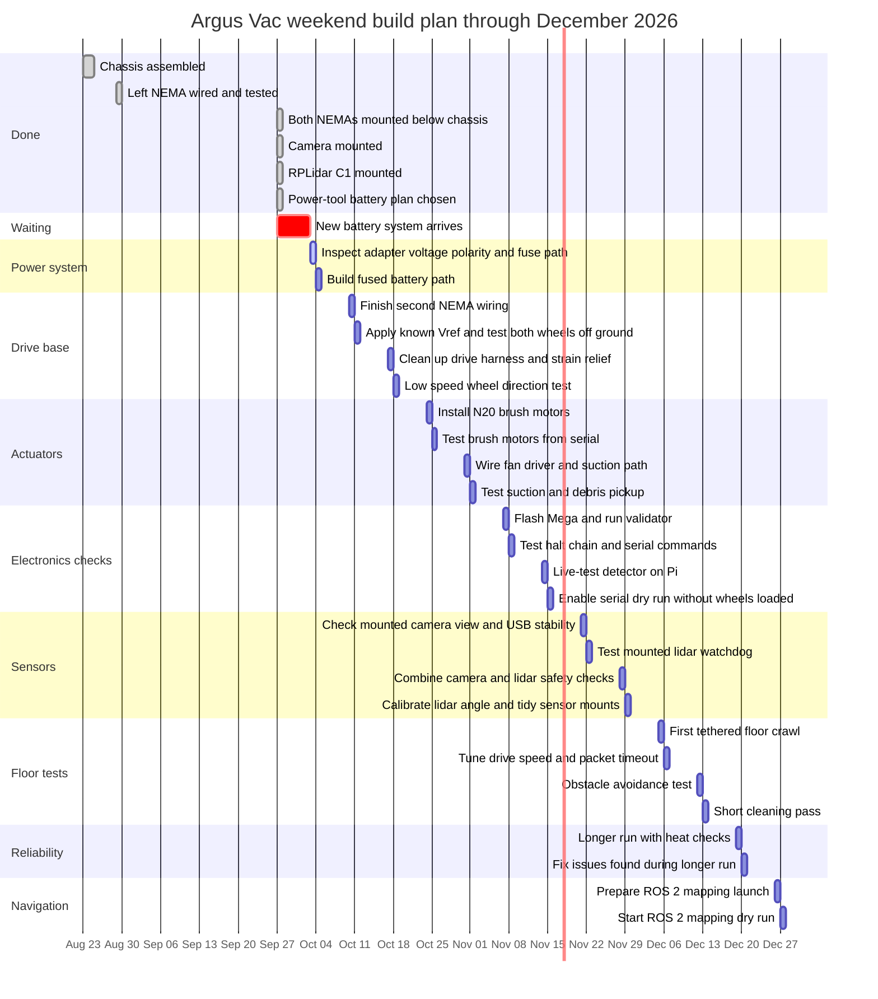

# My robot: where I am and what I do next

Overnight work log, first written 2026-08-25. Updated 2026-09-27 after my chassis and power-plan changes. My action items are listed first; the agent's own log sits at the bottom, clearly separated.

## Where my project stands

- Chassis built. Both NEMA steppers are now mounted below the chassis as of 2026-09-27.
- Wiring progress: one NEMA is wired so far. The other NEMA still needs its driver wiring and wheel-off-ground bench test. I already know the correct Vref.
- Power plan changed 2026-09-27: I am switching from the LiPo plan to a power-tool battery for easier use and safer handling. The incoming adapter ends in 14 AWG red/black leads. Before I connect it to the robot rail, I need to confirm pack voltage, polarity, fuse placement, and whether any 12 V-only loads need a buck converter.
- Missing parts: only the newest battery system is still shipping. The other robot parts have arrived.
- Camera: mounted on the robot as of 2026-09-27. Detector 10.6 works in software (10.5 fixed the proximity-gate hole, 10.6 stops flagging doors/walls after 60s parked). It still needs a live on-robot test with the mounted camera.
- Arduino: firmware draft lives in my vault as `4-Software/mega-controller.ino`, rebuilt from my documented command contract because the original never left the Gemini workspace.
- RPLidar C1: mounted on the robot as of 2026-09-27. Software still needs live hardware testing.
- ROS 2: installed on my Pi, unused until lidar works.

## Weekend-only Gantt chart

This schedule assumes I only work on weekends and the newest battery system arrives before the 2026-10-03 weekend. If it arrives later, slide the battery-dependent bars to the next weekend. The chart runs through the last weekend of December 2026.

## What I do next, in order

### 1. Confirm the power-tool battery adapter before power-up
Do not treat the adapter as proven just because the plug fits. Confirm pack voltage, polarity, wire gauge, switch behavior, and fuse placement with the meter first. If the pack is an 18 V or 20 V tool battery, do not feed 12 V-only motors or fans directly from it.

### 2. Finish second NEMA wiring
The NEMAs are mounted below the chassis. One is wired. Finish the second A4988 path, check VMOT/VDD orientation again, apply the known Vref setting, then test both wheels off the ground.

### 3. Flash and bench-test the Mega
Upload mega-controller.ino (it already compiles clean via arduino-cli), connect USB, run `pi-hardware-validator.py`, walk menu options 1 through 9. If my original mega-diagnostic.ino behaves differently, trust the validator results over either sketch.

### 4. Live-test detector 10.6 on my Pi
Point the camera at open floor, boot, wait for "Floor profile learned", drop a sock in front of it. Check `/stats`: anomaly line should stay under ~10 ms. Tune ANOMALY_SENSITIVITY only if my carpet misbehaves.

### 5. Flip SERIAL_ENABLED to True
Once bench testing passes. Watch `[SERIAL TX]` lines as threats change. Auto-H fires only above 85% risk; verify with the validator's halt test before powering drive motors.

### 6. Test the mounted RPLidar C1
The lidar is mounted now. The watchdog software is written and tested against a virtual lidar: 4-Software/lidar-watch.py. Next sensor job: wire it, install the real driver if needed, then run python3 lidar-watch.py --real --serial --center-deg <mount angle>. It sends halt packets on its own when anything enters the forward cone. Covers what cameras cannot see, like glass table legs.

### 7. Only then: ROS 2 navigation
SLAM and nav2 after both sensors stream data. Not before.

## Agent log (written by Claude, kept separate from Justin's items)

- Wave 1: detector v10 built and validated (two-layer detection; 0% false alarms clean floor, 100% debris flag rate, ~2 ms/cycle).
- Wave 2: deprecated files purged on Justin's order (v8/v9 archived in `_Archive/` until live validation); versioning rule changed to decimal bumps with filename renames; detector bumped to 10.1 with finished serial sender (SERIAL_ENABLED=False default); mega-controller.ino drafted; Humanizer pass over all manuals.
- Wave 3: 14 AWG fuse holder documented everywhere; Node.js v24 installed for skill tooling (`C:\Program Files\nodejs`); computer-vision-opencv skill installed to `.agents/skills/`; all manuals rewritten in Justin's voice; this roadmap restructured so his steps stay separate from agent notes; HANDOFF.md created at vault root for the upcoming AI switch.
- Validation state: all 29 checks pass in `outputs/detector-refine/test_v10.py`.
- 2026-09-27 update: weekend-only Gantt chart added. Current physical state recorded: both NEMAs mounted below chassis, one NEMA wired, power plan changed to a power-tool battery adapter with 14 AWG red/black leads pending verification.
- 2026-09-27 correction: I already know the correct Vref. All parts have arrived except the newest battery system.
- 2026-09-27 chart extension: Gantt chart expanded through the last weekend of December 2026.
- 2026-09-27 sensor update: camera and RPLidar C1 are mounted. Remaining sensor work is live testing, USB stability, lidar driver/wiring, and angle calibration.

## Working across sessions

My memory lasts one conversation; past roughly a million tokens the oldest parts drop out of my memory while files stay safe on disk. Everything important lives in these notes. If a chat feels like it is forgetting things, start fresh and say "read the vault": HANDOFF.md at the root is the entry point, then the change log.
