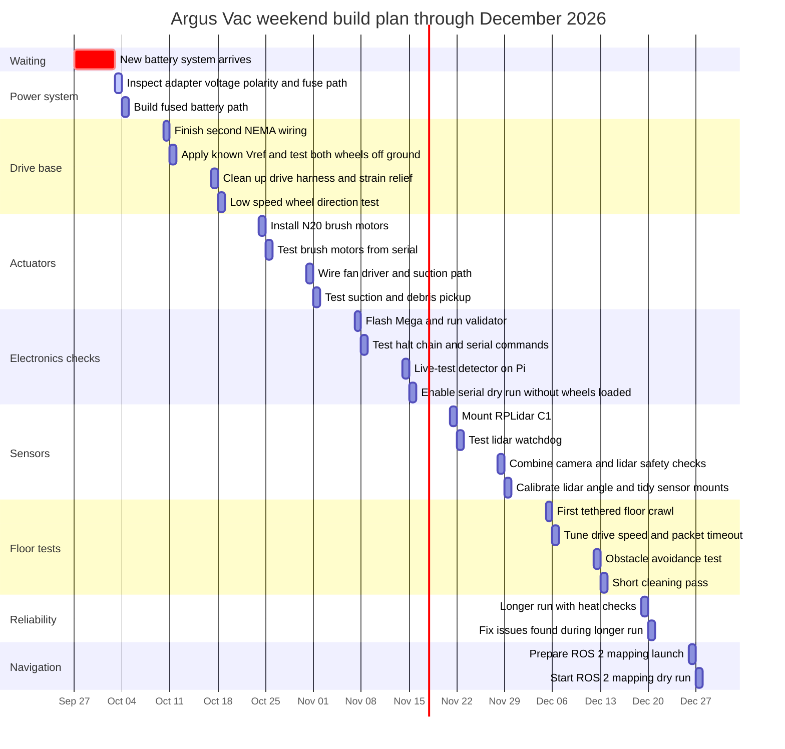

**user**: Its been a hwile since I update everything. As of today, i mounted the nemas at the bottom of the chassis(below), and connected the wiring for 1 nema so far. i decided to swithc to using power tool batteriy isnt4ad of lipo for easier usage and safety(by using an adpater from the powert toll battery to a 14 awg red and black wwire). i am awwwaitng for the parts. create a gaant chart for me for my progress. btwe i will only work on the robot during weekends.
[Timestamp: 2026/09/27 12:27:46]

**ai**: Justin, I’ll use the Obsidian Markdown skill, then check `HANDOFF.md` so the chart lands in the right place and gets registered.Justin, I’m checking the handoff and nearby project records before writing the Gantt note.Justin, the handoff is older than your hardware update, so I’m syncing the progress files rather than making a standalone chart only.Justin, I’m opening the current roadmap and change log now.Justin, I found the files that need sync. Next I’ll patch the roadmap, power reference, progress manual, handoff, and registry.Justin, I’m reading only the affected sections before patching.Justin, I’m checking the Taipei date once so the weekend chart uses real dates.Justin, the battery change touches the wiring docs, so I’m syncing that too instead of leaving stale LiPo wording.Justin, I’m checking stale battery mentions in the other active notes before deciding how far to sync.Justin, I’m applying focused patches now. I’ll keep the chart provisional because the adapter parts have not arrived yet.Justin, the first patch missed an exact line match. I’ll replace the relevant roadmap sections with a safer targeted edit.Justin, I have the exact text now. Applying the roadmap and Gantt update.Justin, roadmap is updated. Now I’m syncing the progress manual with the same facts.Justin, progress manual is synced. Now I’m updating the power reference so it does not contradict the new battery plan.Justin, power reference is updated. Next I’m aligning the wiring checklist so it is safe for the new adapter.Justin, same issue: the checklist lines include task boxes. I’ll patch it in smaller exact chunks.Justin, I’m applying the checklist fixes in smaller chunks now.Justin, checklist header and fuse stage are updated. I’m patching the remaining voltage cautions.Justin, the checklist is synced. I’m updating the other active notes that still say LiPo is the current plan.Justin, I found a small drift too: the calibration file header still said 3.5 while the registry said 3.6. I’m correcting it while updating the battery plan.Justin, hardware manual is synced. Now I’m updating calibration safety for the new battery source.Justin, calibration is synced. I’m adding your raw 2026-09-27 update to the source note without rewriting your older wording.Justin, raw source note is updated. Now I’m syncing `HANDOFF.md` so future sessions start from today’s state.Justin, all content files are patched. Now I’m updating the master registry and change log entries.Justin, I’m opening the relevant change-history section so each version bump gets logged under the right file.Justin, I’m bringing the registry rows current before adding the individual history bullets.Justin, registry rows are current. I’m adding the per-file history bullets now.Justin, change log is synced. I’m checking the housekeeping registry because it also tracks active file versions.Justin, housekeeping is stale too. I’m bumping it to v3.11 and renaming the file per your filename-version rule.Justin, I’m updating the housekeeping register rows first, then I’ll rename the file to match v3.11.Justin, housekeeping content is updated. I’m renaming it now.Justin, housekeeping is now v3.11. I’m updating references to the renamed file.Justin, handoff points to the renamed housekeeping file. I’m patching the master registry row and v25.16 note.Justin, I found the old housekeeping row. Updating that and the session summary now.Justin, registry references are updated. I’m running a focused stale-reference check now.Justin, `rg` is not installed here. I’m using PowerShell search with dotfolders excluded.Justin, stale active references are clean. I’m doing a final sanity check on the updated versions and chart.Justin, final check found one stale source reference in the checklist. I’m fixing that now.Justin, stale checklist source fixed. I’m running one last targeted verification pass.Justin, verification passed. I’m grabbing line numbers for the handoff summary.Justin, done.

- Added the weekend-only Gantt chart in `3-Logs/argus-vac-next-steps.md:16`.
- Logged your current state: NEMAs mounted below chassis, one NEMA wired, parts pending.
- Updated the next safety step for the power-tool battery adapter in `3-Logs/argus-vac-next-steps.md:62`.
- Synced the power reference and checklist safety gates in `1-Manuals/Argus Vac - Electrical Wiring & Power Reference.md:14` and `1-Manuals/Argus Vac - Wiring Day Build Checklist.md:46`.
- Updated `HANDOFF.md:17`, the master change log at `3-Logs/argus-vac-version-control-and-change-log-v25.md:11`, and renamed housekeeping to `3-Logs/argus-vac-housekeeping-and-cleanup-v3.11.md:1`.

Important note: I did not assume the power-tool battery is safe by default. I added checks for voltage, polarity, fuse placement, and buck conversion if the pack is 18 V or 20 V.
[Timestamp: 2026/09/27 12:27:46]

**user**: 1. i already know correct vref
2. Basically all parts arrived except the newest battery system
[Timestamp: 2026/09/27 13:10:13]

**ai**: Justin, I’ll sync those corrections now: Vref is known, and only the new battery system is still pending.Justin, I’m locating the exact stale lines before patching.Justin, found the stale parts and Vref lines. I’m patching the active notes first.Justin, I’m updating the roadmap to show only the new battery system is pending.Justin, roadmap is fixed. I’m updating the progress manual and electrical reference next.Justin, progress manual is fixed. Now patching electrical reference and checklist.Justin, electrical reference is fixed. Now I’m updating the checklist so it stops saying N20s and caps are shipping.Justin, checklist is corrected. I’m updating source and handoff now.Justin, I’m syncing the raw source note and handoff so future sessions do not miss your correction.Justin, raw source note is updated. Now handoff.Justin, handoff is synced. I’m updating the master registry and housekeeping version rows next.Justin, registry rows are updated. I’m adding the change-history bullets now.Justin, one history patch missed an exact line. I’m checking the current history text and applying it in smaller chunks.Justin, I have the exact history text. Applying the history bullets now.Justin, individual history bullets are added. I’m adding the v25.17 session bullet.Justin, appending the v25.17 session entry right after v25.16.Justin, changelog is now at v25.17. I’m updating and renaming the housekeeping register to v3.12.Justin, I’m patching the housekeeping header and active rows, then renaming the file.Justin, housekeeping content is current. Renaming it now.Justin, housekeeping is renamed. I’m fixing the handoff reference to it.Justin, files are patched. I’m verifying stale parts and Vref wording now.Justin, I’m running a targeted stale-reference check across active Markdown.Justin, verification caught one stale current line in `ROBOT_MASTER.md`. I’m correcting that and clarifying the Vref checklist heading.Justin, source note is fixed. Now I’m making the Vref checklist wording match your status.Justin, I’m doing one final active-file check, ignoring historical changelog bullets.Justin, the only live false positive is old raw-source wording. I’m rephrasing it as historical so it does not look current.Justin, raw source wording is now unambiguous. Running the final check again.Justin, verification is clean. I’m grabbing line numbers for the final summary.Justin, synced.

- Updated the roadmap: only the newest battery system is pending, and Vref is known: `3-Logs/argus-vac-next-steps.md:10`, `3-Logs/argus-vac-next-steps.md:41`
- Updated progress, electrical, checklist, handoff, and raw source notes: `1-Manuals/Argus Vac - Project Progress & Action Plan.md:51`, `1-Manuals/Argus Vac - Electrical Wiring & Power Reference.md:3`, `1-Manuals/Argus Vac - Wiring Day Build Checklist.md:3`, `HANDOFF.md:28`, `2-Reference/ROBOT_MASTER.md:35`
- Updated registries: change log is now v25.17 and housekeeping is v3.12: `3-Logs/argus-vac-version-control-and-change-log-v25.md:11`, `3-Logs/argus-vac-housekeeping-and-cleanup-v3.12.md:1`
- Verified active files: no stale current-status references found for N20s, 0.1uF caps, or unknown Vref.
[Timestamp: 2026/09/27 13:10:13]

**user**: gibve the full gaant chart, up to december
[Timestamp: 2026/09/27 13:23:40]

**ai**: Justin, I’ll expand the roadmap Gantt through December and sync the registries so the vault stays consistent.Justin, I’m opening the current chart and registry rows before patching.Justin, I found the current chart ends in early November. I’m replacing just that Mermaid block with a weekend plan through December.Justin, I’m reading the exact Mermaid block so the replacement is clean.Justin, I’m replacing the chart with a full weekend-only plan through December 27.Justin, chart is expanded. I’m syncing the version registry, handoff, and housekeeping rows now.Justin, I’m patching the registry versions and handoff reference.Justin, handoff reference is bumped. Now I’m updating the master change log rows and histories.Justin, master log is at v25.18. I’m updating housekeeping and renaming it to v3.13.Justin, housekeeping content is current. Renaming it now.Justin, I’m verifying the renamed file, registry versions, and December chart dates now.Justin, verification passed. I’m marking the plan complete.Justin, done. The full chart is now in `3-Logs/argus-vac-next-steps.md:16` and runs through December 27, 2026.

Synced registries too: change log is `v25.18`, handoff is `1.19`, housekeeping is `v3.13`.
[Timestamp: 2026/09/27 13:23:40]

**user**: btw i already mounted a camera and also the lidar
[Timestamp: 2026/09/27 13:32:15]

**ai**: Justin, I’ll sync that hardware status now: camera mounted and lidar mounted, then adjust the Gantt tasks that still say “mount.”Justin, I’m searching the active notes for camera and lidar mount wording.Justin, the notes still say lidar is unmounted, so I’m patching the current-state sections and changing “mount” tasks into “test” tasks.Justin, roadmap is updated. I’m syncing progress and hardware manuals next.Justin, progress manual is synced. Now hardware manual.Justin, hardware manual is synced. I’m updating the raw source note and handoff next.Justin, raw source note is updated. Now I’m fixing the handoff current state and stale risk wording.Justin, handoff is synced. I’m updating the master registry and housekeeping.Justin, I’m bumping the registry rows for the affected notes.Justin, the row order differed from my patch. I’m opening the registry top and patching exact rows.Justin, I have the exact rows now. Applying the registry sync.Justin, registry rows are updated. I’m adding the history bullets.Justin, changelog histories are synced. I’m updating housekeeping and renaming it to v3.14.Justin, housekeeping content is updated. Renaming it now.Justin, I’m verifying that no active note still says the lidar is unmounted or needs mounting.Justin, I’m running the stale-reference check now.Justin, verification found one stale handoff file-map line. I’m fixing that now.Justin, final verification now.Justin, verification is clean. I’m grabbing line numbers for the final summary.Justin, synced.

- Roadmap now says the camera and RPLidar C1 are mounted: `3-Logs/argus-vac-next-steps.md:11`, `3-Logs/argus-vac-next-steps.md:13`
- Gantt changed the lidar task from mounting to testing: `3-Logs/argus-vac-next-steps.md:62`
- Handoff updated for mounted camera/lidar: `HANDOFF.md:23`
- Progress and hardware manuals updated: `1-Manuals/Argus Vac - Project Progress & Action Plan.md:18`, `1-Manuals/Argus Vac - Hardware & Mechanical Architecture Manual.md:35`
- Raw source note updated: `2-Reference/ROBOT_MASTER.md:41`
- Registries synced: change log `v25.19`, housekeeping `v3.14`

Verified: no active note still says the lidar is unmounted or needs mounting.
[Timestamp: 2026/09/27 13:32:15]