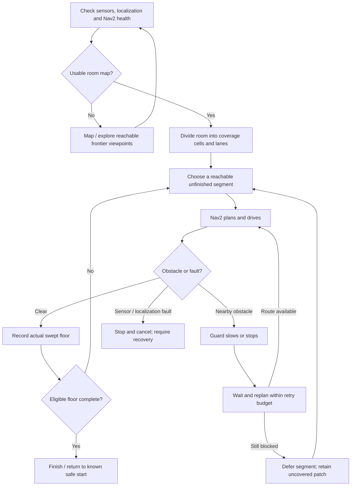

# Autonomous navigation workflow for the vacuum simulator

Prepared 2026-10-06. Scope: /home/robot/vacuum_ws in Ubuntu and the Gazebo vacuum simulation.

## Recommendation

Use a layered approach: systematic room coverage above Nav2 navigation, with a separate collision guard on every autonomous velocity command. For the current slow differential-drive model, start with SLAM Toolbox, NavFn in A* mode, DWB, 2-D obstacle costmaps, and Collision Monitor. This is my practical recommendation for this existing setup; it is not a claim that one controller is best for every robot.

Choose boustrophedon coverage: divide usable floor space into cells around walls/furniture and sweep each cell in alternating parallel lanes. Choset and Pignon's original work explicitly addresses vacuuming and formalizes cell coverage. Its completeness result assumes the modeled geometry and execution conditions; it does not certify this simulator or an implementation. [Original coverage research](https://publications.ri.cmu.edu/coverage-path-planning-the-boustrophedon-decomposition).

The important distinction is that reaching Nav2 goals is navigation. Selecting lanes, tracking which floor was actually swept, revisiting missed patches, and deciding when cleaning is complete require a coverage mission manager.

## What was prepared here

- An opt-in configuration: src/vacuum_sim/config/vacuum_nav2.yaml.
- A wait-and-replan behavior tree: src/vacuum_sim/config/vacuum_navigate.xml.
- navigation.launch.py now accepts params_file; its original default nav2.yaml remains the default.
- A simulator-only check script: tools/validate_autonomy.py. Results are in validation/autonomy-20261006/results.json.
- The previous navigation launch is preserved as navigation.launch.py.before-autonomy-20261006.

This provides the navigation/obstacle-response foundation. The automatic frontier explorer, full coverage mission manager, coverage ledger, perimeter planner, saved-map localization startup, and return-to-dock mission are design recommendations below and are NOT implemented by this change. No coverage percentage is claimed.

No Windows configuration, drivers, hardware firmware, USB devices, or physical robot settings are changed.

## Why these algorithms

| Job | Starting choice | Reason / alternative |
|---|---|---|
| Build a room map | SLAM Toolbox with wheel odometry and lidar | Already installed; produces the occupancy map and map-to-odom transform. |
| Repeat a known room | Saved map + AMCL | Planned next stage; keeps cleaning coordinates consistent. Do not run SLAM and AMCL as competing map-to-odom publishers. |
| Choose where to clean | Boustrophedon cell decomposition and lane traversal | Systematic coverage, explicit skipped-area tracking, and predictable transitions around furniture. |
| Plan travel between lanes/cells | NavFn A* with unknown space disallowed | Already available; sufficient starting planner for this low-speed, pivoting model. Re-evaluate Smac 2D if path quality/clearance benchmarks justify it. |
| Follow and avoid obstacles | DWB with ObstacleFootprint critic | Supports differential drive and trajectory-based obstacle avoidance. |
| Fast stop/slow response | Nav2 Collision Monitor | Additional sensor-to-command protection independent of the costmap planner. |
| Persistent blockage | Bounded wait, replan, defer patch | Keeps the robot from repeating a failed maneuver indefinitely. |

Nav2 describes RPP as an exact path follower; DWB and MPPI can deviate around dynamic obstacles. MPPI is a worthwhile later benchmark for smoother behavior, but changing to it before measuring this model would add tuning work. I would keep DWB for the first implementation. [Nav2 controller selection](https://docs.nav2.org/jazzy/configuration_and_development/tuning_guide/).

OpenNav Coverage / Fields2Cover is a candidate implementation library, not an automatic indoor-vacuum drop-in. Its input zone polygons, furniture holes, confined turns, Jazzy branch/dependency combination, and mission completion behavior must be tested. Its own README has distribution-specific branches and integration caveats. Do not install an arbitrary main branch into this Jazzy workspace. [OpenNav Coverage](https://github.com/open-navigation/opennav_coverage).

## Control flow

The outer coverage supervisor below is the proposed next layer. The prepared profile supplies the Nav2 movement, collision guard, and bounded wait/replan part.



## Proposed mission sequence

1. **Health check and localize.** Require current scan/odometry, valid TF, running simulation clock, and active Nav2 nodes before issuing a goal. A stopped or lost sensor is not permission to drive.
2. **Map if needed.** Start with supervised mapping. For subsequent autonomous exploration, select reachable known-free frontier viewpoints next to unknown space, score them by expected map information and travel cost, and approach them through known free space. A frontier goal belongs on the free side of the boundary; never navigate directly into an unknown cell.
3. **Prepare the cleaning region.** Identify the connected reachable room; exclude occupied, unknown, prohibited and unreachable areas. Use robot geometry for collision checking and cleaning-head geometry for coverage. They are different shapes.
4. **Generate lanes.** Decompose around furniture, choose a sweep direction that avoids unnecessary turns, and use lane spacing no larger than effective cleaning width minus overlap. Example only: a measured 0.25 m effective width and 10% overlap gives 0.225 m spacing. The chassis width is not proof of cleaning width.
5. **Execute and record actual coverage.** Submit bounded individual NavigateToPose goals/transitions in the prepared profile. Mark the cleaning-head swept area from actual map-frame poses, not from planned lane endpoints. Nav2 may detour around an obstacle; that detour must not mark the skipped lane as cleaned. Interpolate between pose samples so the ledger has no sampling holes.
6. **Clean perimeter and remaining patches.** Use offset contours that respect the padded footprint and stop zones. A side brush may reach closer than the chassis; its reach must be modeled. First tests deliberately leave a clearance band near walls. Do not claim that band is cleaned.
7. **Finish or return to a known safe start.** End only after the defined reachable cleanable region passes the coverage target, or report deferred/unreachable patches. Return-to-start must have a valid path. Docking/charging requires an additional tested dock model and mission.

Recommended development order: supervised mapping -> autonomous point-to-point navigation -> obstacle and health-failure tests -> coverage of one mapped room -> perimeter pass -> frontier exploration -> multiple rooms/docking. Map-then-clean is easier to verify than simultaneously discovering and covering an unknown room.

## What to do when something is in the way

The policy below is our proposed mission behavior. The prepared Nav2 profile implements planning, DWB avoidance, collision zones, and bounded recovery; patch scheduling and health supervision remain mission-manager work.

| Situation | Required response |
|---|---|
| Wall in the map | Keep the padded footprint out of the wall; plan an offset route. At a cleaning-lane end, stop that lane and plan the connector to the next one. A wall is not a trigger to reverse blindly. |
| Fixed furniture/new static obstruction | Add observed obstacle cells, plan around them, split the sweep region if necessary, and retain occluded/unswept space as pending. |
| Moving obstacle crosses the path | Slow or stop when guard zones trigger; avoid only through verified free space. Keep observing and resume when clear. Lidar alone does not identify whether the obstacle is a person. |
| Route is blocked but a detour exists | Replan the same bounded goal using the updated obstacle map, then continue. |
| No route / repeated failure | The prepared tree waits 3 simulation seconds and retries at most twice. On abort, the future mission manager should defer that patch, select another reachable patch, and later retry with a finite budget. |
| Scan becomes stale | Collision Monitor outputs a stop once scan data exceeds its 0.5-second validity interval in ROS simulation time; the drive controller also expires stale movement commands after 0.5 seconds. The supervisor should cancel the active goal and require healthy data before resuming. |
| Lost localization / invalid TF | Cancel the mission goal and stop; restore localization before resuming. Do not keep navigating on guessed coordinates. |
| Goal reaches a wall or occupied cell | Reject/abort that goal; do not relax obstacle checks to force progress. |
| Narrow opening / tight turn | Verify the full footprint and turning clearance. Defer an opening that the robot cannot fit through; do not shrink the model to make the planner accept it. |
| Low object / drop-off outside lidar visibility | Treat it as an unhandled perception case and add an appropriate simulated sensor or keepout area before claiming avoidance. The current RGB camera publishes an image; it is not a depth obstacle detector. |

Blocked, deferred, unreachable and unknown are distinct coverage-ledger states. A mission with deferred patches is partial coverage, not a successful full-room clean.

## Prepared simulation parameters

The current model has a 30 cm circular chassis, a body center 3 cm behind the axle/base_footprint, and 22 cm wheel separation. A circumscribed 32-point polygon encloses the 15 cm radius body, with 2 cm padding.

DWB's ObstacleFootprint critic checks footprint contact with mapped obstacles. [Footprint critic](https://docs.nav2.org/jazzy/configuration_and_development/configuration_guide/controller_plugins/dwb_controller/trajectory_critics/obstacle_footprint/).

The current conservative profile uses:
- Forward speed <= 0.20 m/s; automatic reverse disabled; yaw <= 0.7 rad/s.
- A 2-D obstacle layer for the current planar lidar, rather than publishing a 3-D voxel map.
- 0.50 m inflation extent with a graded cost field. This is not a guaranteed fixed wall distance; the footprint and collision checks remain essential.
- Global replanning at 1 Hz and local control at 20 Hz.
- A* with unknown space disallowed and 0.10 m goal/planner tolerance.
- Directional stop polygons: forward to x=0.42 m, reverse to x=-0.46 m, each with 0.19 m half-width; x is measured from the axle. Rotation uses a 0.20 m radius circle around the body center.
- Directional slow polygons extend forward to x=0.90 m or rearward to x=-0.80 m and scale velocity to 40%. The 1.2-second padded footprint prediction remains active.
- A single scan point can trigger these simulation zones. This favors stopping over ignoring a thin obstacle; noisy real sensors would need separate validation.
- A 3-second wait and two retries. Automatic backup, spin recovery and unconditional costmap clearing are omitted from this profile.

The zones and timing are simulation starting values, not proven physical stopping margins. Collision Monitor supports stop/slow/approach responses and stale-source stopping; it is not a certified safety system. [Collision Monitor](https://docs.nav2.org/jazzy/configuration_and_development/configuration_guide/core_servers/collision_monitor/configuring_collision_monitor_node/).

## Command routing

```text
Coverage mission -> Nav2 actions
Nav2 controller/behavior -> /cmd_vel_nav
velocity_smoother -> /cmd_vel_smoothed
command_gate (auto/manual selection + watchdog) -> /vacuum/selected_cmd_vel
collision_monitor -> /cmd_vel
simulation_twist_adapter -> /diff_drive_controller/cmd_vel
```

Only Collision Monitor should publish final /cmd_vel during this autonomous workflow. The existing keyboard teleop program defaults to publishing directly there and therefore bypasses the guard. If testing guarded teleop while this profile is running, explicitly remap its input to /cmd_vel_nav and do not run autonomous goals at the same time. Do not create a second action/velocity commander alongside the mission.

## Run inside Ubuntu

The integrated launcher is recommended: `python3 tools/lab_controller.py start` starts the simulator, gate, mapping, and destination navigation together; `drive` selects controller driving and `stop` stops the tracked lab. The manual terminal example below needs a separate `python3 tools/command_gate.py` process before navigation, and must not be mixed with a launcher session. The gate selects autonomous input when `.lab/manual-mode` is absent.


Terminal 1:
```bash
cd ~/vacuum_ws
source env.sh
python3 tools/run_sim.py
```

For less rendering load, use `python3 tools/run_sim.py gui:=false`; RViz remains. For automated tests both GUI arguments are false.

Terminal 2:
```bash
cd ~/vacuum_ws
source env.sh
ros2 launch vacuum_sim mapping.launch.py
```

Terminal 3:
```bash
cd ~/vacuum_ws
source env.sh
ros2 launch vacuum_sim navigation.launch.py \
  params_file:=$HOME/vacuum_ws/src/vacuum_sim/config/vacuum_nav2.yaml
```

Set RViz Fixed Frame to map and send a Nav2 Goal in mapped free space. This tests autonomous navigation; it does not initiate room coverage. The current simulator workflow uses live SLAM. The recommended AMCL repeat-cleaning startup is a later stage.

The opt-in profile uses NavigateToPose only. NavigateThroughPoses is excluded because its installed default tree has additional recovery behavior; a reviewed coverage-specific many-goal/path tree would be needed before enabling it.

Stop navigation, mapping, and simulator with Ctrl+C in that order. Do not run two simulator instances. The default navigation launch now uses the conservative profile and the six servers required by its destination behavior tree. The original packages remain installed.

## Validation and acceptance

With no other simulator/navigation instance active:
```bash
cd ~/vacuum_ws
source env.sh
python3 tools/validate_autonomy.py
cat validation/autonomy-20261006/results.json
```

The script checks free-space goal completion, abortion of a goal beyond the room wall without driving toward it, and isolated collision-guard behavior for clear/slow/stop/stale scans. Synthetic guard output is on an isolated test topic and cannot command the simulated wheels. It cleans up only processes it starts. The current result file is authoritative; an exception or passed=false is a failure.

Additional required acceptance tests before a full autonomous cleaning claim:
- Static furniture avoidance and correct reachable-room segmentation.
- An obstacle appearing during a turn, then clearing: stop, replan/resume, no collision.
- A permanently blocked lane: finite retry, deferred ledger entry, other reachable lanes continue.
- Localization/TF loss: stop and remain stopped until explicitly recovered.
- Thin obstacles, narrow doorways, corners and visibility gaps.
- Actual swept coverage measured against the defined reachable cleanable area, including missed lane fragments.
- Multiple initial poses and repeated missions; log contacts, closest clearance, completion time, coverage fraction and repeated coverage.
- Target-platform CPU/control timing measurements; GUI performance is a separate measurement.

## Results recorded on 2026-10-06

The Ubuntu integration check passed:
- Free-space goal (1.0, 0.0): succeeded, Nav2 status 4, error code 0.
- Goal (3.15, 0.0) beyond the room wall/map bounds: aborted, status 6; movement during the failed goal was approximately 0.0022 m.
- Isolated guard: clear command 0.20 m/s; slow zone 0.08 m/s; stop zone 0; stale scan 0.
- The stale-scan check waited for simulation time to advance; wall time alone is not the correct timeout clock for this simulation.

The wall-goal result verifies rejection of an out-of-bounds goal, not clearance during a real wall approach. Guard cases use isolated synthetic scans, not a moving furniture model. Dynamic avoidance, full-room coverage, localization-loss supervision and physical safety are not validated by these checks.

## Decision

Build the coverage mission manager on this tested navigation foundation. Avoid random bounce as the principal cleaning policy: it can move around a room, but it offers poor progress accounting and no useful finish criterion. Keep MPPI, OpenNav Coverage integration and autonomous frontier exploration as measured next-stage upgrades.


## Integrated launcher update (October 7, 2026)

The 30 cm circular model and integrated controller workflow supersede the old rectangular footprint in this document. Use [Vacuum Lab](VACUUM_LAB.md) for startup. The conservative profile now receives commands from 	ools/command_gate.py; launching that profile alone will not drive the robot. Manual mode selects a separate input and cancels navigation goals, while Collision Monitor stays active. Updated integration checks are in alidation/lab-20261007/results.json; coverage and docking remain future work.

## Furnished-room update, October 7, 2026

Manual driving is limited to +0.50/-0.30 m/s and 1.2 rad/s; destination navigation keeps its 0.20 m/s limit. DWB and the goal checker both use a 0.10 m position tolerance, avoiding stopping outside the accepted goal radius. See [the current launcher guide](VACUUM_LAB.md) for controller status, directional obstacle escape, scene details, and validation locations. Older results below describe the previous room; use the newer validation reports for the current setup.
